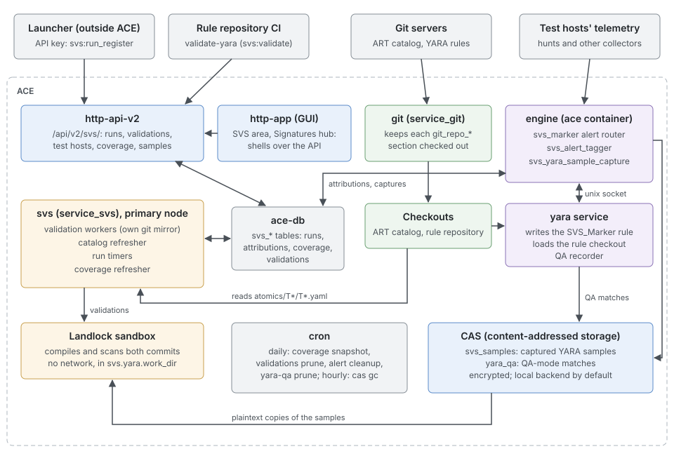
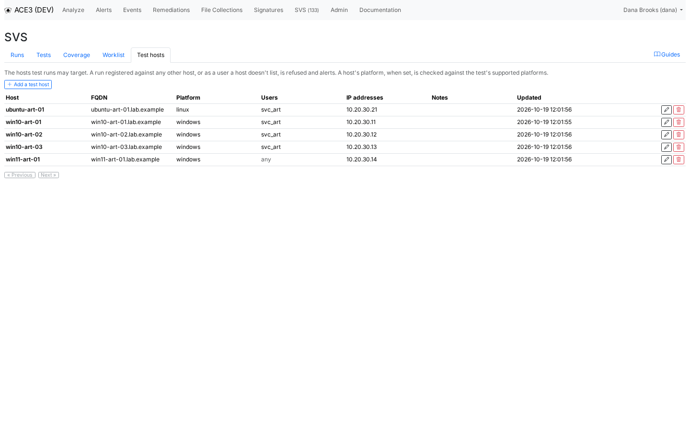
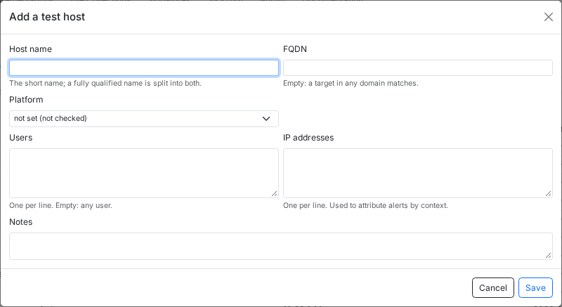
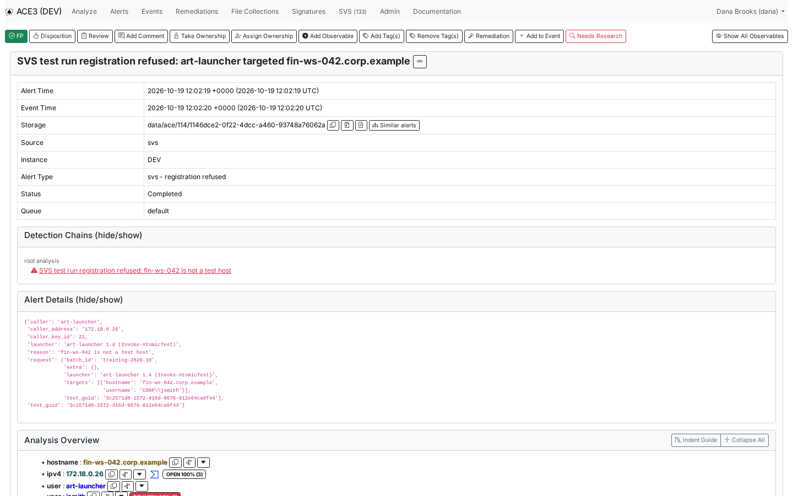
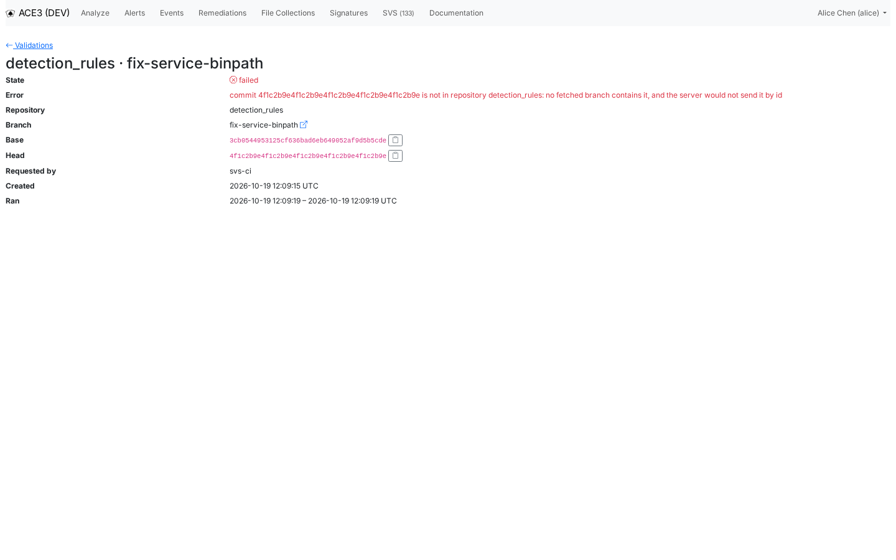
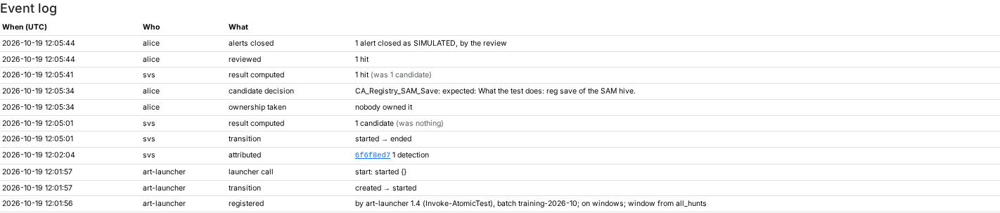

# SVS administrator's guide

This guide is for ACE administrators who set up the Signature Validation System (SVS) and keep it running. It assumes you already run ACE: you know Docker Compose, how ACE layers its YAML configuration, and the `ace` command line. It doesn't explain what SVS is for or how analysts review runs. The [Beginner's guide](beginners.md) and the [User's guide](users.md) cover that.

You will learn how to:

- name the services and data flows SVS depends on, and which node runs them;
- create the groups, the automation users and the scoped API keys SVS needs;
- configure the catalog, the runs, attribution, YARA validation and the sample store;
- manage test hosts and handle refused registrations;
- connect a launcher and a rule repository's CI;
- keep coverage, the ATT&CK release, the scheduled jobs and retention in order;
- read SVS's logs, run daily and weekly health checks, and fix the common failures.

The `ace`, `grep` and `ls` commands in this guide run inside an ACE container (`bin/attach-container.sh` from the host), in `SAQ_HOME` (`/opt/ace`); the `docker compose` commands run on the host, in the ACE checkout. The demo screenshots come from a lab with five test hosts, a launcher called `art-launcher`, and a YARA rule repository called `detection_rules`.

## How SVS runs

SVS is a set of parts inside ACE's existing services, plus one service of its own. Most failures come from one part being down or misconfigured.



The diagram shows the services inside ACE, the outside systems that call them, and the data flows between them.

| Part | Where it runs | What it does for SVS |
|---|---|---|
| `svs` (`service_svs`, `saq/svs/service.py`) | its own `svs` container, primary node only | Four loops: the YARA validation workers, the Atomic Red Team catalog refresher, the run timers, and the coverage refresher |
| `yara` (`service_yara`) | the `yara` container | Writes the `SVS_Marker` rule into `signature_dir` at start, which finds run markers inside files; its QA recorder stores the matches of rules in QA mode |
| engine | the `ace` container | The `svs_marker` alert router attributes alerts to runs and moves them to the test queue; `svs_alert_tagger` tags them; `svs_yara_sample_capture` stores YARA samples from graded alerts |
| `git` (`service_git`) | the `git` container | Keeps every `git_repo_*` section checked out at its `local_path`, including the catalog and rule repositories |
| `http-api-v2` | the `http-api-v2` container | Serves `/api/v2/svs/…`: the launcher's calls, CI's validation requests, and everything the SVS screens show |
| `http-app` | the `http-app` container | The GUI's SVS area and Signatures hub, which read all their data from the API |
| cron | the `cron` container | Snapshots, prunes, alert cleanup and the CAS jobs |
| CAS pool `svs_samples` | `data/cas/svs_samples` by default | The encrypted store of captured YARA samples and their match records |

### What the svs service does

`service_svs` starts four threads, and only on the primary node (`ACE_IS_PRIMARY_NODE=1`, the default). On any other node it logs that it stays idle and does nothing.

| Loop | Interval | Work |
|---|---|---|
| Validation workers | `service_svs.poll_interval_seconds` (5) while idle | Claim queued YARA validations, replay the samples in the sandbox, store the report. `svs.yara.max_concurrent_validations` workers (1). |
| Catalog refresher | `svs.catalog.refresh_interval_seconds` (300) | Reads `atomics/T*/T*.yaml` from each catalog checkout whose commit changed |
| Run timers | `svs.runs.timer_interval_seconds` (30) | Moves runs whose start timeout or windows passed, recomputes stale results, closes late alerts as `SIMULATED` |
| Coverage refresher | `svs.coverage.refresh_interval_seconds` (120) | Recomputes the worklist and ATT&CK coverage |

> [!IMPORTANT]
> The run timers live in `service_svs`. If the service stops, runs stay `started` past their observation window, never end, and nobody is asked to review them. Validations stay `queued`. Nothing in the GUI warns you (see [Known limitations](#known-limitations)), so the health checks below include a check for it.

The catalog, timer and coverage loops run on the primary node whether or not YARA validation is set up, so keep the `svs` container running even when `svs.yara.repositories` is empty.

## Roles, users and API keys

SVS is governed by five permissions, plus `signature:read`, `signature:download` and `alert:write`,
which the rest of ACE uses as well. They are grants like any other (`ace perm`). An SVS permission
does nothing until you grant it.

| Permission | Grants |
|---|---|
| `svs:run_read` | The SVS area (Runs, Tests, Coverage, Worklist), run and test pages, the catalog, the test hosts list, and their read APIs |
| `svs:run_manage` | Taking ownership of, canceling, closing and reviewing runs; a test's expectations, ignores and observation window; resolving worklist rows; associating alerts with runs by hand |
| `svs:admin` | Adding, changing and removing test hosts; global ignores; retiring and deleting YARA samples |
| `svs:run_register` | The launcher's calls: register, start, executed, cancel |
| `svs:validate` | Requesting a YARA validation and reading its status (counts and rule names only) |
| `signature:read` | The Signatures hub, including the Samples and Validations cards and validation reports |
| `signature:download` | The bytes of samples and QA matches, in zips protected with the password `infected` |
| `alert:write` | *Disassociate from run* and *Not a test* on an alert's page |

A few rules decide how you combine them:

- `svs:admin` does not include `svs:run_read`. The Test hosts tab is inside the SVS area, so an SVS administrator needs both.
- Give run reviewers `signature:read`. Without it, the link from a missing YARA signature on a run page to the captured files is not shown, and that link is how a reviewer tells "the rule didn't fire" from "the file never reached ACE".
- A scoped API key can do only what both its scope and its user's grants allow. Grant the permission to the user and scope the key to it.

### Recommended groups

Create one group for the people who review runs and one for the people who administer SVS. Analysts usually already hold `alert:read` and `alert:write` through an existing group; add them here only if they don't.

```bash
ace perm group add svs-analysts
ace perm group add-perm svs-analysts svs:run_read
ace perm group add-perm svs-analysts svs:run_manage
ace perm group add-perm svs-analysts signature:read
ace perm group add-perm svs-analysts signature:download
ace perm group add-user svs-analysts alice
ace perm group add-user svs-analysts bob

ace perm group add svs-admins
ace perm group add-perm svs-admins svs:run_read
ace perm group add-perm svs-admins svs:run_manage
ace perm group add-perm svs-admins svs:admin
ace perm group add-perm svs-admins signature:read
ace perm group add-user svs-admins dana
```

A reporting account that pulls data out of SVS gets `svs:run_read`, `alert:read` and `signature:read`, and nothing that writes. Check what a person ends up with:

```bash
ace perm user test dana svs:admin
ace perm group list-perm svs-analysts
```

### The launcher's automation user

The launcher authenticates with an API key. Give it a dedicated user whose only grant is `svs:run_register`, and scope the key to the same permission, so a leaked key can register runs against test hosts and nothing else.

```bash
ace user add art-launcher art-launcher@lab.example -d "ART launcher"
ace perm user add art-launcher svs:run_register
ace user add-api-key art-launcher --scope svs:run_register --name launcher
```

`ace user add` asks for a password. The account never logs into the GUI, so give it a long random one that nobody keeps. `add-api-key` prints the key once; store it in the launcher's secret store. The launcher's key does not need `svs:run_read`: it gets each test's GUID from its own Atomic Red Team checkout.

### The CI user

The rule repository's CI requests validations with a key of its own user, limited to `svs:validate`. That key can request validations and read their counts and rule names. No sample, file name or alert leaves ACE through it.

```bash
ace user add svs-ci svs-ci@lab.example -d "SVS CI"
ace perm user add svs-ci svs:validate
ace user add-api-key svs-ci --scope svs:validate --name ci
```

To rotate a key, create a new one, update the secret, then revoke the old one:

```bash
ace user list-api-keys svs-ci
ace user revoke-api-key 42
```

## Configuration

SVS is configured in ACE's layered YAML: `etc/saq.default.yaml`, then integration configuration, then the files in `SAQ_CONFIG_PATHS`, then files given on the command line, with later files winning. Put your site's settings in a file listed in `SAQ_CONFIG_PATHS`, not in `etc/saq.yaml`, which is a development overlay. The `svs:` and `cas:` blocks are validated strictly: an unknown or misspelled key fails validation, and every `ace` process refuses to start. Check the merged values with `ace config`, which prints a block two levels deep:

```bash
ace config svs.runs
ace config svs.catalog
ace config -v svs.queue
```

> [!WARNING]
> Every service reads its configuration when it starts. After a change, restart the containers that use it. Run windows are computed when a run is registered, which happens in `http-api-v2`, so a change to `svs.runs` needs that container restarted as well as `svs`.

| Change | Restart |
|---|---|
| `svs.catalog`, `svs.coverage`, `svs.yara`, `service_svs`, `svs.attack_release` | `svs` |
| `svs.runs`, `svs.log_search_url`, `svs.samples` download limits | `svs`, `http-api-v2`, `http-app` |
| `svs.attribution`, `svs.queue`, `svs.samples.pool`, analysis modules, `alert_routers` | `ace` (engine), `http-api-v2` |
| A new `git_repo_*` section | `git`, then `svs` |
| `service_yara` | `yara` |

```bash
docker compose restart svs http-api-v2 http-app ace
docker compose restart ace-http ace-http-external
```

The second line restarts nginx. It resolves its upstreams when it starts, so after `http-api-v2` restarts with a new address, `/api/v2` answers 502 until nginx is restarted too.

### The svs block

| Key | Default | Meaning and when to change it |
|---|---|---|
| `queue` | `svs` | The queue fully attributed test alerts go to; search leaves it out unless asked. Change only on a clash. |
| `simulated_days` | `30` | `SIMULATED` alerts older than this are archived (never deleted). At least 1. |
| `log_search_url` | unset | The run page's link to your log search (below). |
| `attack_release` | `v20.0` | The vendored ATT&CK extract, `etc/attack/<release>.json`. Change to upgrade. |
| `samples.pool` | `svs_samples` | The CAS pool for samples. Redefine the pool rather than renaming it. |
| `samples.max_bulk_download_files` / `_bytes` | `500` / 1 GiB | Limits of one sample download. |
| `samples.inventory_refresh_seconds` | `300` | How old a YARA rule inventory captures and coverage refreshes accept. |
| `catalog.repositories` | `[]` | The `name`s of the catalog's `git_repo_*` sections. |
| `catalog.refresh_interval_seconds` | `300` | How often each catalog checkout is checked for a new commit. |
| `coverage.refresh_interval_seconds` | `120` | How often coverage and the worklist are recomputed. Raise it if a refresh is slow. |
| `runs.start_timeout_minutes` | `30` | A run not started this long after registering goes to `error` and is closed. Raise it if your launcher prepares hosts between register and start. |
| `runs.observation_window.slack_minutes` | `30` | Added to the slowest expected signature's worst-case latency. |
| `runs.observation_window.floor_minutes` | `60` | The shortest observation window. |
| `runs.observation_window.ceiling_hours` | `72` | The longest observation window, and what a test's first run waits when a slow hunt is enabled. |
| `runs.attribution_extra_hours` | `24` | How long after the observation window alerts are still attributed, as late. Raise it if telemetry arrives very late. |
| `runs.max_extra_bytes` / `max_targets` | `16384` / `16` | Limits of one registration. |
| `runs.timer_interval_seconds` | `30` | How often the run timers look for runs to move. |
| `attribution.gate_cache_seconds` | `5` | How long a process trusts its answer to "is any run live?". While none is, nothing looks for markers. |
| `attribution.marker_cache_size` | `1024` | Markers of started runs each process keeps; raise it for many runs at once. |
| `attribution.max_sightings` | `200` | The most markers from analysis details one alert keeps. |
| `yara.repositories` | `[]` | The `name`s of the `git_repo_*` sections whose commits may be validated. |
| `yara.scan_timeout_seconds` | `1800` | One commit's compile and scan over the corpus. Raise it as the corpus grows. |
| `yara.max_concurrent_validations` | `1` | Validation workers. Raise it if pull requests queue up. |
| `yara.retention_days` / `prune_batch_size` | `90` / `100` | How long finished validations are kept, and how many one prune transaction removes. |
| `yara.fetch_timeout_seconds` | `600` | Fetching into SVS's mirror; the first fetch clones. |
| `yara.max_archive_bytes` / `max_archive_members` | unset | Optional caps on one commit's export. |
| `yara.mirror_dir` | `svs/mirrors` | SVS's own bare clone of each rule repository, under `DATA_DIR`. |
| `yara.work_dir` | `svs/work` | Each validation's private directory, under `DATA_DIR`, with a plaintext copy of every sample while it runs. Must allow execution and have no `.` in its path. |
| `yara.sandbox.memory_limit` | 4 GiB | Address-space limit of the sandboxed scan. |
| `yara.sandbox.allowed_tcp_ports` | `[]` | No network. Set `null` only on a kernel older than Linux 6.7, where every sandboxed command fails otherwise. |

The observation window of a run comes from the test's own override, if an operator set one, then from the slowest signature the test is expected to fire plus `slack_minutes` (within the floor and ceiling), and for a test without expectations from the slowest enabled hunt, capped at the ceiling. Large `ceiling_hours` values make every first run of a test wait that long. The details are in [`docs/SVS_RUNS.md`](https://github.com/ACE-Collective/ace3/blob/main/docs/SVS_RUNS.md), *Windows*.

### The log search link

`svs.log_search_url` turns the run page's Logs section into a link to your log search. ACE never calls it. It must be an `http` or `https` URL, and it may use only these placeholders, each URL-encoded: `{run_uuid}`, `{marker}`, `{test_guid}`, `{earliest}` and `{latest}`. The last two are epoch seconds: when the run started (or was registered), and when its attribution window ends (or when it was canceled or closed, or now if that is still to come). Any other name in braces fails validation. Write a literal brace as `{{` or `}}`.

```yaml
svs:
  log_search_url: https://splunk.lab.example/en-US/app/search/search?q=search%20svs_run%3D{run_uuid}&earliest={earliest}&latest={latest}
```

### service_svs

| Key | Default | Notes |
|---|---|---|
| `enabled` | `true` | Keep it on; the run timers live here |
| `shutdown_deadline_seconds` | `30` | A stopping worker cancels its scan and returns its validation to the queue. At least 15. |
| `poll_interval_seconds` | `5` | How long an idle worker waits before it looks for work again |
| `heartbeat_interval_seconds` | `30` | How often a running validation's lease is renewed. At most a third of `lease_seconds`, or every `ace` process refuses the configuration. |
| `lease_seconds` | `300` | After this long without a heartbeat, another worker may take the validation over |
| `max_attempts` | `3` | Claims before an abandoned validation is failed instead |

### Repositories

Both the catalog and the rule repository are ordinary `git_repo_*` sections. `service_git` keeps them checked out at `local_path`; SVS refers to them by their `name` field.

```yaml
git_repo_atomic_red_team:
  name: atomic_red_team
  description: Atomic Red Team
  local_path: data/git/atomic-red-team
  git_url: https://github.com/redcanaryco/atomic-red-team.git
  branch: master
  update_frequency: 3600

git_repo_detection_rules:
  name: detection_rules
  description: Detection Engineering YARA rules
  local_path: data/git/detection-rules
  git_url: git@git.lab.example:detection/rules.git
  ssh_key_path: /home/ace/.ssh/detection_rules_deploy
  branch: main
  update_frequency: 300

service_yara:
  git_repo_dirs: [svs_training]

svs:
  catalog:
    repositories: [atomic_red_team]
  yara:
    repositories: [detection_rules]
```

`service_yara.git_repo_dirs` lists the rule repository's namespace directories under `signature_dir`. Without it, captured samples record their rule's version as `unknown`, and an ERROR says so for every such capture.

### The svs_samples pool

Captured samples are live malware, so the pool is encrypted with the system key and holds bytes for as long as a capture record holds them.

```yaml
cas:
  pools:
    svs_samples:
      backend: local
      encryption: system
      retention: held
      grace_seconds: 86400
      shared: false
```

The `local` backend is right for a single node. A multi-node site changes it ([Multi-node sites](#multi-node-sites)). `ace cas pools` lists the pools with their object counts, sizes and locations.

### Modules, router and disposition that must stay enabled

These ship enabled in `etc/saq.default.yaml`. Don't disable them unless you mean to turn that part of SVS off.

| Setting | Why |
|---|---|
| `alert_routers` entry `svs_marker` (`saq.svs.routing.MarkerRouter`, priority 100) | Attributes alerts to runs and routes them to `svs.queue`, ahead of the detection-queue router |
| `analysis_module_svs_alert_tagger`, listed in `analysis_mode_correlation.enabled_modules` | Adds the `svs_test` and `svs:marker_mismatch` tags and the mismatch detection |
| `analysis_module_svs_yara_sample_capture`, listed in `analysis_mode_dispositioned.enabled_modules` | Captures the YARA samples of graded alerts |
| `dispositions.SIMULATED` with `analyst_selectable: false` | The disposition SVS gives a test run's alerts; analysts can't set it |
| `disposition_classification.SIMULATED: tp` | A reviewed run's YARA hits become TP samples |

`disposition_classification` decides which dispositions grade an alert's detections as tp or fp, and so every sample's label. Changing it relabels every detection at once, which is why the map is logged at WARNING on every start ("disposition classification in effect").

## Test hosts

A run can target only a test host. A registration against any other host, or as a user the host doesn't list, is refused. Test hosts are rows in the database rather than configuration, so you can add one without restarting anything.

Open **SVS → Test hosts** (`/ace/svs/test-hosts`). The tab is shown only with `svs:admin`.



Each row has an edit (pencil) and a delete (trash) button.

### Adding a test host

1. Click **Add a test host**.
2. Fill in the fields (table below) and click **Save**.



The dialog's fields:

| Field | Meaning |
|---|---|
| Host name | The short name. One test host per short name. A fully qualified name is split into the short name and the FQDN. |
| FQDN | Set it. A target named by a fully qualified name then matches only this host, so a production host with the same short name in another domain never matches. Empty means a target in any domain matches. |
| Platform | `windows`, `linux` or `macos`, or *not set (not checked)*. A test whose supported platforms don't include it can't target the host, and the platform is what a run is judged on. |
| Users | One per line. The users runs may use on the host. Empty means any user. |
| IP addresses | One per line. An alert that names one of these as an `ipv4` observable involves the host, for marker checks and for attribution by context. |
| Notes | Free text |

Matching ignores case and treats `LAB\svc_art`, `svc_art@lab.example` and `svc_art` as the same user; ACE stores the bare name, which is why the list shows `svc_art`. A target with no username matches only a host that lists no users.

> [!TIP]
> Always set the platform. A run is on one platform, taken from its targets' hosts. When no host has a platform and the test supports more than one, the registration is refused with 422.

A second host with the same short name is refused (409). Deleting a host doesn't change runs already registered against it: they keep their targets.

### Using the API

The same table is at `/api/v2/svs/test-hosts` (`svs:run_read` to read, `svs:admin` to change), which suits a site that builds test VMs on demand.

```bash
curl -X POST https://ace.lab.example/api/v2/svs/test-hosts/ -H "x-ace-auth: $KEY" \
     -H 'Content-Type: application/json' \
     -d '{"hostname": "win10-art-01.lab.example", "usernames": ["LAB\\svc_art"],
          "ips": ["10.20.30.11"], "platform": "windows"}'
```

`PUT /api/v2/svs/test-hosts/{id}` replaces a host's fields, and answers 412 when an `If-Match` precondition no longer holds. `DELETE` removes it. `GET …/export/csv` and `…/export/ndjson` export the table.

Every change is an INFO record, `AUDIT: svs test host added`, `changed` or `removed`, whose fields carry the host, the actor and, for a change, the previous values ([Logs](#logs) explains where fields appear).

### Refused registrations

A registration whose target is not a test host, or names a user the host doesn't list, answers 403 with the reason for each refused target, and no run is created. It also raises an alert in the `default` queue through the normal alert path, because a launcher pointed at a production host is something an analyst should see. The alert is never attributed to a run.



The alert's type is `svs - registration refused`. Its detection, from the built-in signature `svs_registration_refused`, names the reason ("fin-ws-042 is not a test host"). The details carry the caller, its address and key id, the launcher, the reason and the request.

To stop a retrying launcher from flooding the queue, refusals are collapsed to one alert per caller and host per clock hour. Every refusal, alerted or not, is logged at WARNING with `caller`, `host`, `reason`, `launcher`, `svs_test` and `alerted`.

When you see one:

1. Treat it as a real alert first: find out why the launcher targeted that host.
2. If the host should be a test host, add it, with its FQDN and users.
3. If it shouldn't, fix the launcher's target list. If you can't explain the request, revoke the key (`ace user revoke-api-key`).

## The Atomic Red Team catalog

ACE never runs a test. It reads Atomic Red Team repositories as a catalog: to check the test a run is registered for, to show its name, description and commands, to check its supported platforms, and to know its ATT&CK technique.

### Adding a catalog repository

1. Add a `git_repo_*` section for the repository ([Repositories](#repositories)).
2. Add its `name` to `svs.catalog.repositories`.
3. Restart `git`, wait for the checkout to appear at `local_path`, then restart `svs`.
4. Read it now rather than waiting for the next interval, and check the result:

```bash
ace svs catalog refresh --repository atomic_red_team
ace svs catalog status
```

`status` prints one line per repository, configured or not:

```text
atomic_red_team: 1737 tests at 388942adbd96, read 2026-10-19 11:52:23, 141 skipped, 0 removed since
```

`refresh` reads only a repository whose commit changed; `--force` reads an unchanged one again and prints each skipped test with its reason.

### How the catalog is read

- **A test is its `auto_generated_guid`.** A test without one is skipped with a WARNING. A GUID already taken by another test, in the same repository or another one, is skipped too: the first one read keeps it.
- **A test that disappears keeps its row**, marked removed, so its runs keep their test. If it comes back, it is restored. A removed test can't be registered (422).
- **A repository that can't be read** keeps its tests. The error is logged at ERROR, kept on the repository's row and shown by `ace svs catalog status`. The next successful read clears it.
- **A repository taken out of `svs.catalog.repositories`** is not read again. The next refresh removes its tests, logs a WARNING with the number removed, and `status` shows it as *no longer in svs.catalog.repositories; its tests were removed*. Listing it again brings the tests back.

> [!CAUTION]
> Because a repository dropped from the list has its tests removed, a misspelled name in `svs.catalog.repositories` retires every test of the real repository until you fix it. After editing the list, run `ace svs catalog status` and look for that WARNING.

### Custom repositories

A site's own atomics go in their own repository, in the Atomic Red Team layout (`atomics/T*/T*.yaml`) and schema. Give every test a unique `auto_generated_guid`. A technique ID that the ATT&CK release doesn't know is kept and shown as unknown on the Coverage tab.

## Connecting a launcher

A launcher is whatever runs the tests: a script around `Invoke-AtomicTest`, a CI job, or a person with `curl`. The [User's guide](users.md#running-an-atomic) describes running an atomic; this section covers what you agree with whoever runs the launcher.

The launcher drives each run through `/api/v2/svs/runs` with its `svs:run_register` key, in the `x-ace-auth` header:

| Step | Call | Notes |
|---|---|---|
| 1. Register | `POST /api/v2/svs/runs/` | Body: `test_guid`, `targets` (each `hostname` and `username`), `launcher` (required, 1 to 256 characters), optional `batch_id` and `extra`. Answers 201 with `run_id`, `marker`, `platform` and the window lengths. |
| 2. Put the marker in the test | none | As an input argument the test passes to its command, or as a trailing comment on the executor's command in a per-run copy of the test's YAML |
| 3. Start | `POST /api/v2/svs/runs/{run_id}/start` | Right before the test fires. The windows start now. |
| 4. Report | `POST /api/v2/svs/runs/{run_id}/executed` | Optional. `{"exit_code": 0}`; a non-zero exit code or an `error` string moves the run to `error`. |
| 5. Abort | `POST /api/v2/svs/runs/{run_id}/cancel` | If the launcher gives up. A run canceled before start is closed at once. |

```bash
curl -X POST https://ace.lab.example/api/v2/svs/runs/ -H "x-ace-auth: $KEY" \
     -H 'Content-Type: application/json' \
     -d '{"test_guid": "5c16ceb4-ba3a-43d7-b848-a13c1f216d95",
          "targets": [{"hostname": "win10-art-01.lab.example", "username": "LAB\\svc_art"}],
          "launcher": "art-launcher 1.4 (Invoke-AtomicTest)", "batch_id": "training-2026-10",
          "extra": {"ticket": "LAB-1042"}}'
curl -X POST https://ace.lab.example/api/v2/svs/runs/$RUN/start -H "x-ace-auth: $KEY"
curl -X POST https://ace.lab.example/api/v2/svs/runs/$RUN/executed -H "x-ace-auth: $KEY" \
     -H 'Content-Type: application/json' -d '{"exit_code": 0}'
```

A call that doesn't apply to the run's state (starting twice, `executed` before `start`) answers 409 with the current state. Every call, accepted or not, is in the run's event log with its payload.

### What to agree with the launcher's owner

- **Call start promptly.** A run not started within `svs.runs.start_timeout_minutes` (30) goes to `error` and is closed at once with the reason *start timeout*. It never shows in *Needs attention*; find those runs with the Runs tab's state and reason filters (`f=state:closed&f=reason:start%20timeout` in the API).
- **Put the marker where telemetry shows it.** A marker that never reaches ACE means nothing is attributed by marker. A marker only on the command line doesn't reach a YARA detection on a sibling file observable: put it in the file too, or accept that those detections are attributed only by context.
- **Run one test per host at a time.** Attribution by context works only when exactly one run could have caused an alert. Overlapping runs on one host leave context-only alerts unattributed.
- **Use `batch_id` and `extra`.** The batch groups runs on the Runs tab's Batches view; `extra` (at most `svs.runs.max_extra_bytes`) is shown on the run page and is the place for a ticket number or job id.


A run the launcher reported as failed shows the exit code, the launcher's error and the `extra`. It stays in `error` until a person closes it or its attribution window passes; asking launchers to call `executed` is what makes this visible.

## Setting up YARA validation in CI

Every stored sample is scanned with the rules at a pull request's base and head commits, and the two scans are compared against the samples' labels. The report warns and never blocks.

### Repository layout

SVS works out which directories of the repository the yara service loads from `service_yara.signature_dir`. The yara service loads every directory directly inside `signature_dir` as one namespace, and only the `.yar` and `.yara` files directly inside a namespace directory. The repository must feed it in one of two ways:

| Layout | Means |
|---|---|
| contained | `signature_dir` is the repository's `local_path` or inside it. Every directory at that path in a commit is a namespace, so a namespace a pull request adds is validated with it. |
| linked | Entries of `signature_dir` are, or are symlinks to, directories inside `local_path`. Each entry is a namespace, read from the same path in each commit. |

In the demo lab, `signatures/yara/svs_training` is a symlink into the `detection_rules` checkout. Check what SVS derived:

```bash
ace svs yara layout
```

```text
detection_rules: namespace svs_training is svs_training
```

A repository that feeds neither way holds no rules the yara service loads, and validating it fails.

### Enabling it

1. Add the rule repository's `git_repo_*` section and list its name in `svs.yara.repositories`.
2. Restart `svs`.
3. Create the CI user and key ([The CI user](#the-ci-user)) and store the key as a CI secret.
4. Add a workflow to the rule repository (below).
5. Open a test pull request and check that its report appears under **Signatures → Validations**.

### The CI job

`validate-yara` (in `lib/signature_validator`) works out the base and head commits from a checkout, requests the validation, polls until it ends or `--timeout` (3600 seconds) passes, and prints a Markdown summary with a link to the report. It exits 0 whatever the validation found, and 2 only when it could not ask.

```yaml
name: SVS YARA validation
on:
  pull_request:
    paths: ["svs_training/**"]

jobs:
  validate:
    runs-on: ubuntu-latest
    permissions:
      contents: read
      pull-requests: write
    steps:
      - uses: actions/checkout@v4
        with:
          fetch-depth: 0              # the merge base must be in the clone
      - uses: actions/setup-python@v5
        with:
          python-version: "3.12"
      - run: pip install "git+https://github.com/ACE-Collective/ace3.git#subdirectory=lib/signature_validator"
      - name: Validate
        env:
          ACE_API_HOST: ace.lab.example:443
          ACE_UI_HOST: ace.lab.example:443
          ACE_API_KEY: ${{ secrets.ACE_SVS_VALIDATE_KEY }}
          ACE_SVS_REPOSITORY: detection_rules
        run: |
          validate-yara --head "${{ github.event.pull_request.head.sha }}" \
            --pr-url "${{ github.event.pull_request.html_url }}" --summary-file svs-summary.md
          cat svs-summary.md >> "$GITHUB_STEP_SUMMARY"
      - name: Comment
        if: hashFiles('svs-summary.md') != ''
        env:
          GH_TOKEN: ${{ github.token }}
        run: |
          gh pr comment "${{ github.event.pull_request.number }}" --edit-last --body-file svs-summary.md \
            || gh pr comment "${{ github.event.pull_request.number }}" --body-file svs-summary.md
```

The job validates the pull request's own head, not the checkout's merge commit. A re-run for the same commits reuses the existing validation while the samples and labels are unchanged; a failed one is never reused. The full reference is [`docs/SVS_VALIDATION.md`](https://github.com/ACE-Collective/ace3/blob/main/docs/SVS_VALIDATION.md).

### Running a validation by hand

`ace svs yara validate` runs a validation synchronously in the current process, without the queue, prints the report, and stores nothing. It is the quickest way to test the setup or reproduce a CI result.

```bash
ace svs yara validate --repository detection_rules --base 3cb0544 --head 4f1c2b9 --branch fix-service-binpath
```

It exits 1 when the validation could not run: an unknown repository or commit, no Landlock, a failed export or scan. Add `--json` for the whole result.

### When a validation fails

A failed validation is one that could not run at all; it says nothing about the rules. Its report shows the error.



Here CI asked for a head commit that the repository's server didn't have yet (the job ran before the branch was pushed), so no fetched branch contained it and the server would not send it by id.

| Error | Cause and fix |
|---|---|
| `commit … is not in repository …: no fetched branch contains it, and the server would not send it by id` | The commit was never pushed, was rebased away, or lives only in a fork. Push it and re-run the CI job. |
| `repository … is not in svs.yara.repositories` | CI's `ACE_SVS_REPOSITORY` doesn't match a listed `name` |
| `landlock is unavailable here, so the rules cannot be compiled and scanned` | The kernel has no Landlock. A validation never runs unsandboxed. |
| `the scan exited with …` | Every sandboxed command fails on a kernel older than Linux 6.7 unless `svs.yara.sandbox.allowed_tcp_ports` is `null`; otherwise read the message and the `svs` log |
| `svs.yara.work_dir (…) has a '.' in its path` | Move `work_dir` |
| `internal error; see the svs service log` | Anything unexpected; the traceback is in `data/logs/ace-svs` |

### The SVS node is a malware store

While a validation runs, `svs.yara.work_dir` holds a plaintext copy of every sample. The compile and scan run in the Landlock sandbox: they read only system libraries and the Python runtime, write only the working directory, and open no TCP connection. The directory is deleted when the validation ends.

On the node that runs `service_svs`:

- exclude `svs.yara.work_dir` from antivirus scanning, or validations will fail or the samples will be quarantined;
- encrypt the disk;
- restrict shell access to the containers and the data volume.

## Coverage and the ATT&CK release

`service_svs` recomputes coverage and the declared-vs-measured worklist every `svs.coverage.refresh_interval_seconds` (120), on the primary node. Coverage therefore trails a review or a new expectation by up to that interval. A refresh is all or nothing: if any part fails (a YARA rule location that can't be read, for example), nothing is written, the error is recorded and logged, and the next refresh tries again.

```bash
ace svs coverage status     # the last refresh, its error, the rows per state on each platform, the worklist
ace svs coverage refresh    # refresh now; --force off the primary node
ace svs coverage snapshot   # refresh, then file today's (UTC) snapshot; --force off the primary node
```

`status` prints the time of the last refresh, the release it used, and the counts:

```text
refreshed 2026-10-19 12:43:04 against ATT&CK v20.0 in 389ms: 1905 rows, 0 changed, 0 retired; 0 unknown and 0 ignored mitre: tags
  linux: 2 validated, 11 manual, 148 untested, 205 none
  windows: 2 failing, 5 validated, 18 manual, 282 untested, 179 none
worklist: 4 confirmed, 1 open, 1 kept, 1 remove_pending, 1 removed, 1 undeclared, 9 retired
```

The output above is shortened to two platforms.

*Unknown* tags name a technique the release doesn't have; *ignored* tags aren't technique IDs (a tactic, a template). Pass both to the rule authors.

### The daily snapshot

Coverage holds only the current state. A report of coverage over time needs history that can't be rebuilt later, so `etc/cron/daily/svs-coverage-snapshot` runs `ace svs coverage snapshot` once a day on the primary node. It refreshes first; if the refresh fails, no snapshot is written and the command exits 1, so the cron job reports it. A second snapshot on the same day replaces the day. A day the job didn't run has no snapshot and can't get one afterwards. Snapshots are kept forever, about 1,900 rows a day.

### Upgrading the ATT&CK release

Production ACE never fetches ATT&CK. Each supported release is vendored as a compact extract, `etc/attack/<release>.json`, and `svs.attack_release` names the one in use. Configuration validation fails at startup when the file is missing:

```text
svs.attack_release v21.0: /opt/ace/etc/attack/v21.0.json is missing; bin/update-attack-catalog v21.0 builds it
```

To move to a new release:

1. Get the extract. It normally arrives with an ACE release. A developer builds one with `bin/update-attack-catalog`, which needs network access to GitHub; `--previous` records renamed techniques for the upgrade notes.
2. Set `svs.attack_release` to the new release in your site configuration.
3. Restart `svs` and the other ACE containers (every `ace` process validates the setting).
4. Run `ace svs coverage refresh` and `ace svs coverage status`, and compare the counts with the previous day's.

```bash
bin/update-attack-catalog v21.0 --previous etc/attack/v20.0.json
```

A revoked technique counts as its successor, and its worklist resolutions move to the successor's row when that row has none. Keep the previous extract until no site uses it. The details are in [`docs/SVS_COVERAGE.md`](https://github.com/ACE-Collective/ace3/blob/main/docs/SVS_COVERAGE.md), *The ATT&CK release*.

## Scheduled jobs and retention

The cron service runs every task in `etc/cron/{hourly,daily,weekly}/` through `bin/run-cron-job`. Each task's output goes to `data/logs/<cadence>-<task>-<date>.log` (for example `daily-svs-coverage-snapshot-2026-10-19.log`), and its exit code to the structured `data/logs/cron-jobs` stream.

| Task | Cadence | Runs | Node |
|---|---|---|---|
| `svs-coverage-snapshot` | daily | `ace svs coverage snapshot` | primary only (skips elsewhere) |
| `svs-validations-prune` | daily | `ace svs yara prune`: removes validations finished more than `svs.yara.retention_days` (90) ago, with their results | primary only |
| `alert-cleanup` | daily | `ace alert cleanup`: archives `SIMULATED` alerts older than `svs.simulated_days`, archives false positives, deletes `IGNORE` alerts. Only when `global.instance_type` is `PRODUCTION`; output in `data/logs/cleanup_<date>.log`. | any |
| `yara-qa-prune` | daily | `ace yara-qa prune`: removes QA matches past `yara_qa.retention_days` | primary only |
| `cas-gc` | hourly | `ace cas gc`: deletes objects no hold keeps, after the pool's grace period | primary only |
| `cas-node-stats` | hourly | `ace cas node-stats` | every node |
| `cas-verify` | weekly | `ace cas verify`: re-hashes a sample of objects | primary only |
| `cas-orphans` | weekly | `ace cas orphans`: removes backend bytes with no index row | primary only |

### Test alerts and SIMULATED

When a run is reviewed or closed, every alert fully attributed to it that is still open and that nobody has taken gets the disposition `SIMULATED`. A `SIMULATED` alert is frozen: analysts can't change its disposition, reset it, re-analyze it or add observables to it. It is archived after `svs.simulated_days` and never deleted, because its detection points are what the verdicts, sample labels and run attributions are derived from.

To archive with another age, or to see what would be archived:

```bash
ace alert cleanup --dry-run --simulated-days-old 0
ace alert cleanup --simulated-days-old 7
```

> [!WARNING]
> `ace alert cleanup` also archives false positives and deletes `IGNORE` alerts on their own schedules. Run it with `--dry-run` first.

### What is kept

| Data | Kept |
|---|---|
| Runs, their events, results and attributions | Forever |
| Coverage rows and snapshots | Forever (rows retire, never deleted) |
| Validations and their reports | `svs.yara.retention_days` after they finished |
| Samples (`svs_samples` pool) | As long as their capture rows exist; deleting a sample (`svs:admin`) purges it |
| QA matches (`yara_qa` pool) | `yara_qa.retention_days` after a file last matched |
| `SIMULATED` alerts | Archived after `svs.simulated_days`; the row and detection points are kept |

Capture is the only chance to keep a sample: archiving removes a false positive's files after `fp_days`.

## Multi-node sites

The catalog, the runs, coverage and the validation queue are shared state in the database, so one node runs them: the primary.

1. Set `ACE_IS_PRIMARY_NODE=0` in the `.env` of every node except one. It defaults to `1`, so a second node left alone also behaves as the primary for cron jobs and `service_svs`.
2. Run the `svs` container everywhere if you like; off the primary it logs that it stays idle.
3. Attribution needs nothing extra: the router runs in every node's engine and reads the runs from the database.

Samples need a decision before you rely on them. The default `svs_samples` pool uses the `local` backend, so the bytes stay on the node that owns the alert. On a multi-node site:

- the API serves bytes only from the node that has them (409 `wrong_node` elsewhere);
- a validation skips samples stored on another node and counts them as `wrong_node`.

Do one of two things:

- Redefine the pool with a backend every node can reach and `shared: true`. ACE has no S3 backend yet, so this is a `custom` backend class; a shared pool refuses a node-local backend at validation. Give `yara_qa` the same treatment.
- Or disable capture until you have one: `analysis_module_svs_yara_sample_capture.enabled: false`.

```yaml
cas:
  pools:
    svs_samples:
      backend: custom
      custom:
        python_module: site_package.cas_backend
        python_class: SharedBackend
        config: {}
      encryption: system
      retention: held
      shared: true
```

See [`docs/SVS_SAMPLES.md`](https://github.com/ACE-Collective/ace3/blob/main/docs/SVS_SAMPLES.md), *Nodes*, and [`docs/CAS.md`](https://github.com/ACE-Collective/ace3/blob/main/docs/CAS.md), *Backends*.

## Logs

SVS follows ACE's logging convention: the message describes the event and `extra={}` carries the fields. Every record about a run carries `svs_run`, plus `svs_test` and `svs_marker` where they are known, so one search on `svs_run=<run uuid>` returns everything ACE did about a run, across services and nodes.

> [!IMPORTANT]
> The fields reach your log search only through a structured output. The local files under `data/logs/ace-*` keep only the message text: fluent-bit's file output renders `[time] [file:line] [thread] [pid] [level] - message`, and every `extra` field, including `svs_run` and the actor of AUDIT lines, is dropped there. Add a fluent-bit output to your log search (Splunk, for example) to search on fields.

Without a structured sink you can still follow a run locally: most run messages include the run's uuid, and marker sightings include the marker.

```bash
grep -h c8874a46-d445-4cd3-9abb-c1f296a51b89 data/logs/ace-api-v2 data/logs/ace-svs data/logs/ace-engine
grep -h svs-4zq5otxbasx7j22an2dkuoevhu data/logs/ace-engine
```

| File | What it holds for SVS |
|---|---|
| `data/logs/ace-api-v2` | Launcher calls, refusals, and every person's action and AUDIT record |
| `data/logs/ace-svs` | Timers, results, the catalog, coverage and validations |
| `data/logs/ace-engine` | Router decisions, marker sightings, attributions, sample captures |
| `data/logs/ace-yara` | The marker rule, the QA recorder |

### The records

The records you will search for most:

| Record | Level | Fields beyond the run's own |
|---|---|---|
| `svs run …: <from> -> <to> by <actor>` | INFO | `from_state`, `to_state`, `actor` (`svs` for a timer) |
| `svs marker … in alert …` | INFO; a mismatch at WARNING | `alert_uuid`, `scan_point`, `result` (`attributed`, `unknown`, `other host`, `outside window`) |
| `svs router decision on alert …` | INFO | `alert_uuid`, `stage`, `decision`, `queue`, `confidence` |
| `svs context attribution of alert … refused` | WARNING | `alert_uuid`, `candidate_runs` |
| `svs attribution written` / `removed` | INFO | `alert_uuid`, `detection`, `confidence`, `late`, `source` |
| `svs coverage refreshed` | INFO | `rows`, `changed`, `retired`, `duration_ms`, `worklist_changed` |

Launcher calls, results, missing expected signatures and `SIMULATED` closes are logged too, and every person's change is an `AUDIT:` record with `actor` and `actor_user_id`. The full list of records and fields is the logging contract in [`docs/SVS.md`](https://github.com/ACE-Collective/ace3/blob/main/docs/SVS.md), *Logging contract*.

### The hunt completion record

When a hunt you expected to fire didn't, check whether it ran over the run's window at all. Every hunt execution logs `completed hunt <name>` with `hunt_uuid`, `hunt_name`, `hunt_type`, `status`, `submission_count`, `duration_ms` and the query's time range. The hunter knows nothing of runs, so search by `hunt_uuid` and the run's window.

### The run page's Logs section

Each run page has a Logs section with the run's search keys, ready to copy, and the link built from `svs.log_search_url` when it is set.


The keys are `svs_run`, `svs_marker` and `svs_test`, then the targets and the window in UTC. *Search the logs for this run* opens your log search with the placeholders filled in.

The run's **event log**, at the bottom of the run page, is its history, not a debugging tool: one row per registration, launcher call, transition, attribution, decision, review and close, with who and when.



Rows by `svs` are the timers and the router, rows by `art-launcher` the launcher's calls. A run whose latest transition is `created → started` long after its window should have ended points at `service_svs`.

## Health checks

### Daily

1. **The containers are up.** `docker compose ps svs yara git cron`. A container stopped with `docker kill` or `docker stop` stays stopped despite `restart: always`.
2. **service_svs is working.** Run `ace svs coverage status`. The refresh time should be within a couple of `svs.coverage.refresh_interval_seconds`; an older time means the service is down or idle. `grep "svs coverage refreshed" data/logs/ace-svs | tail -n 1` should show a recent time.
3. **The catalog reads.** `ace svs catalog status` shows no *last error* and a recent read for each repository.
4. **Runs are moving.** On **SVS → Runs**, open the *Started* saved filter. A started run whose Time left reads *ending* for more than a minute or two means the run timers aren't running.
5. **Needs attention is under control.** The number next to the SVS navigation entry counts the runs that wait for a person. Make sure someone owns what is there.
6. **Validations aren't stuck.** On **Signatures → Validations**, filter on state *queued* and *running*. A validation running longer than `svs.yara.scan_timeout_seconds`, or queued while nothing runs, points at `service_svs`.
7. **Errors.** `grep -E "\[(ERROR|WARNING)\]" data/logs/ace-svs | tail -n 20`, and in the default queue, any alert of type `svs - registration refused`.


*Needs attention*, the Runs tab's default view, lists ended runs that wait for review, runs in error, reviewed runs changed since review, and closed or reviewed runs that still hold an open alert. Here one ended run waits for review and one run is in error, owned by bob.

The same checks through the API, for a monitoring script with an `svs:run_read` key (validations need `signature:read`):

```bash
curl -s "https://ace.lab.example/api/v2/svs/runs/?f=state:started" -H "x-ace-auth: $KEY"
curl -s "https://ace.lab.example/api/v2/svs/runs/?f=needs_attention:true" -H "x-ace-auth: $KEY"
curl -s "https://ace.lab.example/api/v2/svs/yara/validations/?f=state:queued,running" -H "x-ace-auth: $KEY"
```

Compare each started run's `observation_ends_at` with the current time: a run past it by more than `svs.runs.timer_interval_seconds` hasn't been moved.

### Weekly

1. **The marker rule is in place.** `ls signatures/yara/svs_marker/svs_marker.yar` (under `service_yara.signature_dir`). The yara service writes it at every start; `unable to write the svs marker rule` in `data/logs/ace-yara` means it couldn't. Without it, markers inside files are never found.
2. **Samples are complete.** On **Signatures → Samples**, a banner counts the captures missing their file or match record, per rule, with *Show them*. A warning icon on a row counts captures with an unknown rule version.
3. **The cron jobs succeed.** Check the latest `data/logs/daily-svs-coverage-snapshot-*.log`, `daily-svs-validations-prune-*.log` and `weekly-cas-verify-*.log`, and the exit codes in `data/logs/cron-jobs`.
4. **Storage.** `ace cas pools` for the size of `svs_samples` and `yara_qa`; `du -sh data/svs/mirrors data/svs/work`. The work directory should be empty while no validation runs.
5. **Test hosts are current.** Rebuilt or retired lab machines are updated on the Test hosts tab, with their IPs.

## Troubleshooting

| Symptom | Likely cause | Fix |
|---|---|---|
| Registration answers 403 | The key's user lacks `svs:run_register`, or the key's scope doesn't include it; the `detail` says which. `data/logs/ace-api-v2` says `does not have permission svs.run_register` or `scope does not permit`. | `ace perm user add art-launcher svs:run_register`; create a key with `--scope svs:run_register` |
| Registration answers 403 `registration refused` with reasons | A target isn't a test host, its FQDN doesn't match the host's, the user isn't listed, or no user was given for a host that lists users. A refusal alert is raised. | Fix the test host or the launcher's target ([Refused registrations](#refused-registrations)) |
| Registration answers 422 | The test isn't in the catalog or was removed; the test doesn't support a host's platform; the hosts' platforms differ or none is set; `launcher` missing; `extra` too large; too many targets | Read the `detail`; check `ace svs catalog status`; set the hosts' platform |
| `start` or `executed` answers 409 | The call doesn't fit the run's state: started twice, executed before start, or the run already timed out | Read the `state` in the answer; register a new run |
| Run went to `error` and was closed with *start timeout* | The launcher didn't call `start` within `svs.runs.start_timeout_minutes` | Fix the launcher, or raise the timeout and restart `svs` and `http-api-v2` |
| Run in `error` with an exit code | The launcher reported the test failed on the host (in the demo, a proxy refused the download with HTTP 407) | Fix the host, close the run, register a new one |
| Runs stay `started` past their window; Time left shows *ending* | `service_svs` is down, or runs on a node with `ACE_IS_PRIMARY_NODE` not `1` (its log says it stays idle) | `docker compose up -d svs`; check the primary node setting |
| No alerts attributed to a run | The marker never reached the alerts; the alert names neither the target's host name nor one of its IPs; the event time is outside the window (host clock, slow ingestion); the marker is on a command line and the detection on a sibling file | Search `data/logs/ace-engine` for the marker: no line means it isn't in any alert; `other host` or `outside window` is the next row. Check the hunt completion records. Associate alerts by hand. |
| An alert shows MARKER MISMATCH | Its marker is unknown (another instance's run, a copy-paste), on a host that isn't the run's target, or outside the window (before `start`, after the attribution window) | Register the right targets; call `start` before the test fires; raise `attribution_extra_hours` for late telemetry. A mismatch is never taken back, but a person can associate the alert by hand. |
| `TEST?` alerts pile up, or `svs context attribution … refused` warnings | Context attribution takes any alert about a target inside a run's window; with two overlapping runs on one host, it attributes nothing | Run one test per host at a time; keep test hosts quiet; reviewers mark noise *Not a test* |
| A run's alert stays in the default queue as PARTIAL TEST | Some of its detections aren't on the marker's branch of the analysis tree | Expected. Analysts triage the other detections; the run stays in *Needs attention* until the alert is dispositioned. |
| Validations stay `queued` | `service_svs` is down or idle (nothing else signals it, see *Known limitations*); or one long validation holds the only worker | Start `svs`; raise `svs.yara.max_concurrent_validations` |
| Validation failed: `commit … is not in repository …` | CI ran before the branch was pushed, the commit was rebased away, or it exists only in a fork | Push the branch and re-run the CI job |
| Validation failed: `repository … is not in svs.yara.repositories` | The name CI sends doesn't match a listed `git_repo_*` `name` | Fix `ACE_SVS_REPOSITORY` or the list |
| `ace svs catalog status` shows a last error | `no git_repo section is named …` (a typo in the list or a missing section); `the checkout … does not exist yet; is service_git running?`; `is not a git repository` | Fix the config, start `git`, wait for the checkout, `ace svs catalog refresh` |
| Tests vanish from the Tests tab after a config change | A repository was removed from or misspelled in `svs.catalog.repositories`, so its tests were retired | Restore the name; the next refresh brings them back |
| Coverage doesn't change after a review | Coverage trails by `svs.coverage.refresh_interval_seconds`; `service_svs` is down; the last refresh failed (`the latest refresh failed: …` in `ace svs coverage status`, and on the Coverage tab) | Wait one interval; start `svs`; fix the error (often an unreadable YARA rule location) and run `ace svs coverage refresh` |
| A worklist row changes status, or loses its resolution, by itself | Statuses are derived from the signatures' tags on every refresh: a merged removal turns *remove pending* into *removed*, a tag that comes back clears a *remove*, an unmeasured signature retires, an ATT&CK upgrade moves a resolution. Tags lag the repository by `service_git`'s pull and `svs.samples.inventory_refresh_seconds`. | Read the `svs worklist row of signature … on …` lines (`from_status`, `to_status`) in `data/logs/ace-svs` |
| Samples show *missing data* | `file`: the file was gone or changed before capture; `storage`: the CAS refused it (retried on the alert's next dispositioned pass); `match_record`: the alert was archived before capture | Check `ace cas pools` and the `svs_samples` pool's disk. Missing files can't be recovered. |
| Samples show an unknown rule version | The rule's repository isn't in `service_yara.git_repo_dirs` | Add it and restart `yara` and `ace` |
| `SIMULATED` alerts are never archived | `alert-cleanup` runs only when `global.instance_type` is `PRODUCTION` | On other instances, run `ace alert cleanup --simulated-days-old N` yourself, after a `--dry-run` |
| Every `/api/v2` call answers 502 after a restart | nginx kept the old address of `http-api-v2` | `docker compose restart ace-http ace-http-external` |
| ACE won't start: `svs.attack_release … is missing` | The configured extract isn't in `etc/attack/` | Restore the previous `attack_release` or install the extract |

## Known limitations

- **Nothing signals that `service_svs` is down.** No health indicator exists in the GUI or the CLI. While it is down, runs stay `started` past their window and validations stay `queued`, and a container stopped by hand doesn't come back on its own. Use the daily checks above, or alert on the age of the last `svs coverage refreshed` record.
- **A harmless 404 on the test page.** A test's page always requests `/api/v2/svs/tests/{guid}/settings`, which answers 404 when no observation-window override is set, the normal state. The browser console shows an error; nothing is wrong.
- **Local log files lose the fields.** `data/logs/ace-*` keep only the message text, so `svs_run=` searches and AUDIT actors need a structured log output.
- **nginx doesn't re-resolve its upstreams.** After an API container restarts with a new address, restart `ace-http` and `ace-http-external`.
- **No shared CAS backend ships.** A multi-node site writes a `custom` backend for `svs_samples` and `yara_qa`, or disables capture.
- **No CLI for runs or test hosts.** Use the GUI or `/api/v2/svs/runs` and `/api/v2/svs/test-hosts`.
- **Paging samples by a changing value can skip a row.** The Samples list pages by keyset; sorted by capture count, label or capture time while captures are being added, a page boundary can move past a row. For a complete export, sort by sha256.

## Next steps

- New to SVS? The [Beginner's guide](beginners.md) explains what SVS is for and the words it uses.
- Analysts who run atomics and review their results use the [User's guide](users.md), starting at [running an atomic](users.md#running-an-atomic).
- To change or extend SVS, read the [Developer's guide](developers.md).
- For depth: [`docs/SVS.md`](https://github.com/ACE-Collective/ace3/blob/main/docs/SVS.md) (the design), [`docs/SVS_RUNS.md`](https://github.com/ACE-Collective/ace3/blob/main/docs/SVS_RUNS.md), [`docs/SVS_VALIDATION.md`](https://github.com/ACE-Collective/ace3/blob/main/docs/SVS_VALIDATION.md), [`docs/SVS_COVERAGE.md`](https://github.com/ACE-Collective/ace3/blob/main/docs/SVS_COVERAGE.md), [`docs/SVS_SAMPLES.md`](https://github.com/ACE-Collective/ace3/blob/main/docs/SVS_SAMPLES.md) and [`docs/SVS_API.md`](https://github.com/ACE-Collective/ace3/blob/main/docs/SVS_API.md).
