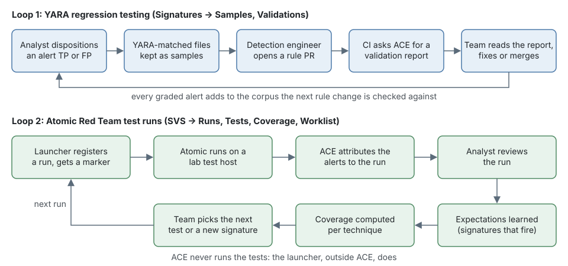
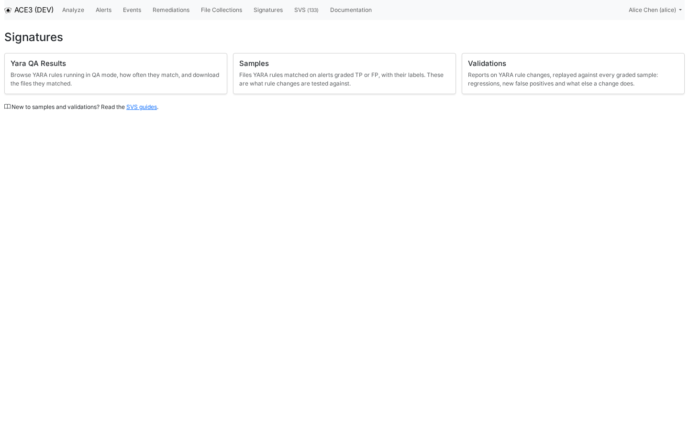
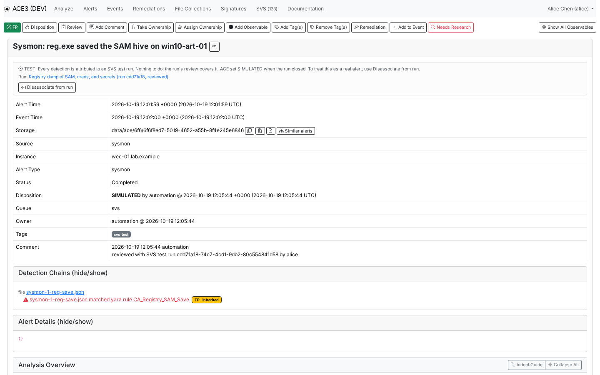

# SVS beginner's guide

This guide is for people who are new to ACE, to signature validation, or to both: new SOC analysts,
managers who want to know what the SVS screens are telling them, and detection engineers who know
testing but not ACE. It assumes no knowledge of ACE internals and explains each term the first time
it comes up.

By the end of it you will know:

- the handful of ACE ideas SVS builds on (alerts, observables, detections, signatures, dispositions
  and queues);
- why detection signatures need testing, and what regression testing and coverage mean;
- the two halves of SVS, and what SVS deliberately does not do;
- the words the SVS screens use;
- where each SVS screen lives, who uses it and what permission it needs;
- how triage works day to day: dispositions grade detections, test alerts have their own queue and
  status, and search leaves them out.

## ACE in five minutes

ACE (Analysis Correlation Engine) takes in security data, analyzes it, and turns what looks
malicious into **alerts** that analysts triage in the ACE web interface (the GUI).

- **Observables** are the pieces of data inside an alert that ACE can analyze further: a file, a
  URL, an IP address, an email address, a command line, a host name. Analysis of one observable
  often finds more observables, so an alert grows into a tree.
- A **detection** (also called a *detection point*) is a mark somewhere in that tree that says
  "this looks bad". A detection is what turns analysis into an alert.
- A **signature** is the rule that produced a detection. The two kinds SVS cares about most are
  **YARA rules**, which match patterns in file contents, and **hunts**, which are scheduled queries
  against your log data (for example in Splunk).
- A **disposition** is the analyst's verdict on an alert when they close it: `FALSE_POSITIVE`,
  `DELIVERY`, `EXPLOITATION`, `POLICY_VIOLATION`, `IGNORE` and so on.
- A **queue** is a named bucket of alerts. Analysts normally work the `default` queue; other teams
  or purposes get their own queues.

Analysts pick alerts off a queue, take ownership, investigate, and set a disposition. SVS reads
every disposition as a grade of the alert's detections.

## Why signatures need testing

Signatures are code, and code rots. Three things go wrong, usually silently:

1. **A rule edit breaks what it used to catch.** Someone tunes a YARA rule to cut noise, and it no
   longer matches the malware it was written for. Catching this is **regression testing**: checking
   a change against examples that used to work, to see whether any of them stopped working
   (regressed).
2. **A broadened rule catches things it shouldn't.** A rule rewritten to catch a new variant starts
   firing on a harmless backup script. Analysts get new false positives and trust the rule less.
3. **Nobody knows which attacker techniques are actually detected.** A rule may be tagged "detects
   credential dumping", but nobody has checked that it fires when credential dumping happens.

A few more terms help here:

- A **true positive (TP)** is a detection that was part of detecting real (or simulated) malicious
  activity. A **false positive (FP)** is a detection that fired when there was no malicious
  activity. In SVS the question is always "did we detect malicious activity?", not "did the rule
  match what its author intended?".
- **MITRE ATT&CK** is a public catalog of attacker behavior. Each **technique** has an id, such as
  T1003 (OS Credential Dumping) or its sub-technique T1003.002 (Security Account Manager), and lists
  the **platforms** it applies to (windows, linux, macos and others).
- **Atomic Red Team** (ART) is an open-source library of small, scripted attack simulations called
  **atomics** (in SVS, **tests**). Each atomic exercises one ATT&CK technique, for example "Registry
  dump of SAM, creds, and secrets" for T1003.002. Running atomics on lab machines and watching what
  fires is how you measure **coverage**: which techniques you actually detect.

## What SVS does

SVS (Signature Validation System) answers two questions.

**YARA regression testing.** "Does this rule change break what it used to catch, or start
catching what it shouldn't?"

- When an analyst dispositions an alert as TP or FP, ACE keeps every file a YARA rule matched on it,
  together with the match. Each kept file, for one rule, is a **sample**, and its TP or FP grade is
  its **label**. Nothing extra is asked of the analyst: the disposition is the grade.
- When someone opens a pull request (PR) against the YARA rule repository, the repository's CI asks
  ACE for a **validation**. ACE scans every sample with the rules as they were before the change and
  as they are after it, and writes a report: TP samples that stopped matching (regressions), FP
  samples that started matching (new false positives), and other differences. CI posts a summary on
  the PR with a link to the report in ACE.
- A validation warns and never blocks. People decide what to merge.

**Atomic Red Team test runs.** "Which ATT&CK techniques do we actually detect?"

- A **launcher**, a script or job outside ACE, runs atomics on lab **test hosts**. Before each test
  it registers a **run** with ACE and receives a **marker**: a random token it plants in the test's
  command line so the resulting telemetry can be recognized.
- As alerts arrive, ACE **attributes** them to the run (mostly by finding the marker), moves them
  into a separate test queue and labels them as test alerts, so analysts don't triage them as real
  incidents.
- When the run ends, a person reviews it. Signatures that fired and that nobody has decided about
  are **candidates**; accepted ones become **expectations** that later runs of the test are judged
  against.
- From reviewed runs, ACE computes **coverage** per ATT&CK technique and platform.

**What SVS does not do:**

- It doesn't run tests or prepare test hosts. A separate, site-specific launcher does that.
- It doesn't prove that telemetry exists. When an expected signature doesn't fire, SVS can't tell
  whether the log data never reached your SIEM or the signature didn't match. It flags when a hunt
  was probably suppressed, and the rest is for a person to investigate.
- It doesn't regression-test signatures other than YARA rules.
- It doesn't backfill. It grades the alerts it analyzes, and samples and attributions start empty.
- It doesn't suggest what to test next. That stays the team's call.

## The two loops

Each half of SVS is a loop that gets better the more it runs. The diagram shows both.

Every graded alert adds samples for the next rule change to be checked against, and every
reviewed run teaches ACE what a test should fire, so coverage reflects what was measured rather
than what was claimed.

## Key terms

| Term | Meaning |
|---|---|
| **Disposition class** | Every disposition counts as **tp**, **fp** or **unclassified**. `FALSE_POSITIVE` is fp; `GRAYWARE`, `POLICY_VIOLATION`, the kill-chain dispositions and `SIMULATED` are tp; `OPEN`, `IGNORE`, `UNKNOWN` and `REVIEWED` grade nothing. |
| **Verdict** | TP or FP for one detection, as opposed to the whole alert. It is inherited from the alert's disposition unless an analyst set it on the detection. |
| **Sample** | One file a YARA rule matched on a graded alert, for that rule, kept with its match. The same file and rule seen on several alerts is one sample. |
| **Label** | A sample's TP or FP grade, worked out from the verdicts of the detections behind it. When strong votes disagree, the sample is **conflicted** and someone has to relabel it. |
| **Validation** | A check of one YARA rule change (a base commit and a head commit) against every sample, requested by the rule repository's CI. Its report lists regressions and new false positives. |
| **Test (atomic)** | One Atomic Red Team test from the catalog ACE reads from the ART repository, identified by its GUID. |
| **Run** | One registered execution of one test against one or more test hosts. It has a state (created, started, ended, reviewed, canceled, error, closed), an owner and a reviewer, like an alert. |
| **Marker** | A random token, `svs-` followed by 26 characters, that the launcher puts into the test's command so ACE can recognize the alerts it causes. It counts only for its own run, on its own targets, inside the run's time window. |
| **Attribution** | Linking an alert's detections to a run, by marker, by context (right host, right time, no marker), or by hand. |
| **Expectation** | A signature a test is expected to fire on a platform. It is learned from reviewed runs: a person accepts it as expected (or rejects it). |
| **Candidate** | A signature that fired during a run and that nobody has decided about yet for that test. |
| **Coverage** | For each ATT&CK technique and platform, a state: failing, stale, validated, manual, untested or none. It is measured by reviewed runs and claimed by signature technique tags. |
| **Worklist** | The list that compares the techniques a signature's tags claim with the techniques its tests measure, so each tag gets confirmed by a test or kept or removed by a person. |
| **Test host** | A lab machine an SVS administrator listed as a valid target. A launcher that names any other host is refused, and ACE raises an alert about it. |
| **Launcher** | The script, job or person outside ACE that registers runs, fires the tests and reports back through the API. ACE never runs a test itself. |
| **SIMULATED** | The disposition ACE gives a test alert when its run is reviewed or closed. Only ACE sets it, analysts can't, and an alert with it is frozen. |

## A tour of the screens

The run and coverage screens are under **SVS** in the navigation bar, and the YARA screens under
**Signatures**.

| Area | Permission to open it | Extra permission to act |
|---|---|---|
| Documentation | any logged-in user | none |
| SVS: Runs, Tests, Coverage, Worklist | `svs:run_read` | `svs:run_manage` to take ownership, cancel, close, review, decide candidates and resolve worklist rows |
| SVS: Test hosts | `svs:admin` | `svs:admin` |
| Signatures: Samples, Validations | `signature:read` | `signature:download` to download sample files |

If a menu entry or tab is missing for you, you don't hold its permission; your ACE administrator
grants them.

### Documentation and the guides

**Documentation** in the navigation bar opens the guide index, where these four SVS guides live. The SVS
area also has a **Guides** link at the right end of its tabs, and the Signatures page links to the
guides under its cards. Anyone who can log in can read them.

### Runs

[SVS → Runs](/ace/svs/runs) lists every test run, newest first, much as the alert list does for
alerts: state, test and technique, targets, launcher and batch, times, a result summary (such as
"1/1 expected" or "1 missing"), attributed alerts, owner and reviewer. The *Needs attention* view
holds the runs waiting for a person, and its count appears next to **SVS** in the navigation bar.
The people who run the test program and review runs work here.

Each run has its own page: timeline, result per signature, candidates, alerts, log search keys,
comments and an event log. This reviewed run of the SAM registry dump test shows the expected
signature `CA_Registry_SAM_Save` as a hit, and its one alert as a `TEST` alert closed as
`SIMULATED`.

### Tests

[SVS → Tests](/ace/svs/tests) is a read-only list of every Atomic Red Team test in the catalog, by
technique, with its platforms, its state (never run, awaiting review, no expectations, validated,
failing or stale), its latest run and latest reviewed run, how many runs it has had, and how many
signatures are expected of it. It answers "how has this test fared?" and deliberately doesn't
suggest what to run next.

### Coverage

[SVS → Coverage](/ace/svs/coverage) shows one row per ATT&CK technique and platform: its coverage
state, the tests that count toward it, and its measured and manual (tag-only) signatures, under a
summary of rows per platform and state. A parent technique rolls up its sub-techniques: T1003 on
Windows is validated because sub-techniques under it are, although its own state is untested.
Managers and detection leads use it for the big picture. *Failing* means a test missed an expected
signature, not that the technique goes undetected.

Next to it, the **Worklist** tab lists the technique tags that no test confirms yet, so a detection
engineer can keep or remove each one. The [User's guide](users.md) covers it.

### Signatures

[Signatures](/ace/signatures/) is the hub for YARA-related screens: *Yara QA Results*, *Samples* and
*Validations*. Opening it needs `signature:read`.

[Samples](/ace/signatures/samples) lists every kept file per rule, with its label (`TP · inherited`,
`FP · inherited`, or conflicted), the file name and sha256, how many captures it has and the votes
behind the label. The *Conflicted* view shows the samples someone has to relabel. Downloads come as
zip files protected with the password `infected`, because some samples are live malware.

[Validations](/ace/signatures/validations) lists the validation reports CI requested, one per rule
change, with the branch (linked to its pull request), the two commits, who requested it, and its
counts of regressions, new false positives and compile errors. A *failed* validation is one ACE
couldn't run, for example because CI asked about a commit that wasn't pushed yet. Detection
engineers open a report from here or from the link CI posts on their PR.

## Day-to-day triage

Most of SVS stays off the alert queue. These are the parts of triage it takes part in.

### Your disposition grades the detections

`FALSE_POSITIVE` says none of the alert's detections found malicious activity; any tp disposition
says all of them did; `IGNORE`, `REVIEWED` and `UNKNOWN` record nothing. Those grades become the
labels future rule changes are tested against, so choose `FALSE_POSITIVE` only when there really was
no malicious activity, and don't use `REVIEWED` or `IGNORE` to avoid the call. On a real attack
where one signature was noise, you can mark just that detection FP on the alert page
([User's guide](users.md)).

### Test alerts have their own queue and status

Alerts that SVS attributes fully to a test run are moved to the test queue (`svs` by default) so they
stay out of your way. Each one carries an SVS status, shown after the alert's description in the
alert list and as a banner at the top of the alert page:

| Status | What it means | What to do |
|---|---|---|
| `TEST` | Every detection is attributed to a run by its marker. | Nothing. The run's review covers it. |
| `TEST?` | Every detection is attributed by context alone: the right host at the right time, but no marker. | Nothing, unless it looks wrong. Then mark it *Not a test*. |
| `PARTIAL TEST` | Some detections are from a run and some aren't. The alert stays in its normal queue, and the test detections are greyed out. | Triage the other detections. |
| `MARKER MISMATCH` | A marker in the alert doesn't agree with its run: wrong host, outside the run's window, or a marker no run has. The alert stays in its normal queue, and the banner is red. | Treat it as suspicious and investigate. A test marker where it doesn't belong, such as on a production host, is exactly what an analyst should see. |

`TEST?` and `MARKER MISMATCH` are the two worth a look. An alert you already own is never moved,
even when ACE attributes it to a run.

Here is a whole alert page for a test alert. The `TEST` banner names the run it belongs to, the
disposition is `SIMULATED`, set by the automation user, the queue is `svs`, and the comment says
which run review closed it.

### SIMULATED alerts are frozen

When a run is reviewed or closed, ACE gives its fully attributed open alerts the disposition
`SIMULATED`, which counts as TP: the detections did detect the (simulated) activity. Only ACE sets
it. The disposition dialogs don't offer it, and bulk disposition leaves these alerts alone and says
why.

A `SIMULATED` alert is frozen: you can't change its disposition, reset it, re-analyze it or add
observables, and its verdict chips are read-only. That keeps what a run review signed off from
drifting afterwards. Tags, comments and ownership changes still work. After 30 days by default these
alerts are archived like false positives: the analysis details go, the alert stays.

### Telling ACE an alert is not a test

If an alert was wrongly treated as a test, give it back to analysts from its page. With the
`alert:write` permission, the SVS banner offers:

- **Disassociate from run**: removes the alert from every run that holds it.
- **Not a test**: the same, on a `TEST?` alert, one the run holds by context alone.

Both ask for a reason. A `SIMULATED` alert then comes back as `OPEN` and unowned, an open alert that
nobody else has taken goes back to the queue SVS took it from, and ACE won't attribute it to that run
again.

> [!TIP]
> If you aren't sure whether an alert is part of a test, follow the run link in its banner. The run
> page shows the test, the target hosts and the time window, which is usually enough to decide.

### Search leaves test alerts out

Alert search and *Similar alerts* leave test-run alerts out by default, so "have we seen this
before?" is answered from real alerts. On the alert list, the search results say how many were
left out ("3 test-run alerts left out.") with an *Include them* link to bring them back. A search
that names the test queue always gets it.

### A refused registration is a real alert

If a launcher tries to register a run against a host that isn't a test host, ACE refuses it and
creates an alert in the `default` queue, titled like *SVS test run registration refused:
art-launcher targeted fin-ws-042.corp.example*. It is never treated as a test alert: a test tool
pointed at a production machine is something an analyst should look at.

## Next steps

Pick the guide that matches what you do next:

- **You review runs, write or fix signatures, or read validation reports**: the
  [User's guide](users.md).
- **You set SVS up or keep it running** (test hosts, the launcher's key, CI, configuration): the
  [Administrator's guide](administrators.md).
- **You want to know how SVS works inside, to improve it or fix it**: the
  [Developer's guide](developers.md).

For depth, [docs/SVS.md](https://github.com/ACE-Collective/ace3/blob/main/docs/SVS.md) is the
design of record and links to the documents on runs, samples, validations and coverage.
