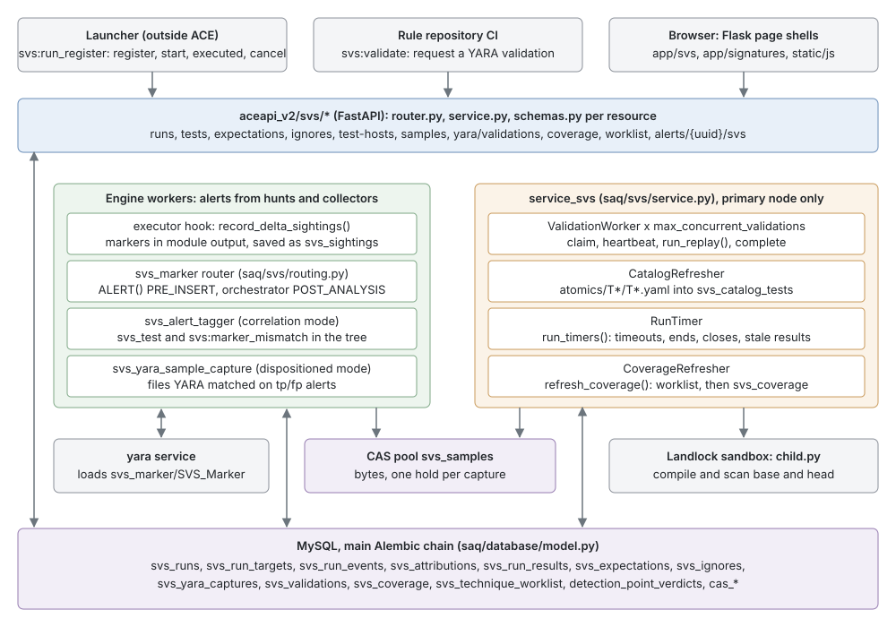
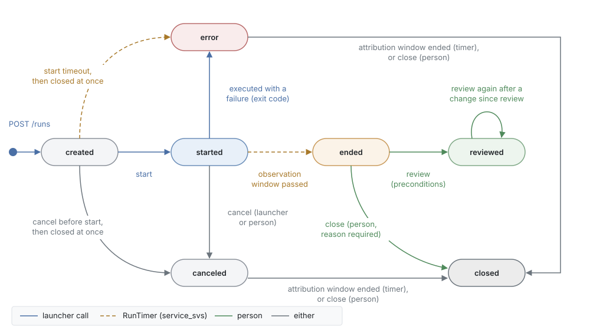
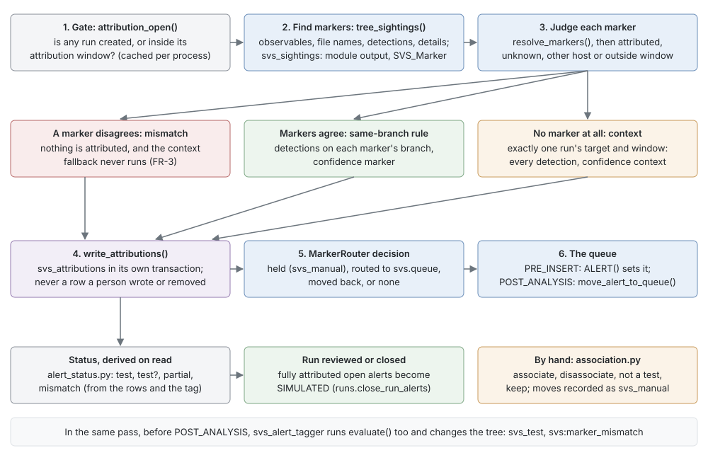
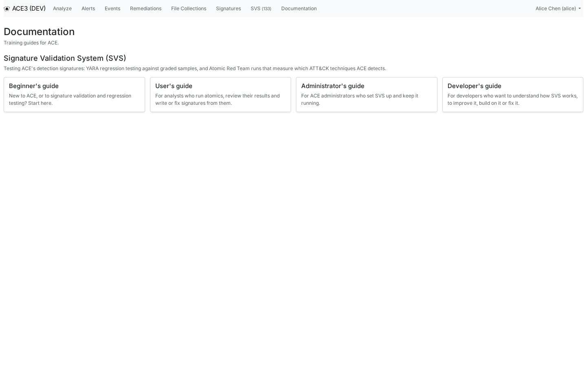

# SVS developer's guide

This guide is for developers who want to understand how the Signature Validation System (SVS) works, so that they can improve it, build on it or fix it. You know Python, SQLAlchemy, FastAPI, Flask and pytest; you may not know ACE yet. The guide walks the code from the outside in: what the parts are, where each one lives, which invariants hold them together, and which files to touch for the common changes.

You will learn:

- where the design record is and how to read it;
- how a run, an alert, a sample and a validation flow through the engine, the API, `service_svs` and the database;
- the rules that every SVS write follows (conditional transitions, private transactions, derived state that is never stored);
- how the GUI, the API and the filter screens fit together;
- how to test a change, update these guides and refresh their screenshots;
- what is still open.

If you have not used SVS yet, read the [Beginner's guide](beginners.md) first, and keep the [User's guide](users.md) at hand for what each screen does. ACE itself is described in `CLAUDE.md` at the repository root, which also holds the repository conventions this guide assumes.

## Where to start

SVS has a design of record and a set of operating documents. Read them before you change behavior: almost every rule in the code has a recorded reason, and the comment next to it usually names the decision.

| Document | What it is |
|---|---|
| [docs/SVS.md](https://github.com/ACE-Collective/ace3/blob/main/docs/SVS.md) | The design of record: concepts, the five parts (labels, YARA regression, test execution, coverage, operating SVS), data access, data model, permissions and what is deferred. |
| [docs/SVS_REVIEW.md](https://github.com/ACE-Collective/ace3/blob/main/docs/SVS_REVIEW.md) | The decision record. Each bracketed ID in the code and in `SVS.md`, such as `[D-6]`, `[DP-2]` or `[ART-7]`, is an item here, with the alternatives that were rejected. |
| [docs/SVS_FINAL_REVIEW.md](https://github.com/ACE-Collective/ace3/blob/main/docs/SVS_FINAL_REVIEW.md) | The pre-implementation review of the design against the code. `[FR-n]` IDs point here; the decisions on its items are written into `SVS.md`. |
| [docs/SVS_API.md](https://github.com/ACE-Collective/ace3/blob/main/docs/SVS_API.md) | The API's data dictionary: conventions, fields, filters, joins, the run event kinds and worked examples. |
| [docs/SVS_RUNS.md](https://github.com/ACE-Collective/ace3/blob/main/docs/SVS_RUNS.md) | Test runs: test hosts, the catalog, registration, states and timers, windows, attribution, results, expectations, review and `SIMULATED`. |
| [docs/SVS_SAMPLES.md](https://github.com/ACE-Collective/ace3/blob/main/docs/SVS_SAMPLES.md) | Captured YARA samples: what is captured, storage, states, labels and the sample actions. |
| [docs/SVS_VALIDATION.md](https://github.com/ACE-Collective/ace3/blob/main/docs/SVS_VALIDATION.md) | YARA validation: the CI request, the queue, how a replay compiles and scans, the sandbox and the report. |
| [docs/SVS_COVERAGE.md](https://github.com/ACE-Collective/ace3/blob/main/docs/SVS_COVERAGE.md) | Coverage states, roll-up, manual mappings, the worklist, refresh, snapshots and the ATT&CK release. |
| [docs/CAS.md](https://github.com/ACE-Collective/ace3/blob/main/docs/CAS.md) | The content-addressed storage that holds sample bytes. |

How to read them:

1. Start with the *Concepts* table in `SVS.md`. The words in it (verdict, sample, label, run, marker, attribution, expectation) have exact meanings, and the code uses them the same way.
2. Read the operating document for the part you are changing. It describes what the code does now; `SVS.md` describes why.
3. When a comment cites an ID, open the item in `SVS_REVIEW.md` or `SVS_FINAL_REVIEW.md` before you change the rule it explains. Several rules look arbitrary until you read the case that forced them.
4. When a document and the code disagree, the code is what runs. Fix whichever is wrong, in the same pull request.

> [!NOTE]
> Every module in `saq/svs/` opens with a docstring that states its contract and names the table it owns. Read the docstring before the code; it is kept current, and it is often the shortest correct description of the mechanism.

## Architecture

SVS is not a service with a single entry point. It is a set of hooks in the engine, one long-running service, a group of API routers and a set of page shells, all sharing one set of tables on the main database chain.



The diagram shows who calls whom. In words, the main flows are:

1. **A test run.** A launcher outside ACE registers a run (`POST /api/v2/svs/runs`, `saq/svs/runs.py::register`), gets its marker, starts it and runs the test.
2. **Alerts.** The telemetry reaches ACE as alerts through hunts and collectors. In the engine, the `svs_marker` router judges each alert at insert and after each correlation pass, and attributions go to `svs_attributions`.
3. **Ending and reviewing.** `service_svs` ends the run when its observation window passes and computes its result. A person reviews it, which gives its alerts the disposition `SIMULATED`.
4. **Samples.** Any tp or fp disposition, `SIMULATED` included, requeues the alert into `dispositioned` mode, where `svs_yara_sample_capture` keeps every YARA-matched file in the `svs_samples` CAS pool.
5. **Validations.** A rule repository's CI requests a validation; `service_svs` replays every sample under the base and head commits in the Landlock sandbox and stores the report.
6. **Coverage.** `service_svs` recomputes the worklist and then coverage; a daily cron task files a snapshot.
7. **Screens.** Every GUI page is a Flask shell whose JavaScript reads the same public API that reports use.

Three properties hold across all of this, and most bugs come from breaking one of them:

- **State is derived on read wherever possible.** A detection's effective verdict, a sample's label, an alert's SVS status, a run's needs-attention flag and a test's state are never stored. Only decisions people make (overrides, expectations, ignores, resolutions) and facts that happened (attributions, events, captures) are rows.
- **Every state change is conditional.** A run moves with `UPDATE … WHERE id=? AND state=?`, a validation is claimed with a conditional update that repeats its claim condition, and a worklist row is resolved under a row lock. A duplicate timer, a racing launcher call or a second node changes nothing.
- **SVS never breaks the host operation.** A router that raises is skipped, the executor hook swallows its errors, and capture failures are logged per candidate. Each SVS write that could fail runs in its own private transaction (`saq/database/private_session.py`), never on the caller's session.

## Code map

### saq/svs

| File | What it holds |
|---|---|
| `__init__.py` | The package marker. |
| `actions.py` | The analyst actions on a sample: relabel, reset, confirm, retire, unretire, delete. |
| `alert_status.py` | An alert's SVS status derived from `svs_attributions`: `derive_status`, `fully_attributed_condition`, `alert_svs_statuses`, `alert_svs_view`. |
| `association.py` | A person's changes to which alerts belong to a run: `associate`, `disassociate`, `keep`, `disassociate_alert`. |
| `attack.py` | The pinned ATT&CK release: `AttackCatalog`, `get_attack_catalog`, technique and platform normalization. |
| `attack_files.py` | `release_path`: where `etc/attack/<release>.json` is. |
| `attribution.py` | Finding markers, judging them, attributing detections and writing `svs_attributions`. |
| `capture.py` | Capturing YARA-matched files from dispositioned alerts into the CAS. |
| `catalog.py` | The Atomic Red Team catalog: parsing `atomics/T*/T*.yaml` and refreshing `svs_catalog_tests`. |
| `catalog_filters.py` | SQL for the Tests screen's filters. |
| `constants.py` | Every SVS enum (run states, event kinds, result statuses, coverage and worklist states), tags and actor names. Kept free of heavy imports. |
| `coverage.py` | Computing and writing `svs_coverage`, snapshots and a technique's drill-down. |
| `coverage_filters.py` | SQL for the Coverage and coverage history filters. |
| `coverage_lock.py` | `lock_refresh`: the `svs_coverage_state` row lock shared by coverage and the worklist. |
| `expectations.py` | Expectations, ignores and per-test settings, and the observation window a test gets. |
| `filters.py` | SQL for the Samples screen's filters. |
| `hosts.py` | Test hosts: normalization, `match_target`, create, update, delete. |
| `labels.py` | A sample's label, as SQL and as `aggregate_label` in Python. |
| `log_search.py` | The run page's link to the site's log search (`svs.log_search_url`). |
| `marker_rule.py` | The built-in `SVS_Marker` YARA rule and `install_marker_rule`. |
| `markers.py` | The marker format: `new_marker`, `MARKER_REGEX`, `find_markers`, `find_markers_in_match`. |
| `preconditions.py` | `Precondition` and `StaleWrite`: the If-Match / If-None-Match rule for writes. |
| `refusals.py` | Refused registrations: one alert per caller and host per hour. |
| `result_state.py` | `mark_runs_stale`: the generation counter that keeps a run's result current. |
| `results.py` | Computing a run's result: `compute_result`, `recompute_stale_results`. |
| `review.py` | Ownership, cancel and close by a person, and review with its preconditions. |
| `routing.py` | `MarkerRouter`, the `svs_marker` alert router. |
| `run_comments.py` | Comments on a run. |
| `run_events.py` | `new_run_event` and `run_log_fields`. |
| `run_filters.py` | SQL for the Runs screen's filters, including `needs_attention_condition`. |
| `run_summary.py` | Per-page summaries for the Runs screen, batches and the suppression share. |
| `runs.py` | Registration, the launcher calls, the timers, and closing a run's alerts. |
| `samples.py` | Reading samples: one row per `(sha256, rule uuid)` with its label, keyset paging. |
| `service.py` | `SVSService` and its four thread classes. |
| `service_config.py` | `SVSServiceConfig`, validated when the configuration is read. |
| `signatures.py` | Signature names, families, content hashes and `mitre:` tags, from built-ins, hunts and the YARA inventory. |
| `storage.py` | The capture holds on the `svs_samples` pool, and the purge of a deleted file. |
| `test_state.py` | A test's state per platform: `judge`, `evaluate_tests`, `catalog_histories`. |
| `validation_filters.py` | SQL for the Validations screen's filters. |
| `validations.py` | The validation queue: request, claim, heartbeat, complete, fail, prune; corpus version and engine fingerprint. |
| `windows.py` | Observation and attribution windows, and hunt latencies. |
| `worklist.py` | The declared-vs-measured worklist: derivation and resolution. |
| `worklist_filters.py` | SQL for the Worklist screen's filters. |

### saq/svs/yara

| File | What it holds |
|---|---|
| `__init__.py` | The package marker for YARA validation. |
| `child.py` | Runs inside the sandbox: compiles one commit's rules the way the yara service does and scans the replayed samples. Imports nothing from ACE. |
| `corpus.py` | Reads every stored capture with its label and writes the plaintext replay tree. |
| `diff.py` | Compares base and head scans against the labels: `Category`, `categorize`, `diff`. |
| `layout.py` | Which directories of a repository the yara service loads as namespaces (*contained* or *linked*). |
| `replay.py` | `run_replay`: one validation, from fetch to diff. Writes nothing to the database. |
| `repository.py` | `Mirror`: SVS's own bare clone of a rule repository, and exporting a commit with `git archive`. |

### Everything else

| Path | What it holds |
|---|---|
| `saq/modules/svs.py` | The analysis modules `YaraSampleCapture` (`svs_yara_sample_capture`) and `SVSAlertTagger` (`svs_alert_tagger`). |
| `saq/detection_verdicts/` | Part 1, detection verdicts: `constants.py`, `effective.py` (the rule), `store.py` (writes), `query.py` (selects with the effective verdict), `filters.py` (the detection points screen). |
| `saq/cli/commands/svs.py` | `ace svs yara validate|layout|prune`, `ace svs catalog refresh|status`, `ace svs coverage refresh|status|snapshot`. |
| `saq/gui/filter_screens.py` | `FilterScreen` and every registered screen (`svs_runs`, `svs_tests`, `svs_coverage`, `svs_coverage_history`, `svs_worklist`, `svs_samples`, `svs_validations`). |
| `saq/gui/filter_names.py` | Each screen's display name to URL slug map; a permanent contract. |
| `saq/gui/filter_entry.py` | The pydantic entry models that validate each screen's filter values (`RunFilterEntry` and friends). |
| `saq/alert_routing/` | The core alert-router registry (`registry.py::route_alert`, `router.py`), which SVS plugs into. |
| `aceapi_v2/svs/` | One package per resource (`alerts`, `catalog`, `coverage`, `expectations`, `ignores`, `runs`, `samples`, `test_hosts`, `worklist`, `yara/validations`), each with `router.py`, `service.py` and `schemas.py`, plus `preconditions.py`. |
| `aceapi_v2/common/listing.py` | Keyset listings, cursors, `settled()` and the NDJSON/CSV exports. |
| `app/svs/` | The SVS area's Flask views: `runs.py`, `tests.py`, `coverage.py`, `worklist.py`, `test_hosts.py`, `tabs.py`, `access.py`. |
| `app/signatures/` | The Signatures hub, Samples, Validations and Yara QA Results views. |
| `app/templates/svs/`, `app/templates/signatures/` | The page shells. |
| `app/templates/analysis/_svs_alert_banner.html`, `_svs_status.html` | The alert page banner and the status text used in the manage list. |
| `app/static/js/svs_*.js` | `svs_runs.js`, `svs_run.js`, `svs_tests.js`, `svs_coverage.js`, `svs_worklist.js`, `svs_test_hosts.js`, `svs_alert.js`, `svs_nav.js`. |
| `app/static/js/signatures_*.js` | `signatures_samples.js`, `signatures_validations.js`, `signatures_yara_qa.js`. |
| `app/static/js/filter_list_page.js` | The generic filtered, sorted, paged list every SVS screen is built on. |
| `app/static/js/detection_verdicts.js` | The verdict chips on the alert page. |
| `app/help/` | The Documentation area that serves these guides. |
| `etc/attack/` and `bin/update-attack-catalog` | The vendored ATT&CK extract and the script that builds it. |
| `etc/cron/daily/svs-coverage-snapshot`, `svs-validations-prune` | The daily cron tasks. |
| `tests/saq/svs/`, `tests/saq/svs/yara/` | Unit and integration tests of `saq/svs`. |
| `tests/aceapi_v2/svs/` | API tests. |
| `tests/app/svs/`, `tests/app/signatures/`, `tests/app/help/` | GUI smoke tests and the help content tests. |

## Data model

All SVS tables are on the main Alembic chain, with their models in `saq/database/model.py`. Each model's docstring names the one module that writes it; keep that true when you add a writer, because the invariants of a table (lock order, conditional updates, what is logged) live in that module.

| Part | Table | One line |
|---|---|---|
| Labels | `detection_point_verdicts` | An analyst's explicit TP/FP override on one detection, keyed on `(alert_id, content_hash)`. |
| Labels | `detection_point_verdict_history` | Append-only record of every change to a stored override. |
| Samples | `svs_yara_captures` | One row per `(alert uuid, sha256, rule uuid)`: the file, the match record and the scan context. |
| Samples | `svs_sample_retirements` | A sample retired for its rule; unretiring is soft. |
| Samples | `svs_sample_deletions` | The audit of a deleted file; while it exists, capture never stores the sha256 again. |
| Samples | `cas_objects`, `cas_holds`, `cas_purges` | The CAS index: objects, the holds that keep them alive (`holder_kind` `svs_capture`), forced purges. |
| Validation | `svs_validations` | A validation request, its lease, its state and its report. |
| Validation | `svs_validation_results` | One listed `(sample, rule uuid)` outcome with its category and the label it had. |
| Runs | `svs_test_hosts` | The hosts a run may target. A table, not config, so adding one needs no restart. |
| Runs | `svs_catalog_repositories`, `svs_catalog_tests` | The catalog repositories with the commit last read, and the tests by `auto_generated_guid`. |
| Runs | `svs_runs`, `svs_run_targets` | Runs with their lifecycle timestamps, marker, windows, owner and reviewer; their targets. |
| Runs | `svs_run_events` | The append-only event log of each run. |
| Runs | `svs_registration_refusals` | Refused registrations per `(caller, host, hour)`. |
| Runs | `svs_attributions` | One attributed detection: run, alert uuid, `content_hash`, signature, confidence, late, source, removal and keep. |
| Runs | `svs_run_comments` | Comments on a run. |
| Runs | `svs_expectations`, `svs_ignores`, `svs_test_settings` | Decisions about a test's signatures per platform, ignores (global or per test), and the observation window override and `holds_host`. |
| Runs | `svs_run_results`, `svs_run_result_state` | One row per `(run, signature)`, live and as reviewed; and the run's stale flag and generation. |
| Runs | `alert_queue_changes` (core) | Every queue move, with the router that made it; `svs_manual` marks a person's move through SVS. |
| Coverage | `svs_coverage`, `svs_coverage_state` | One row per technique and platform; and the single refresh lock row (id 1). |
| Coverage | `svs_coverage_snapshots` | The daily copy of `svs_coverage`. |
| Coverage | `svs_technique_worklist` | One row per `(signature, technique)` of a measured signature; only the resolution is a decision. |
| Screens | `saved_filters` (core) | Saved filters, unique per `(user, screen, name)`. |

Two keys need care. `svs_attributions` is keyed on the alert **uuid**, not its id, because the router writes at `PRE_INSERT`, before the alert row exists [FR-23]. Verdicts and attributions are keyed on the detection's `content_hash` (`saq/analysis/detection_identity.py`), never on the `detection_points` row, because the sync deletes and re-creates those rows.

> [!IMPORTANT]
> Never hand-write a migration. Change the model in `saq/database/model.py`, then run `make db-revision MESSAGE="what changed"` to autogenerate the revision on the main chain (`alembic/ace.ini`), and `make db-check` to confirm there is no drift between the models and the migrated schema. CI enforces one head per chain: if `main` gained a revision while you worked, rebase so your `down_revision` points at it.

A new permission is a data-only revision: an entry in `saq/permissions/catalog.py` and a revision that seeds it. `alembic/ace/versions/19cd3b98d43f_svs_run_permission_catalog.py` shows the pattern, including the snapshot of the catalog entries and a downgrade.

Every SVS table has `updated_at`, maintained by the server, because `changed_since` pulls page on `(updated_at, id)`. `svs_run_events` has one too, so the event feed can be pulled incrementally. Its rows are built only by `run_events.py::new_run_event`, which `runs.py`, `attribution.py`, `results.py`, `review.py`, `association.py` and `expectations.py` all append through.

## Labels and verdicts

Part 1 of the design grades each detection as TP or FP. Only explicit overrides are stored; everything else is derived when read. The rule is in `saq/detection_verdicts/effective.py`, once as SQL expressions (`effective_verdict_expr`, `verdict_source_expr`) and once as `compute_effective()` in Python, and `tests/saq/detection_verdicts/test_effective.py::test_sql_agrees_with_python` holds the two together:

```text
effective(dp) =
    NULL                    if class(alert.disposition) is unclassified
    NULL                    if the alert is attributed to a test run that is not Reviewed
    FP   inherited_single   if class(alert.disposition) == fp      # overrides are masked
    override  explicit      if an override row exists              # tp alerts only
    TP   inherited_single   if the alert has detections from one signature only
    TP   inherited_multi    otherwise
```

- The disposition class comes from the `disposition_classification` config map, read through `saq/disposition.py::get_disposition_class`. `SIMULATED` is tp.
- The unreviewed-run rule is `unreviewed_run_condition`: an attribution that holds to a run whose state is not `reviewed`. It is what makes *Close* teach nothing, even though closing gives the alerts `SIMULATED`.
- The verdict sources are `explicit`, `inherited_single` and `inherited_multi` (`saq/detection_verdicts/constants.py`). `inherited_multi` is the weakest: a TP inherited on an alert where several signatures fired, which nobody confirmed.
- Writes go through `saq/detection_verdicts/store.py::set_verdicts`, which accepts an override only on a tp alert whose disposition analysts can set, and records each change in `detection_point_verdict_history` in the same transaction. Review uses it with `analyst=False` to give ignored detections FP.

A sample's **label** for a rule aggregates the effective verdicts of its contributing detections: on each alert a capture of the pair came from, the detections of that rule on a file node with that sha256. The strongest source that has any vote decides (`explicit` > `inherited_single` > `inherited_multi`); disagreement at that strength is `conflicted`, and the newest vote never silently wins. `saq/svs/labels.py` holds the rule as SQL (`label_expr`, `label_source_expr`, `contributing_detection_condition`) and as `aggregate_label()`, and `tests/saq/svs/test_labels.py` checks that they agree. The docstrings of both modules say "nothing else may restate it": if you need the verdict or the label anywhere, import these expressions.

## Sample capture

Capture is Part 2's first half. The module `YaraSampleCapture` (`saq/modules/svs.py`) is enabled in `analysis_mode_dispositioned` (`enabled_modules` in `etc/saq.default.yaml`), where both disposition writers requeue an alert. It works in `execute_post_analysis`, analyzes no observable and leaves the tree as it is.

1. It reads the alert's disposition from the database, because roots don't carry it, together with `unreviewed_run_condition`. An unclassified alert, or one attributed to a run that is not reviewed, is skipped.
2. `saq/svs/capture.py::candidates_from_root` lists one candidate per `(file sha256, rule uuid)`: a YARA detection on a file observable with the structured details the YARA module gives it. A detection without those details, and a rule without a uuid, is skipped.
3. For each candidate, `capture()` checks `svs_sample_deletions` first (`saq/svs/storage.py::is_deleted`), then `_capture()` inserts or claims the `svs_yara_captures` row in a private session, puts the file and the match record into the pool with a hold `Hold("svs_capture", <row id>)` (`storage.capture_hold`), and updates the row to `stored` or `missing` with a reason (`file`, `match_record`, `storage`).
4. It checks the deletion audit again after storing, because a deletion can commit between the two; a capture that lost that race removes what it wrote.

Why it is shaped this way:

- **Idempotent on the unique key.** Post-analysis runs at the end of every pass, so every later dispositioned pass captures again. A stored row is left alone; a `missing` row is retried on the alert's next dispositioned pass.
- **The row before the bytes.** The row exists before the CAS put, so a failure leaves a counted `missing` row rather than an orphaned object, and the hold id is the row id.
- **No foreign key to `alerts`.** A capture outlives its alert, so its holds are never orphaned.
- **Labels are never stored.** A relabel writes verdict overrides on the contributing detections (`saq/svs/actions.py::relabel`), a reset clears them, a confirm upgrades inherited votes to explicit; the label changes because its inputs did.
- **Deleting is a purge.** `actions.delete_sample` removes the captures for every rule, records `svs_sample_deletions`, and calls `storage.purge_deleted_file`, which survives a legal hold by leaving the deletion unfinished and retryable.

The pool is `cas.pools.svs_samples` (encrypted, `retention: held`, `local` and `shared: false` by default), named by `svs.samples.pool`. On a multi-node site the pool needs a shared backend, because capture runs on whichever node owns the alert and validation reads every sample from one node; `docs/SVS_SAMPLES.md`, *Nodes*, has the detail. The capture module imports `yara` and the YARA analysis module, which is why `storage.py` is kept apart from it: the API needs the hold and purge helpers without those imports.

## YARA validation

Validation is Part 2's second half: replay the whole corpus under the whole base ruleset and the whole head ruleset, and diff the results per `(sample, rule uuid)` against the labels.

**The queue** (`saq/svs/validations.py`). `request_validation` returns, in order: a validation queued or running for the same `(repository, base_sha, head_sha)` (the `active_key` column is unique, so two identical requests collapse to one row); a completed one whose `corpus_version` and `engine_fingerprint` are both still current; or a new queued row. A failed validation is never reused.

- `corpus_version()` digests the greatest change time and the row count of the stored captures, the verdict history, retirements, deletions and the alerts the captures reference. The counts are there because a cleared verdict or a deleted alert bumps no change time.
- `engine_fingerprint(repository)` digests the installed versions of `yara-python` and `yara_scanner_v2`, the source of every file in `saq/svs/yara/`, the disposition classification, the yara service's per-file timeout and the repository's layout. Any change to the replay code rescans.
- `claim()` takes the oldest queued validation, or a running one whose lease expired with attempts left, with a conditional update that repeats the claim condition. Lease times come from the database clock (`func.now(6)`), never the worker's.
- `heartbeat()` extends the lease while the claim token still matches; `release()` requeues without counting the attempt (a shutdown is not the validation's fault); `fail_abandoned()` fails a validation that was claimed `max_attempts` times without finishing; `complete()` stores the report and its rows in one transaction and raises `LeaseLost` when another worker took over.

`validations.py` must not import `yara_scanner` or `child.py`: the API imports it, and the drift check's environment installs only the pinned requirements. That is why the fingerprint reads library versions from `importlib.metadata`.

**The replay** (`saq/svs/yara/replay.py::run_replay`) runs synchronously in the worker thread:

1. `repository.Mirror` fetches the branch into SVS's own bare clone under `svs.yara.mirror_dir`, verifies the commits, and exports each with `git archive`, unpacked member by member with tarfile's `data` filter. It is never the checkout the yara service loads, so a validation can't change what production scans.
2. `layout.resolve_layout` derives which directories of the repository are namespaces from `service_yara.signature_dir`: *contained* (the signature directory is inside the checkout) or *linked* (its entries are symlinks into it). A repository that feeds no namespace is a `LayoutError`.
3. `corpus.read_corpus` reads every stored capture with its label in one transaction, and `write_units` writes each distinct `(sha256, file_path, yara_meta_tags)` to `<n>/files/<file_path>` by copying from the pool's `open()`, never `materialize()`, which could hardlink the read cache into a tree the sandboxed scan can write.
4. `child.py` runs once per commit in the Landlock sandbox (`saq/sandbox/runner.py::run_sandboxed`), as `python3 -I child.py <workdir>`, with no network (`svs.yara.sandbox.allowed_tcp_ports: []`) and a memory limit. It compiles each file on its own, drops a file that fails, then compiles the survivors once per namespace, exactly as the yara service does, through `yara.compile()` so errors and warnings are kept.
5. Rules are parsed from source for their uuids and content hashes (`saq/signatures/loaders/yara.py::parse_rule_file`), and `diff.diff` categorizes every pair.

The categories (`saq/svs/yara/diff.py::Category`) are `regression`, `regression_unconfirmed` (a regression on an `inherited_multi` label), `new_fp`, `new_fp_other_rule`, `rule_removed`, `scan_error`, `recovered`, `improvement`, `already_broken`, `new_match_real_hit`, `unlabeled_change`, and the counted-only `known_fp`, `retired`, `not_testable` and `unchanged`. A *match* means the rule would make a detection: it matched, it is enabled, and its modifiers include neither `qa` nor `no_alert`. A scan that timed out or failed is a `scan_error`, never a miss.

> [!CAUTION]
> The work directory holds every sample in plaintext while a validation runs. `run_replay` deletes it when the replay ends, whatever happened, and the node that runs `service_svs` is a malware store by design (`docs/SVS_VALIDATION.md`, *The SVS node is a malware store*). Never widen the sandbox's allowlists to make a replay work.

`ace svs yara validate` runs the same replay from the command line and prints the report, and `ace svs yara layout` prints the derived layout, which is the first thing to check when a repository fails with a layout error.

## Test runs

Part 3 is the largest part of SVS. A run is one registered execution of one catalog test against one or more test hosts, with its own marker and lifecycle.



The transitions are all in `saq/svs/runs.py` (launcher calls and timers) and `saq/svs/review.py` (people):

| From | To | Trigger | Function |
|---|---|---|---|
| (none) | created | `POST /runs` | `register` |
| created | started | `POST /runs/{id}/start` | `start` |
| started | error | `POST /runs/{id}/executed` with a non-zero exit code or an error | `executed` |
| created, started | canceled | `POST /runs/{id}/cancel`, or a person | `cancel`, `cancel_by_person` |
| canceled | closed | in the same call, when canceled before start | `_cancel` |
| created | error, then closed | `start_timeout_minutes` passed | `_time_out` |
| started | ended | `observation_ends_at` passed | `_end` |
| canceled, error | closed | `attribution_ends_at` passed (or it never started) | `_close_after_attribution` |
| ended, canceled, error | closed | a person; a reason is required on an ended run | `close_by_person` |
| ended, reviewed | reviewed | a person signs off, or signs off again | `review._sign_off` |

`executed` with exit code 0 and no error records the call and the exit code but changes no state.

**Transitions name their from-state.** `_transition(run, from_state, to_state, …)` issues `UPDATE svs_runs SET state=:to WHERE id=:id AND state=:from` and appends a `transition` event in the same transaction. The caller passes `from_state`; it is never read back from the ORM object, because a commit may have refreshed it with what another process wrote. A transition that matches no row returns `False` and changes nothing, so a timer that fires twice, or a launcher call racing a timer, moves the run once. Launcher calls that don't apply raise `RunStateConflict` and are still recorded as a `launcher_call` event with outcome `conflict`.

**Markers** (`saq/svs/markers.py`). A marker is `svs-` followed by 26 base32 characters (128 random bits from `secrets.token_bytes(16)`), stored lower case. `MARKER_REGEX` is case-insensitive and bounded by non-base32 characters, so a marker inside a longer token is not found. A marker is not a secret; it only attributes when the alert agrees with its run (next section).

**Windows** (`saq/svs/windows.py`). The observation window is the worst-case latency of the slowest expected signature plus `slack_minutes`, clamped to `floor_minutes` and `ceiling_hours` (`svs.runs.observation_window`). A hunt's latency is `frequency + time_range + offset` (`hunt_latency`, with `cron_interval` for cron frequencies); every other signature fires while the alert is analyzed and counts as zero. A test with no expectations yet uses the slowest enabled hunt [FR-10], and an override in `svs_test_settings` replaces the computation (`expectations.py::observation_for_test`, which also says where the window came from: `override`, `expected` or `all_hunts`). The attribution window is the observation window plus `attribution_extra_hours`. Both are fixed at registration and stored as seconds; `start` stores `observation_ends_at` and `attribution_ends_at`, starting at the whole second because MySQL rounds fractions half up.

**Timers** (`run_timers`, called by `RunTimer` every `svs.runs.timer_interval_seconds`). Each pass, in order: times out created runs, ends started runs, closes canceled and error runs whose attribution window passed, closes late alerts of closed runs (`close_late_alerts`), recomputes stale results (`results.recompute_stale_results`) and prunes old refusal rows. Each kind of move reads at most `TIMER_BATCH` runs and moves each in its own transaction; a run that fails is logged with `log_loop_exception` and retried on the next pass.

**Closing a run's alerts.** `close_run_alerts` and `close_reviewed_run_alerts` give `SIMULATED` to the run's alerts that are open, not owned by anyone but the automation user, and fully attributed. They go through `set_dispositions`, the same writer analysts use, so the alert is requeued into dispositioned mode and captured. The `eligible` callback re-checks full attribution under the alert's row lock in a fresh private transaction (`_still_fully_attributed`), which closes the race with a disassociation.

**Run events.** Every change appends a row through `run_events.py::new_run_event`. The kinds are `RunEventKind` in `saq/svs/constants.py`: `registered`, `transition`, `launcher_call`, `attributed`, `attribution_removed`, `alerts_closed`, `result_computed`, `candidate_decision`, `associated`, `disassociated`, `context_kept`, `ownership_taken` and `reviewed`. The event log is the run's change feed (`GET /api/v2/svs/runs/events`) and its history on the run page.


The event log above is the reviewed SAM registry run from the demo data: the launcher's registration and start, the router's attribution, the timer's end, two result computations, alice's ownership and candidate decision, her review, and the alert closed as `SIMULATED` by the review.

**One run per test host** (`runs.py::host_holders`). A run holds its targets' test hosts from registration until it starts, times out or is canceled, and once started, in any state, until its claim ends: `claim_ends_at()`, the observation window, or the attribution window when the run `holds_host` (copied from the test's settings at registration). `register()` and `start()` lock the hosts' `svs_test_hosts` rows `FOR UPDATE` in id order (`_lock_hosts`), check again under the lock, and raise `HostBusy` (409 from the API, no alert); the session is READ COMMITTED, so the check sees a concurrent registration's commit. `decide()` reports it to `POST /runs/validate` as `host_busy`.

**Registration refusals** (`saq/svs/refusals.py`). A target that is not a test host, or a user the host doesn't list, raises `RegistrationRefused` (403 from the API). `refuse()` inserts a row per `(caller, host, hour)`; only the request whose insert succeeds creates the alert, through `ALERT()` with the `SVS_REGISTRATION_REFUSED` built-in signature. The SVS built-ins are in `RUN_SIGNATURES` and are never attributed or counted in a result, which keeps a refusal alert out of the test queue even while a run is live on that host.

## Attribution and routing

Attribution decides which detections of an alert belong to which run. Routing decides which queue the alert is in. They are separate steps that run together.



### Where it runs

- **`PRE_INSERT`**, inside `ALERT()` (`saq/database/util/alert.py`), the one function every alert insert goes through. `route_alert` runs the routers in priority order and the first decision wins; `svs_marker` is configured in `alert_routers:` at priority 100, ahead of the built-in detection-queue router. A `PRE_INSERT` router is pure: it may write its own rows, but never touches the tree [FR-3].
- **During analysis.** The executor calls `_record_svs_sightings` after each module returns, which calls `attribution.py::record_delta_sightings` with the module's `ModuleExecutionDelta`. It scans the new analysis details (the cache path replays the same delta) and saves the markers it finds on the root, in the `svs_sightings` extension, capped by `svs.attribution.max_sightings`. Errors are logged as warnings and never break analysis.
- **In file contents.** `marker_rule.py::install_marker_rule` writes the `SVS_Marker` rule (`modifiers = "no_alert"`) to `<signature_dir>/svs_marker/svs_marker.yar`. The yara service calls it before it starts its server, and the module's fallback scanner before it compiles, because the scanner lists namespace directories only when it is built. It writes only when the content differs, because a rewrite of the same bytes would recompile every rule. The rule's matches land in `YaraScanResults` details, which the executor hook reads as `file_contents` sightings.
- **`POST_ANALYSIS`**, in the orchestrator after each correlation pass (`analysis_orchestrator.py::_route_post_analysis`). A decision moves the existing alert through `move_alert_to_queue`, and only while it is `OPEN` and nobody but the automation user owns it.
- **The tagger.** `SVSAlertTagger` runs in correlation mode's post-analysis, which comes before the router's `POST_ANALYSIS` stage in the same pass. It calls `evaluate()` itself rather than reading the router's rows, which would lag a pass, and adds `svs_test` or `svs:marker_mismatch` plus a mismatch detection. A mismatch is never taken back; `svs_test` is removed when the alert stops being fully attributed.

### How an alert is judged

`attribution.py::evaluate(root, event_time)` reads the database and writes nothing:

1. **The gate.** Callers check `attribution_open()` first: is any run `created`, or inside its attribution window? The answer is cached per process for `svs.attribution.gate_cache_seconds`. A registered run opens the gate before its test fires, so the cache never hides the start of a run, and nothing is scanned while no run is open.
2. **Sightings.** `tree_sightings` collects markers from observable values and file names, from detections' descriptions and details, from `root.details`, and from the saved `svs_sightings` (dropped when their observable left the tree). Each sighting records its node: the observable it was on, or `None` for the root.
3. **Judgement.** `resolve_markers` maps markers to run snapshots. Its cache holds only runs that have started, whose windows and targets never change again; a marker the cache doesn't have always goes to the database, so a stale cache can never turn a real test into a mismatch [FR-8]. Each marker is then `attributed`, `unknown`, `other host` (the alert involves none of the run's targets, by `hostname`/`fqdn` observables and their subtypes, or an `ipv4` the test host lists) or `outside window` (judged on `root.event_time`, falling back to the alert's insert time).
4. **Mismatch ends it.** If any marker disagrees, the status is `mismatch` and nothing is attributed, not even by context [FR-3]. Otherwise an alert carrying run A's marker outside A's window could be attributed by context to run B on the same target.
5. **Markers that agree** attribute by the same-branch rule [ART-7]: a detection is attributed when its node and the marker's node are on one branch of the tree, meaning one of them is the root, they are the same observable, or one is above the other (`_Branches.same_branch`, built over a parent map that tolerates several parents and cycles). Confidence is `marker`.
6. **No marker at all** falls back to context: the runs whose window covers the event time and whose targets the alert involves. `context_claimant` picks the run: the only candidate, or the one that started last when every other candidate's claim on the host ended before it started. Every detection is attributed to it with confidence `context`. When the claims overlap, which only runs registered before one run per host was enforced can have, nothing is, and `log_sightings` writes a WARNING naming every candidate run [FR-9]. `context_owners` makes this decision for attribution and for the hunter alike (a grouped hunt's suppression key and its suppressed matches), so they never disagree on which run owns an event.
7. A run a person disassociated the alert from is never attributed it again, and `(run, detection)` pairs a person wrote or removed are left alone.

The status is `derive_status` in `saq/svs/alert_status.py`: none attributed is no status, some is `partial`, all is `test`, or `test?` when context is all there is. The router and the database readers use this one function, the router over its evaluation and `alert_svs_statuses` over the rows (plus the `svs:marker_mismatch` tag for a mismatch).

### Writing and routing

`write_attributions` brings the router's rows in line with the evaluation inside `run_private_transaction`, which runs the whole transaction again on a deadlock or lock wait timeout, up to `WRITE_ATTEMPTS` times. It locks the involved runs in id order first (`_lock_runs`), because every attribution row takes a shared lock on its run through the foreign key and marking the run stale needs an exclusive one; without the ordered lock, two alerts of one run written at once deadlock. It inserts with `INSERT IGNORE` on the unique key, removes rows that no longer hold (keeping them, marked removed), changes a row only while it is still the router's (`_update_own_row`), appends `attributed` and `attribution_removed` events, flags a reviewed run `changed_since_review`, and marks every touched run's result stale.

`MarkerRouter.route` then decides:

- **held (manual)**: the alert's latest queue move was made by a person through SVS (`alert_queue_changes.router` is `svs_manual`). The router returns the alert's current queue, which also stops any lower-priority router from moving it.
- **routed**: every detection is attributed; the decision is `svs.queue`. A marker that agrees overrides a configured queue [FR-2].
- **moved back**: at `POST_ANALYSIS`, an alert this router put in the test queue that is no longer fully attributed goes back to the queue it came from.
- **none**: partial, mismatch or nothing; the configured route applies.

### After routing

- Closing or reviewing a run gives its fully attributed open alerts `SIMULATED` (previous section). A `partial` alert stays in its queue and keeps the run in *Needs attention*.
- `saq/svs/association.py` is the person's side. `associate` writes `manual` attributions for every detection with confidence `marker` and moves the alert to the test queue when it is now fully attributed; `disassociate` removes the person's rows, moves the alert back to its previous queue and reopens a `SIMULATED` alert as `OPEN`; `keep` confirms context attributions, which review requires. Each locks the alert row first, writes in the router's lock order, records its move with the router name `svs_manual`, and logs an AUDIT record. `disassociate_alert` is the alert page's version, over every run that holds the alert.

> [!WARNING]
> A `PRE_INSERT` router must never change the tree, and no router may let an exception escape into the insert. If you extend the router, keep tree changes in `SVSAlertTagger` and keep every database write inside its own private transaction.

## Results, expectations and test state

**Results** (`saq/svs/results.py`). A run's result is one `svs_run_results` row per signature. What fired is the run's attributions that hold, by signature, minus `UNTRACKED_SIGNATURES` (the generic, legacy, uuid-less YARA and flagged-observable built-ins, plus the SVS built-ins). Each fired signature is `ignored`, `hit`, `rejected` or `candidate`, in that precedence; each expected signature that did not fire is `missing`, or `possibly_suppressed` when it is a hunt that alerted within its suppression period before the window closed; for a hunt with `group_by`, when the hunter recorded dropping a match of it during the run (`svs_suppressed_matches`, written by `record_suppressed_matches` in `saq/svs/attribution.py`). `compute_result` runs in its own private transaction and writes only what changed; a signature that left the live result keeps its row only while it holds a reviewed status.

**Stale and generation** (`saq/svs/result_state.py`). Anything that changes what a result would be calls `mark_runs_stale` in its own transaction: attribution writes, a run ending, an expectation or ignore decision. Marking bumps `generation` and sets `stale`, in run id order so concurrent writers lock in the same order. `compute_result` reads the generation before it reads anything else and clears `stale` only if the generation is unchanged when it finishes (`_finish`), so a change that lands mid-computation leaves the run stale for the next timer pass. Started runs are marked too, which closes the race between an attribution and the run's end.

**Expectations** (`saq/svs/expectations.py`). Decisions are per test and platform: `expected` or `rejected` (never proposed again). A candidate is not a row: it is a status of a run's result, so nothing goes stale when a decision is removed. Ignores are per test (on every platform, `svs:run_manage`) or global (`svs:admin`); an ignored signature is never a candidate and never missing. Every change marks the affected runs stale, appends `candidate_decision` where a run is named, and logs an AUDIT record. Writes accept a `Precondition` (see *The API*).

**Review** (`saq/svs/review.py`). `review()` takes the run when nobody owns it (or when the person confirmed taking it from its owner, `check_alert_ownership`), then `_sign_off`:

1. checks the state is `ended` or `reviewed`;
2. checks `review_blockers`: the result is not stale (and was computed at all), no signature is a `candidate`, and every context attribution was kept or removed. A run that was never computed is marked stale so the next timer pass computes it;
3. conditionally updates the run to `reviewed`, with reviewer and time, and clears `changed_since_review`;
4. copies the live columns of `svs_run_results` into the `reviewed_*` columns, the result as signed off;
5. appends a `reviewed` event with the counts and commits.

Only after the commit does it close the alerts as `SIMULATED` and give ignored detections FP verdicts, because capture skips the alerts of a run that is not reviewed. A failure after sign-off never undoes it: the alerts stay open, the run stays in *Needs attention*, and a re-review finishes the job.

**Test state** (`saq/svs/test_state.py`). Nothing here is stored. `judge` evaluates a test on one platform from its latest reviewed run there, as signed off: `awaiting_review`, `no_expectations`, `failing` (a missed expected signature, possibly suppressed included), `stale` (the test or an expected rule changed since that run was reviewed) or `validated`. A test's state is `never_run` or the worst of its platforms' (`WORST_FIRST`). `evaluate_tests` and `catalog_histories` read any number of tests in a fixed number of queries.

**Run summaries** (`saq/svs/run_summary.py`). `run_summaries` and `batch_result_summaries` count signatures per status, live and as reviewed, and alerts by confidence and lateness, for a page of runs or batches. `suppression_share` reads the share of missing results that were possibly suppressed, from the results as signed off, which is the revisit trigger for hunt suppression [ART-8].

## Coverage and the worklist

Part 4 is materialized. `CoverageRefresher` calls `saq/svs/coverage.py::refresh_coverage` every `svs.coverage.refresh_interval_seconds`, and `ace svs coverage refresh` runs one at once.

1. It reads the signatures' `mitre:` tags first, outside the lock (`signatures.py::signature_techniques`: hunt tags, and YARA tags from the inventory, with `counts` false for a disabled rule or one in QA mode).
2. It takes `coverage_lock.lock_refresh`: the single `svs_coverage_state` row, created on first use and locked `FOR UPDATE` for the whole transaction. Worklist resolutions and snapshots take the same lock, so nothing computes from what another writer is about to change.
3. It reads the catalog tests and evaluates them (`test_state.evaluate_tests`), then refreshes the worklist (`worklist.py::refresh_worklist`), because a tag resolved *remove* stops counting.
4. `compute_rows` derives every row from the inputs alone; `_write` writes only the columns that changed, so `updated_at` moves only on a real change, and retires rows the computation no longer produces instead of deleting them.
5. It records the refresh on `svs_coverage_state` and logs a transition record per row that changed state. A failure changes no row and records the error on the state row.

A row's state is the worst of what counts toward it and toward its sub-techniques on the same platform, in the order `failing`, `stale`, `validated`, `manual`, `untested`; `none` when nothing counts. `own_state` leaves the sub-techniques out. A test contributes its state on the platform; an expectation no reviewed run has judged yet makes it `stale`; a counting `mitre:` tag makes the technique's rows `manual`.

**The worklist** (`saq/svs/worklist.py`). For every measured signature (one expected of a catalog test) there is a row per technique: `declared` (a tag, resolved against the release), `undeclared` (a measured technique no tag covers) or `unknown` (a tag naming an id the release doesn't have). Everything except the resolution is derived on each refresh by `derive_status`: `confirmed`, `open`, `kept`, `remove_pending`, `removed`, `undeclared`, `unknown` or `retired`. A tag on a parent technique is confirmed by a test of a sub-technique, not the other way round. `resolve`, `resolve_many` and `reopen` take the coverage lock, check the precondition and write the resolution; a refresh writes a resolution only to clear a *remove* when the tag comes back after it was gone, or to move it when an ATT&CK upgrade revoked the technique.


The worklist screenshot shows the derived statuses next to the stored resolutions: alice's *keep* on T1078.003 and her *remove* on T1098 with its pull request link, which shows as `remove pending` until the tag is gone from the rule.

**Snapshots.** `write_snapshot` refreshes, then copies the live rows into `svs_coverage_snapshots` under the day's date (UTC); a second snapshot the same day replaces the day. `etc/cron/daily/svs-coverage-snapshot` runs `ace svs coverage snapshot`.

**The ATT&CK release** (`saq/svs/attack.py`). Production never fetches ATT&CK. `svs.attack_release` names a vendored extract at `etc/attack/<release>.json`, built by `bin/update-attack-catalog <release>`, and the config validator fails when the file is missing. `AttackCatalog.resolve` maps a revoked id to its successor and keeps an unknown id as unknown; `get_attack_catalog` caches the loaded release.

> [!NOTE]
> The YARA tags and rule content hashes come from the YARA rule inventory (`saq/signatures/yara_inventory.py`), which reads the checkout the yara service loads and is cached per process for `svs.samples.inventory_refresh_seconds` (300 by default). In the long-running `service_svs` process, coverage, the worklist and the stale check of test states can therefore lag a rule repository commit: first by however long `service_git` takes to pull it, then by up to that cache age, then by the next refresh interval. A tag removed in a merged pull request can show as `remove pending` for several minutes.

## The svs service

`service_svs` (`saq/svs/service.py::SVSService`, config block `service_svs:`) runs as `ace service start svs`, usually in its own container. `get_config_class()` returns `SVSServiceConfig` (`saq/svs/service_config.py`), which the configuration loader also validates when the configuration is read in every process, so an invalid lease (`heartbeat_interval_seconds * 3 > lease_seconds`) or a shutdown deadline shorter than the sandbox launcher's stop fails at load time, not at service start.

| Thread | Class | Interval | Work |
|---|---|---|---|
| `svs-validation-<n>` | `ValidationWorker` | `poll_interval_seconds` when idle | `fail_abandoned`, `claim`, then `execute`: a lease keeper thread heartbeats while `run_replay` runs. |
| `svs-catalog` | `CatalogRefresher` | `svs.catalog.refresh_interval_seconds` | `catalog.refresh_catalog`. |
| `svs-runs` | `RunTimer` | `svs.runs.timer_interval_seconds` | `runs.run_timers`. |
| `svs-coverage` | `CoverageRefresher` | `svs.coverage.refresh_interval_seconds` | `coverage.refresh_coverage`. |

There are `svs.yara.max_concurrent_validations` workers. Every loop iteration ends with `remove_all_sessions()`, and every failure is logged with `log_loop_exception`, the convention for long-running loops (`CLAUDE.md`, *Shutdown*).

**Primary node.** `start()` checks `is_primary_node()` (the `ACE_IS_PRIMARY_NODE` environment variable, `1` by default) and stays idle on any other node, logging why. The queue, the catalog, the runs and coverage are shared, so one node runs them; every timer move and claim is conditional anyway, so a second instance by mistake changes nothing it shouldn't.

**Shutdown.** `ace service start` owns the lifecycle (`saq/shutdown.py`, `docs/SHUTDOWN.md`) and calls `stop()` and `wait()` under bounded timeouts. `stop()` sets the service's event and cancels each worker's running replay; the sandboxed scan raises `ReplayCancelled`, and the worker releases its validation back to the queue unless its lease was lost. `wait()` joins every thread. `shutdown_deadline_seconds` must leave room for the sandbox launcher's stop plus the release.

**Single-threaded mode.** `ace service start --single-threaded svs` calls `start_single_threaded()`: one catalog refresh, one timer pass, one coverage refresh, then every queued validation one at a time, and it returns. This is the easiest way to drive the service by hand in the dev container, and the shape the service's tests use.

## The API

Every SVS screen reads through a public `aceapi_v2` endpoint, and a screen with no endpoint behind it is a bug (`SVS.md`, Part 6). The routers are mounted in `aceapi_v2/application.py` under `/api/v2/svs/...`: `samples`, `yara/validations`, `test-hosts`, `tests` (the `catalog` package), `expectations`, `ignores`, `runs`, `coverage` and `worklist`, plus `/api/v2/alerts/{uuid}/svs` for one alert's side.

Each package follows the repository's API convention:

- `router.py` declares routes and permissions (`require_permission("svs", "run_read")` and friends as dependencies) and stays thin;
- `service.py` holds the queries and calls into `saq/svs`, synchronously, run in a thread (`run_db_in_thread`, `run_listing`);
- `schemas.py` holds the pydantic models, whose fields are the API contract and its CSV columns (`RUN_ROW_CSV_FIELDS = tuple(RunRow.model_fields)`).

**Permissions.** The `svs:*` permissions are in `saq/permissions/catalog.py`, and `SVS.md`, *Permissions*, says what each grants; samples and validation reports use the existing `signature:read` and `signature:download`. A route has one permission gate, which is why the CI status (`GET …/validations/{id}/status`, `svs:validate`) and the report (`GET …/validations/{id}`, `signature:read`) are separate routes.

**Listings** (`aceapi_v2/common/listing.py`). A list endpoint prepares a listing once per request (its filters resolved into a statement) and pages it by keyset with an opaque cursor, never by OFFSET: base64url JSON such as `{"v":1,"o":"id","k":[42]}`, whose encoding never changes for a given listing. `…/export/ndjson` and `…/export/csv` stream every page in one response; everything that can be a 4xx happens before the first byte, so the first page is fetched up front. `changed_since` pulls page on `(updated_at, id)` and return only rows older than `CHANGED_SINCE_SETTLE_SECONDS` (`settled()`): `updated_at` is stamped when the UPDATE runs, not when it commits, and waiting until no transaction can still be writing a value that old is what makes the keyset safe. Delivery is at-least-once.

**Filters.** A filter is the same object in the GUI and the API: `{name, inverted, values}` entries, encoded in URLs as `f=[!]slug:value[,value…]` (`docs/ALERT_FILTER_URLS.md`). Each screen is a `FilterScreen` in `saq/gui/filter_screens.py` with its entry model (`saq/gui/filter_entry.py`), its slugs (`saq/gui/filter_names.py`), its read permission and its editor fields. `GET /api/v2/filter-screens/{screen}` returns the descriptor the generic editor is built from. Saved filters are per screen (`saved_filters.screen`, unique on `(user_id, screen, name)`), and `aceapi_v2/saved_filters/service.py` holds the defaults a user starts with (`DEFAULT_SVS_RUN_SAVED_FILTERS` is *Needs attention* and *Started*). The SQL of each screen's filters lives next to its domain (`saq/svs/run_filters.py`, `catalog_filters.py`, `coverage_filters.py`, `worklist_filters.py`, `filters.py`, `validation_filters.py`): entries ANDed, values ORed, repeats merged, and an inverted entry wrapped in a `CASE` so rows whose value is NULL fall in the inverse.

**Conflicting writes.** Writes that two people can make from one page accept HTTP preconditions. `aceapi_v2/svs/preconditions.py` parses `If-Match` (the row's `updated_at` as read) and `If-None-Match: *` (the client saw no row) into a `saq.svs.preconditions.Precondition` through the `WritePrecondition` dependency; the writer calls `precondition.check(row, what)` under the row lock, and a `StaleWrite` becomes a 412 with `{"detail": {"message", "current"}}` through `stale_write()`. A request without either header applies as before, which is what a script wants; the GUI always sends one. `docs/SVS_API.md`, *Conflicting writes*, lists which writes take which header.

## The GUI

SVS has two homes. The **SVS** area (`app/svs/`, blueprint `svs`, mounted at `/ace/svs`) holds the Runs, Tests, Coverage, Worklist and Test hosts tabs, starting at [Runs](/ace/svs/runs). The **Signatures** area (`app/signatures/`) holds [Samples](/ace/signatures/samples) and [Validations](/ace/signatures/validations) as cards next to Yara QA Results, gated by `signature:read` like the rest of that hub.

Every page is a shell. The Flask view renders a template with `data-` attributes (the API path, the filter screen, default filters, URL templates, what the user may do), and the page's script reads everything from the API with the session cookie. The views never query SVS data themselves; `tests/app/svs/test_svs_smoke.py` asserts that the area serves only GET pages and that each page names its API.

- **Access.** `app/svs/views/access.py` registers a blueprint-level `before_request` that requires `svs:run_read`, so a page added later inherits the gate. Pages that offer more check their own permission in the template (`has_permission('svs', 'run_manage')`), and the API enforces it regardless.
- **Tabs.** `app/svs/views/tabs.py::SVS_TABS` lists the tabs with their endpoint, title, active endpoints and permission; `svs_tab_context` shows only those the user may open. The same module defines the template globals for each tab's default filters and the navigation count URL that `svs_nav.js` reads.
- **Lists.** `app/static/js/filter_list_page.js` is the controller every SVS list uses: it loads the screen descriptor, builds the filter editor, saved filters, share links, sorting, keyset paging and the Export menu, which is the API. `svs_runs.js`, `svs_tests.js`, `svs_coverage.js`, `svs_worklist.js`, `signatures_samples.js` and `signatures_validations.js` configure it and render rows.
- **Detail pages.** `svs_run.js` is the run page (facts, review blockers, result with history, alerts, candidates, logs, comments, event log). Values that came from telemetry, launchers or rule files are placed as text, never markup.
- **The alert page.** `app/analysis/views/index.py` calls `alert_svs_view` and renders `analysis/_svs_alert_banner.html` when SVS touched the alert; with `alert:write`, `svs_alert.js` offers *Disassociate from run* and *Not a test*. The manage list shows the status from `alert_svs_statuses` through `_svs_status.html`, as text with an icon, never a badge (badges mean tags and dispositions). `detection_verdicts.js` draws the verdict chips, read-only on a `SIMULATED` alert.

### The Documentation area

These guides are served by `app/help/`, at [/ace/help/](/ace/help/), readable by any logged-in user.



- `app/help/guides.py` is the registry: `GUIDE_SETS`, each a directory under `app/help/content/<set>/` with one `<guide>.md` per guide and an `images/` directory.
- `app/help/rendering.py::render_markdown_guide` renders with Python-Markdown (`extra`, `toc`, `sane_lists`) plus a tree processor that turns `users.md#section` links into guide links, GitHub alert blockquotes into callouts, and images into links to their full-size file. `render_guide` caches by file modification time, so an edited guide renders again on its next view.
- `app/help/views/guides.py` serves the index, each guide with its sidebar table of contents (H2 and H3) and pager, and the images.
- `tests/app/help/test_help_content.py` checks that every registered guide has its file, that every image exists, that every link resolves (sibling guides and their anchors, and GUI paths against Flask's URL map), and that `images/` holds nothing no guide uses.

To update a guide:

1. Edit the Markdown in `app/help/content/svs/`. Keep headings stable, since they are anchors other guides link to; use four-space indentation for nested lists.
2. Reference images as `images/<name>.png` (or `.svg`); delete an image no guide uses any more, or the orphan test fails.
3. Run `tests/app/help/` in the dev container (see *Testing*).

To refresh screenshots:

1. Seed a dev stack with the demo story: `bin/training/svs_demo_seed.py setup` creates the training rule repository and prints a config overlay to merge into `etc/saq.yaml`; restart the services it names, then run `bin/training/svs_demo_seed.py seed` (about 20 minutes; `--resume` skips the phases already done). It refuses to run unless the instance type is DEV, and records the ids it created in `data/svs-training/manifest.json`.
2. Serve the GUI from the checkout: `ace gui start --port 5050 --api-v2` in the background.
3. Run `bin/training/svs_guide_screenshots.py` for every shot, or name the shots to retake (`--list` prints them). Each `Shot` names a page, a persona, an element to crop to, steps to take first and text the page must show; a page that logs a console error or an unexpected HTTP error fails its shot instead of being saved.

## Logging

ACE's convention applies: the message describes the event, and `extra={}` carries the fields, which `saq.log` renders as `key=value` and the fluent formatter makes top-level fields in the site's log tooling. Every record about a run carries `svs_run`, `svs_test` and `svs_marker` (`SVS.md`, Part 5, *Logging contract*; `run_events.py::run_log_fields`, or `RunSnapshot.log_fields` in attribution), so one search on `svs_run=<uuid>` returns everything ACE did about a run across services and nodes.

| Record | Where | Fields beyond the run's |
|---|---|---|
| Transition, including timers | `runs.log_transition` | `from_state`, `to_state`, `actor`, `reason` |
| Launcher call | `runs._log_call` | `launcher`, `call`, `outcome`, `caller`, and `platform` on a registration |
| Refused registration (WARNING) | `refusals.refuse` | `caller`, `host`, `reason`, `launcher`, `svs_test` |
| Router decision | `MarkerRouter._log` | `alert_uuid`, `stage`, `decision`, `queue`, `confidence`, `status` |
| Marker sighting (mismatch at WARNING) | `attribution.log_sightings` | `alert_uuid`, `scan_point`, `result`, `stage` |
| Context attribution refused (WARNING) | `attribution.log_sightings` | `alert_uuid`, `candidate_runs`, no single `svs_run` |
| Attribution written or removed | `attribution.write_attributions` | `alert_uuid`, `detection`, `confidence`, `late`, `source` |
| Alerts closed as `SIMULATED` | `runs._close_alerts` | `alert_uuids`, `left_alone`, `late`, `actor` |
| Result computed (DEBUG per signature) | `results._log` | `counts` |
| Coverage refreshed, row transitions, snapshots, worklist changes | `coverage.py`, `worklist.py` | `attack_release`, `rows`, `changed`, `technique`, `platform`, `from_state`, `to_state`, … |

`tests/saq/svs/test_logging_contract.py` drives each event and asserts that its record carries its fields (`RUN_FIELDS`, `TRANSITION_FIELDS`, `LAUNCHER_CALL_FIELDS`, `REFUSAL_FIELDS` and the per-test lists). The table is a contract: if you add an SVS record about a run, add `run_log_fields` and a case to that test; if you rename a field, you break every site's saved searches.

People's actions (taking a run, associating an alert, resolving a worklist row, changing a test host or an expectation) are logged as `AUDIT:` records with the actor and the row's fields.

## Testing

Tests live next to what they test:

| Directory | What it covers |
|---|---|
| `tests/saq/svs/` | The modules of `saq/svs`, one test file per module, plus the configuration and the logging contract. |
| `tests/saq/svs/yara/` | The validation queue, the service, the replay, the child, the corpus, the diff, the layout and the mirror. |
| `tests/saq/detection_verdicts/` | The effective verdict rule and the store. |
| `tests/aceapi_v2/svs/` | The API: one file per resource and per concern (runs, run reads, run results, run page reads, review, association, alerts, catalog, expectations, coverage, worklist, samples, validations, test hosts). |
| `tests/app/svs/`, `tests/app/signatures/` | GUI smoke tests: GET-only shells, the permission gates, the tabs and the data attributes. |
| `tests/app/help/` | The guide registry, rendering, pages and content integrity. |
| `tests/saq/gui/test_filter_screens.py` | Each screen's registration, entry model and the permanent slug contract. |

Most files are marked `integration` (they need the database); pure functions are `unit`. Markers are strict (`pytest.ini`).

**Fixtures** in `tests/saq/svs/conftest.py`:

- `clear_attribution_caches` (autouse): every test starts with no cached gate answer or resolved marker, because both caches are per process.
- `svs_pool`: the `svs_samples` CAS pool.
- `attack_catalog`: a small ATT&CK extract (`ATTACK_EXTRACT`, release `v99.0`) loaded from a temporary file, with revoked and renamed entries.
- `no_hunts`: no enabled hunts, so a run's observation window is the floor.

Helpers in the same file (plain functions, imported by tests): `scan_result`, `add_file`, `add_yara_match`, `graded_alert`, `insert_capture`, `capture_rows`, `set_disposition` for samples; `add_catalog_test`, `add_test_host`, `started_run` and `attribute_to_run` for runs; the constants `RULE_UUID`, `OTHER_RULE_UUID`, `COMMIT`, `LAUNCHER` and `SIGNATURE_UUID`. `tests/saq/svs/yara/conftest.py` adds the `rule_repo` and `svs_repository` fixtures (a real git repository of rules, configured as a validated repository) and the `rule` and `stored_sample` helpers.

**Running them.** Tests run in the `dev` container, in `/venv`. From a shell there:

```bash
pytest -n auto tests/saq/svs tests/aceapi_v2/svs tests/app/svs tests/app/signatures
pytest -n auto tests/saq/svs/test_attribution.py -v
pytest tests/app/help
```

Use `-n auto` unless there is a technical reason not to, and never `-p no:cacheprovider`. Each session provisions its own databases, so a fresh run takes a few seconds per worker to migrate and seed.

> [!IMPORTANT]
> Start only one run of the test suite per checkout at a time. A second run would reuse the first one's slots; `tests/session_lock.py` refuses it with exit code 4 while `$SAQ_HOME/.pytest-running` exists.

**The two-twin rules.** Where a rule exists as SQL and as Python (effective verdicts, labels), add your case to the agreement test, not only to one side. Where a status is derived by one function (`derive_status`, `needs_attention_condition`), test through that function.

**GUI checks.** Check a GUI change in a browser through the Playwright MCP only when you are asked to, and never add browser tests to the pytest suite (`CLAUDE.md`, *Testing GUI changes*, and `docs/GUI_TESTING.md`). The screenshot script above is a documentation tool, not a test.

## Recipes

Each recipe lists the files to touch, in the order that keeps the tests passing.

### Add a run filter

1. Add the display name and its URL slug to `SVS_RUN_FILTER_SLUGS` in `saq/gui/filter_names.py`. Slugs are permanent: choose carefully, and never rename one.
2. Add value validation and normalization for the new name to `RunFilterEntry.validate_values` in `saq/gui/filter_entry.py`, if its values are more than free strings.
3. Add a `FilterField` for it to `SVS_RUNS_SCREEN.fields` in `saq/gui/filter_screens.py`; the screen test requires every filter to have one.
4. Add its condition to `run_filter_condition` in `saq/svs/run_filters.py`, as a standalone condition on `svs_runs` (subqueries, not joins), so the event, result and attribution feeds can apply it too.
5. Update `test_the_svs_run_slugs_are_a_permanent_contract` and the normalization cases in `tests/saq/gui/test_filter_screens.py`, add cases to `tests/saq/svs/test_run_filters.py`, and add an API case in `tests/aceapi_v2/svs/test_run_reads.py`.
6. Document it in the Runs *Filters* table of `docs/SVS_API.md`.

The GUI needs no change: `filter_list_page.js` builds the editor from the screen descriptor.

### Add a field to the runs API

1. If the value is stored, add the column to `SVSRun` in `saq/database/model.py`, generate the revision with `make db-revision`, and run `make db-check`. If it is derived, add it to `saq/svs/run_summary.py` (or a new reader) so a page is still read in a fixed number of queries.
2. Add the field to `RunRow` (or `RunDetail` for the run page only) in `aceapi_v2/svs/runs/schemas.py`. The CSV columns follow the model fields automatically; flatten nested values in `_flatten_run` in `aceapi_v2/svs/runs/service.py`.
3. Fill it in `_row_values` or `_summary_values` in `aceapi_v2/svs/runs/service.py`.
4. If it should sort, add it to the listing's order columns there, with a stable tiebreaker.
5. Add API tests in `tests/aceapi_v2/svs/test_run_reads.py`, document the field in `docs/SVS_API.md` (*Runs*, *Fields*), and render it in `svs_runs.js` or `svs_run.js` if a screen shows it. Renaming or removing a field is a breaking change and goes in the changelog.

### Add a run event kind

1. Add the kind to `RunEventKind` in `saq/svs/constants.py`, with a comment saying what it records.
2. Append it with `new_run_event(run.id, RunEventKind.YOUR_KIND, actor, details=…)` in the same transaction as the change it records, in the module that owns that change.
3. If the change concerns a run, log it with `run_log_fields(run)` in `extra`, and add a case to `tests/saq/svs/test_logging_contract.py`.
4. Render it in `event_details` in `app/static/js/svs_run.js`; unknown kinds fall back to the raw JSON, so the page never breaks, but people deserve a sentence.
5. Add its row to the *Run events* table in `docs/SVS_API.md`. Readers skip kinds they don't know, so a new kind is not a breaking change; changing the shape of an existing kind's `details` is.

### Add a new SVS screen tab

1. Build the API first: a package `aceapi_v2/svs/<resource>/` with `router.py`, `service.py` and `schemas.py`, a keyset listing and its exports through `aceapi_v2/common/listing.py`, mounted in `aceapi_v2/application.py`, with tests in `tests/aceapi_v2/svs/`.
2. Register its filter screen: slugs in `saq/gui/filter_names.py`, an entry model in `saq/gui/filter_entry.py`, a `FilterScreen` with its permission and fields in `saq/gui/filter_screens.py` (added to `FILTER_SCREENS`), the filter SQL in `saq/svs/<resource>_filters.py`, and default saved filters in `aceapi_v2/saved_filters/service.py`.
3. Add the view in `app/svs/views/<resource>.py` on the `svs` blueprint, import it in `app/svs/__init__.py`, and call `ensure_default_saved_filters` for the screen as `app/svs/views/runs.py` does.
4. Add the tab to `SVS_TABS` in `app/svs/views/tabs.py`, with its permission.
5. Add the template in `app/templates/svs/` (include `svs/_tabs.html`, pass the API, the screen and the default filters as `data-` attributes) and its script `app/static/js/svs_<resource>.js` on top of `filter_list_page.js`.
6. Add the endpoint to `PAGE_VIEWS` and a shell test in `tests/app/svs/test_svs_smoke.py`.

### Add a config setting

1. Add the field to the right model in `saq/configuration/schema.py` (`SVSConfig`, or `SVSRunsConfig`, `SVSAttributionConfig`, `SVSYaraConfig`, `SVSCatalogConfig`, `SVSCoverageConfig`, `SVSSamplesConfig`), with a default, bounds and a `description`. The models forbid unknown keys, so a setting the schema doesn't know fails validation.
2. For a `service_svs` setting, add it to `SVSServiceConfig` in `saq/svs/service_config.py` instead, with a cross-field check in its validator if it constrains another setting.
3. Add it, commented, to the `svs:` or `service_svs:` block of `etc/saq.default.yaml`.
4. Read it at the point of use with `get_config().svs.<section>.<name>` (or `get_service_config(SERVICE_SVS)`), not at import time, so tests can change it.
5. Add a case to `tests/saq/svs/test_config.py`, and document it in the configuration section of the operating document it belongs to (`docs/SVS_RUNS.md`, `docs/SVS_VALIDATION.md`, `docs/SVS_SAMPLES.md` or `docs/SVS_COVERAGE.md`).

Never put integration-specific settings in `saq/configuration/schema.py`; integrations extend core through generic hooks (`CLAUDE.md`, *Conventions*).

## Known issues

- **Nothing signals that `service_svs` is down.** While it is down, runs stay `started` past `observation_ends_at`, results stay stale, coverage stops refreshing and validations stay `queued`. Nothing on the Runs tab or elsewhere says so. A fix would be a health or "runs overdue" indicator, for example from the newest `svs_coverage_state.refreshed_at` or the count of started runs past their window.
- **The test page requests `/settings` and gets a 404.** `svs_tests.js` always reads `GET /api/v2/svs/tests/{guid}/settings`, which answers 404 when the test has no observation-window override, the normal case. The page handles it, but it logs a console error; the screenshot script allows that status for its test page shot. A fix is a 200 with null, or treating the 404 as "computed" in the script.
- **Inventory lag.** As described under *Coverage and the worklist*, `service_svs` sees a rule repository commit only after the checkout is pulled and the YARA inventory cache expires. Combined with the missing health signal, a stale worklist and a stopped service look the same from the GUI.
- **Deferred by design.** The *Deferred* section of `docs/SVS.md` lists what was decided not to build yet: the dynamic case of YARA regression, preventing hunt suppression for test targets (with its revisit trigger, the suppression share), moving other byte stores onto the CAS, and per-company coverage.

## Next steps

- If you are new to SVS's vocabulary, read the [Beginner's guide](beginners.md).
- To see the screens as analysts use them, and what each action does, read the [User's guide](users.md).
- To set SVS up (configuration, test hosts, the launcher's key, CI, the service and the CAS pool), read the [Administrator's guide](administrators.md).
- Before you change a rule, read its section of [docs/SVS.md](https://github.com/ACE-Collective/ace3/blob/main/docs/SVS.md) and the decision it cites in [docs/SVS_REVIEW.md](https://github.com/ACE-Collective/ace3/blob/main/docs/SVS_REVIEW.md).
