# SVS user's guide

This guide is for the analysts and detection engineers who use SVS day to day: you launch Atomic
Red Team tests on the lab's test hosts, review what ACE saw, and write or fix signatures based on
the results. It assumes you already triage alerts in ACE. If SVS itself is new to you, read the
[Beginner's guide](beginners.md) first.

You will learn how to:

- register and drive a test run from a launcher;
- follow runs and find the ones that need you;
- review a run, decide its candidates and sign its result off;
- handle test alerts on the alert page;
- debug an expected signature that didn't fire;
- turn a result into a new or better signature, and read the validation report your change gets;
- keep sample labels, coverage and technique tags honest.

The screenshots come from a demo lab: five test hosts (`win10-art-01` to `03`, `win11-art-01` and
`ubuntu-art-01`), a launcher called `art-launcher`, a batch of runs called `training-2026-10`, and
two analysts, Alice Chen and Bob Ortiz.

## Roles and permissions

What you can do depends on the permissions your ACE administrator gave you. A screen or button
you don't see is usually a permission you don't hold.

| Permission | Lets you |
|---|---|
| `svs:run_read` | Open the SVS area: Runs, Tests, Coverage and Worklist, every run page and test page |
| `svs:run_manage` | Take ownership of runs, cancel, close and review them; decide candidates; keep or mark not-a-test on alerts; associate alerts by hand; comment; set a test's expectations, ignores and observation window; resolve worklist rows |
| `svs:admin` | Manage test hosts; ignore a signature for every test; retire and delete samples |
| `signature:read` | Open the Signatures area: Samples, Validations and Yara QA Results |
| `signature:download` | Download sample files (as zips protected with the password `infected`) |
| `alert:write` | From an alert's page, *Disassociate from run* and *Not a test*; on a sample, *Relabel*, *Reset* and *Confirm* |
| `svs:run_register` | The launcher's own calls. People rarely hold it: it belongs to the launcher's API key |

A typical reviewer holds `svs:run_read`, `svs:run_manage`, `signature:read`, `signature:download`
and `alert:write`.

## Running an atomic

ACE never runs a test. A **launcher** does: a script, a scheduled job or a person, outside ACE, that
runs Atomic Red Team tests on the lab's test hosts and tells ACE about each one through the API.
Your site has its own launcher; this section describes what any launcher does, so you can drive one
or read its output.

### The calls

Every call uses the launcher's API key in the `x-ace-auth` header. The key needs `svs:run_register`.

| Step | Call | What it does |
|---|---|---|
| 1. Register | `POST /api/v2/svs/runs/` | Creates a run for one catalog test against one or more test hosts. Answers 201 with the `run_id` and the run's **marker** |
| 2. Mark | (on the test host) | The launcher puts the marker where the test's process telemetry shows it |
| 3. Start | `POST /api/v2/svs/runs/{run_id}/start` | The test is about to fire. The run's windows start now |
| 4. Report | `POST /api/v2/svs/runs/{run_id}/executed` | Optional. `{"exit_code": 0}` when the test ran; a non-zero `exit_code` or an `error` moves the run to *error* |
| — | `POST /api/v2/svs/runs/{run_id}/cancel` | Stops the run, if something goes wrong |

The registration body:

| Field | Required | Meaning |
|---|---|---|
| `test_guid` | yes | The test's `auto_generated_guid` from the Atomic Red Team catalog (it is on the test's page in the Tests tab) |
| `targets` | yes | A list of `{"hostname": ..., "username": ...}`: the test hosts it runs on, and the user it runs as |
| `launcher` | yes | A name for the launcher, kept with the run and shown on its page |
| `batch_id` | no | A label shared by runs registered together, such as tonight's batch |
| `extra` | no | Any JSON object you want kept with the run (a ticket number, a job id); shown on the run page |

With `curl`, using the demo lab's values:

```bash
ACE=https://ace.example.com
KEY=...   # the launcher's API key

curl -s -X POST "$ACE/api/v2/svs/runs/" -H "x-ace-auth: $KEY" -H 'Content-Type: application/json' \
     -d '{"test_guid": "5c2571d0-1572-416d-9676-812e64ca9f44",
          "targets": [{"hostname": "win10-art-01.lab.example", "username": "LAB\\svc_art"}],
          "launcher": "art-launcher 1.4", "batch_id": "training-2026-10",
          "extra": {"ticket": "LAB-1042"}}'
# {"run_id": "cdd71a18-...", "marker": "svs-qiotmcqyniddyy5bujh5ngxpku", "state": "created", ...}

curl -s -X POST "$ACE/api/v2/svs/runs/$RUN/start" -H "x-ace-auth: $KEY"
# ... the test runs on the host ...
curl -s -X POST "$ACE/api/v2/svs/runs/$RUN/executed" -H "x-ace-auth: $KEY" \
     -H 'Content-Type: application/json' -d '{"exit_code": 0}'
```

### The marker

The marker is how ACE tells a test's alerts from real ones. It is `svs-` followed by 26 characters,
and the launcher puts it somewhere the test's telemetry will carry it:

- in an input argument the test passes to its command, when the test has a free-text or
  output-name argument (with `Invoke-AtomicTest`, through `-InputArgs`);
- or as a trailing comment on the test's command, in a per-run copy of the test's YAML: `& REM svs-…`
  for `command_prompt`, `# svs-…` for `sh` and `bash`, `<# svs-… #>` for `powershell`.

The marker isn't a secret. It counts only for its own run, on its own target hosts, inside its time
window, so a marker that shows up anywhere else is reported as a **marker mismatch** rather than
silently accepted. ACE also finds markers inside files (a dropped script, a document) with a YARA
rule of its own, `SVS_Marker`.

### A reference launcher

Here is a minimal example of the ACE side of a launcher, in PowerShell around the Invoke-AtomicRedTeam
module. It is **an example your site adapts, not a supported tool**: it has no retries, it runs the
test locally on the test host it executes on, and it assumes the test takes the marker in an input
argument whose name you pass in. Run anything like it only on lab test hosts.

```powershell
# Example only: register a run, start it, run the atomic with the marker, report how it went.
param(
    [Parameter(Mandatory)] [string]$Technique,   # the test's technique, e.g. T1136.001
    [Parameter(Mandatory)] [string]$TestGuid,    # its auto_generated_guid, from the Tests tab
    [Parameter(Mandatory)] [string]$MarkerArg,   # the input argument that will carry the marker
    [string]$Ace = "https://ace.example.com",
    [string]$Key = $env:ACE_SVS_LAUNCHER_KEY,
    [string]$Batch = (Get-Date -Format "yyyy-MM-dd")
)
$headers = @{ "x-ace-auth" = $Key }
$body = @{
    test_guid = $TestGuid
    targets   = @(@{ hostname = [System.Net.Dns]::GetHostEntry("").HostName; username = "$env:USERDOMAIN\$env:USERNAME" })
    launcher  = "example-launcher"
    batch_id  = $Batch
} | ConvertTo-Json -Depth 4

$run = Invoke-RestMethod -Method Post -Uri "$Ace/api/v2/svs/runs/" -Headers $headers `
       -ContentType "application/json" -Body $body
Invoke-RestMethod -Method Post -Uri "$Ace/api/v2/svs/runs/$($run.run_id)/start" -Headers $headers

$exit = 0; $err = $null
try {
    # the marker rides in one of the test's input arguments, so its command line carries it
    Invoke-AtomicTest $Technique -TestGuids $TestGuid -InputArgs @{ $MarkerArg = "art_$($run.marker)" }
} catch { $exit = 1; $err = $_.Exception.Message }

$report = @{ exit_code = $exit; error = $err } | ConvertTo-Json
Invoke-RestMethod -Method Post -Uri "$Ace/api/v2/svs/runs/$($run.run_id)/executed" -Headers $headers `
    -ContentType "application/json" -Body $report
```

### When ACE says no

| Answer | Why | What happens |
|---|---|---|
| 403 | A target isn't a test host, or the user isn't one the host allows | Nothing is registered, and ACE raises a *registration refused* alert in the normal queue, because a test tool pointed at a production machine is something an analyst should see |
| 422 | The test isn't in the catalog, its platforms don't include the host's, the targets are on different platforms, or a field is missing | Nothing is registered and nothing is alerted |
| 409 | The call doesn't fit the run's state (starting it twice, `executed` before `start`) | The answer says the run's current state |

A run that is registered but never started goes to *error* after `svs.runs.start_timeout_minutes`
(30 minutes by default) and is closed. Every call, accepted or not, is in the run's event log with
its payload, so a launcher problem is visible from the run page.

### How long a run waits

A started run has two windows. The **observation window** is how long it waits for alerts before it
ends. For a test with expectations it is the latency of the slowest expected signature, within a
floor and a ceiling; for a test nobody has reviewed yet it is the slowest hunt's latency, because
the first run is the one that discovers what fires. The **attribution window** is longer: an alert
that arrives after the run ended but inside it still counts, as *late*. Both are fixed when the run
is registered.

## Following runs

[SVS → Runs](/ace/svs/runs) lists the runs, newest first. Each row shows the run's state, the test
and its technique, the targets and platform, the launcher and batch, its times (and the time left
while it is started), a result summary, its alerts by how they were attributed, and its owner and
reviewer.

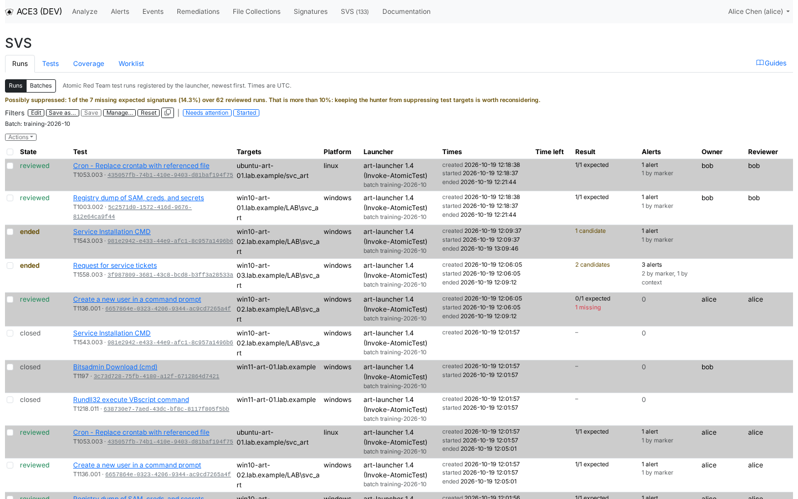

The result column reads like this:

- **1/1 expected**: every expected signature fired.
- **0/1 expected · 1 missing**: an expected signature didn't fire.
- **2 candidates**: signatures fired that nobody has decided about.
- **–**: there is no result yet (the run hasn't ended) or there never will be (it was canceled or
  failed).

### Needs attention

The default view, *Needs attention*, holds the runs that are waiting for a person:

- ended runs nobody has reviewed;
- runs in *error*;
- reviewed runs that changed since their review (a late alert, an association by hand);
- finished runs that still hold open alerts.

Its count is the number next to **SVS** in the navigation bar. Start your day there.

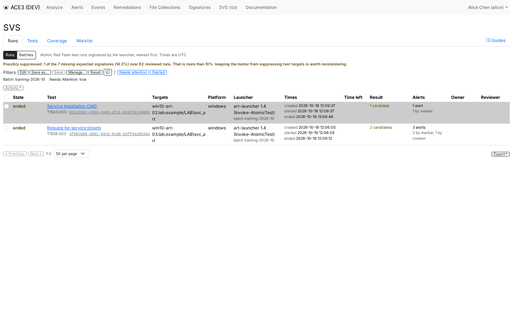

### Filters, batches and bulk actions

The filters work like the alert list's: edit them, save them under a name, and copy a link that
carries them (the copy button next to *Reset*). Useful ones are *Batch*, *Test*, *Technique*,
*Target*, *State*, *Owner*, and the *Has missing*, *Has candidates*, *Has context only* and *Has
late* checks.

*Batches* groups the runs by their `batch_id`: one row per batch, with its runs by state and how
many need attention. It is the quickest way to see how last night's batch went.

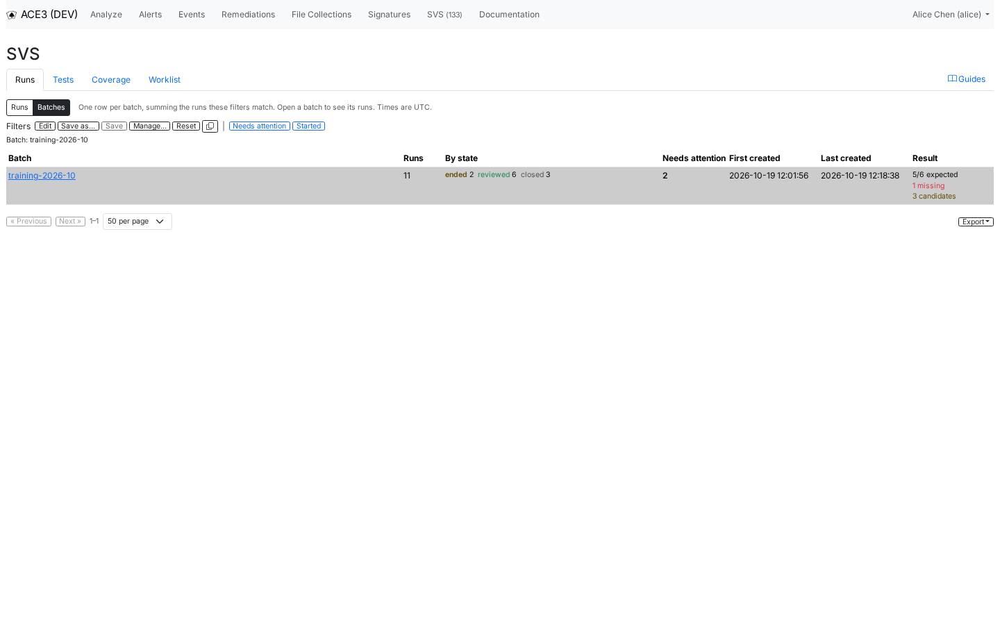

Select runs with their check boxes to act on several at once: *Take ownership*, *Cancel* or
*Close*. Review is never a bulk action, because each run's result has to be looked at.

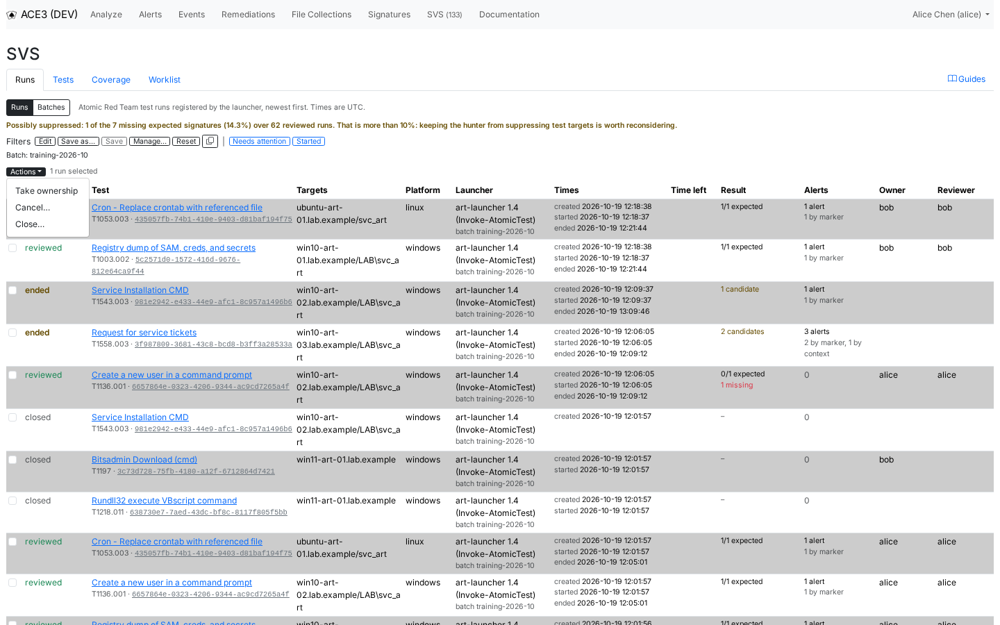

## The run page

Click a run's test name to open its page. Here is a run that is still going: started, 57 minutes
left of a one-hour window, with one alert attributed so far.

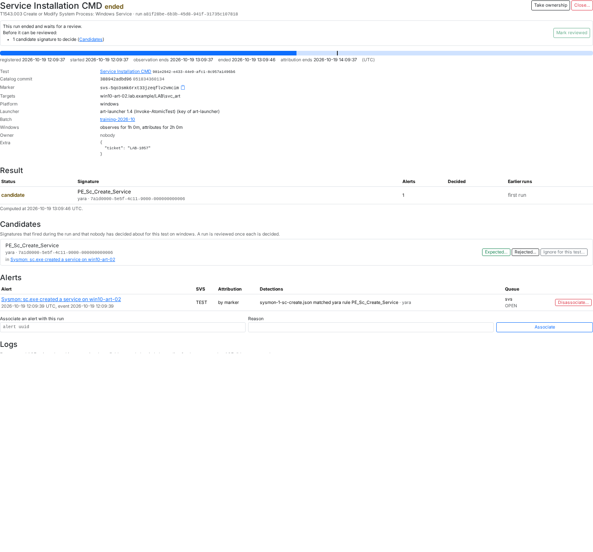

From top to bottom:

1. **The header**: the test, its technique and the run's state, and the actions you may take
   (*Take ownership*, *Cancel*, *Close*, *Mark reviewed*).
2. **The timeline**: registered, started, observation ends, ended, attribution ends. The bar fills
   as time passes, and a started run shows its time left.
3. **The facts**: the test and the catalog commit it was registered at, the marker (with a copy
   button), targets, platform, launcher, batch, the windows' lengths, the owner and the launcher's
   `extra`.
4. **Result**: one row per signature that fired or was expected.
5. **Candidates**: the signatures that fired and that nobody has decided about.
6. **Alerts**: every alert attributed to the run, how, and what you can do with it.
7. **Logs**: the keys to search your log tool with.
8. **Comments**: notes from the people working the run.
9. **Event log**: everything that happened to the run, who did it and when.

While a run is started, its page keeps itself up to date as alerts arrive.

## Reviewing a run

Reviewing a run signs its result off: you confirm which signatures a test should fire, and ACE
learns from it. This walk-through uses the demo run of *Request for service tickets* (T1558.003,
Kerberoasting) on `win10-art-03`, which ended and is waiting for a review.

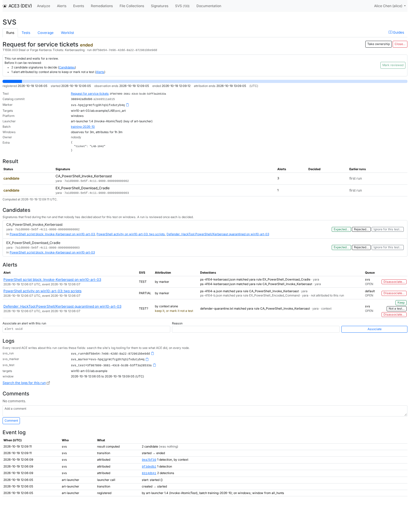

### Step 1: take ownership

Click **Take ownership** in the header. Ownership tells your team you are on it, as it does for
alerts. If someone else owns the run, ACE asks you to confirm taking it from them. If you review an
unowned run without taking it first, the review takes it for you.

### Step 2: see what is in the way

The box under the header says what has to happen before the run can be reviewed, with links to the
sections concerned. *Mark reviewed* stays disabled until the list is empty.

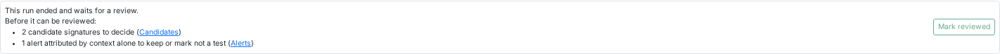

A run can be reviewed when:

- its result is current (right after a change, the page says the result is being recomputed; give
  it a few seconds);
- every candidate is decided;
- every alert attributed by context alone is kept or marked not a test.

### Step 3: read the result

The **Result** table has one row per signature: its status, how many of the run's alerts carry it,
what was decided about it, and how it did in the test's earlier runs.

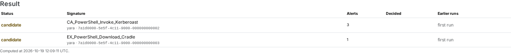

| Status | Meaning |
|---|---|
| `hit` | Expected, and it fired |
| `missing` | Expected, and it didn't fire |
| `possibly suppressed` | Missing, but it is a hunt that alerted within its suppression period just before, so it may have been suppressed rather than blind |
| `candidate` | It fired, and nobody has decided about it |
| `rejected` | It fired, and it was rejected for this test |
| `ignored` | It fired, and it is ignored for this test or for every test |

*Earlier runs* shows the signature's history on this test, newest first: ● hit, ○ missing,
◐ possibly suppressed, ? candidate, × rejected, – ignored. "first run" means there is nothing
earlier to compare with.

### Step 4: decide each candidate

Under **Candidates**, each signature that fired shows the alerts it is in and four choices:

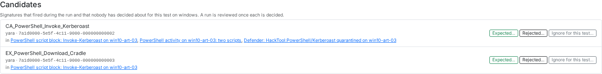

| Choice | Means | Effect |
|---|---|---|
| **Expected** | This signature detects what the test does | Every later run of this test on this platform should fire it; a run where it doesn't is *missing* |
| **Rejected** | It fires, but it isn't what the test is about (a side effect) | It is remembered and not proposed again on this platform |
| **Ignore for this test** | It is noise during this test's runs, such as the launcher's own remoting | It never counts for this test, on any platform |
| **Ignore everywhere** | It is noise during every test (shown only to `svs:admin`) | It never counts for any test |

Each choice opens a dialog for a reason. Write one: the next person to wonder why a signature is
expected of a test will read it.

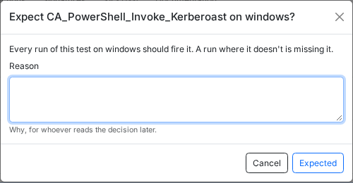

In the demo, `CA_PowerShell_Invoke_Kerberoast` is the test's own technique, so it is *Expected*.
`EX_PowerShell_Download_Cradle` fired because the test downloads its script; whether that is
*Expected* or *Rejected* is a judgment your team makes once and records.

Decisions are made per test **and platform**: what a Linux run of a test taught isn't expected of a
Windows run, because the commands differ. To undo a decision, use *Undo…* on its row in the Result
table, or *Remove* on the test's page.

### Step 5: check the alerts

The **Alerts** section lists every alert attributed to the run.

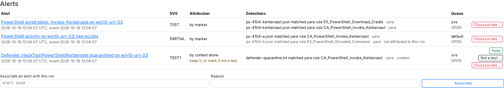

- **TEST**, *by marker*: every detection carries the run's marker. Nothing to do.
- **PARTIAL**, *by marker*: some detections are from the run and some aren't. Here one file had
  the marker and a second one matched `EX_PowerShell_Encoded_Command` without it, so the alert stays
  in the normal queue for an analyst to triage the rest.
- **TEST?**, *by context alone*: the alert came from the right host in the run's window, but
  without a marker. Decide: **Keep** it (it is the test; a Defender quarantine of the test's own
  script, as here) or **Not a test…** (it is something else that happened on the host). This is
  required before review.
- **Disassociate…** takes an alert out of the run entirely, with a reason.

Below the list, *Associate an alert with this run* attaches an alert ACE didn't attribute, by its
uuid and a reason; use it when you know an alert came from the test but it carried no marker and
arrived without enough context.

An alert with the run's marker that came from another host isn't in this list: it is a **marker
mismatch**, and it stays with analysts (see [Test alerts on the alert page](#test-alerts-on-the-alert-page)).

### Step 6: mark it reviewed

When the review box is empty, click **Mark reviewed**. In this order, ACE:

1. records the run as *reviewed*, with you as reviewer, and keeps a copy of the result as you
   signed it off (*As reviewed*);
2. closes the run's fully attributed open alerts as `SIMULATED`, with a comment naming the run and
   you. Because they now count as TP, their YARA hits are kept as TP samples;
3. gives the detections of signatures ignored for the test an FP verdict from you, unless someone
   already set one.

Here is a reviewed run: the expected signature is a hit, it shows *as reviewed*, and its alert is
closed as `SIMULATED` in the `svs` queue.

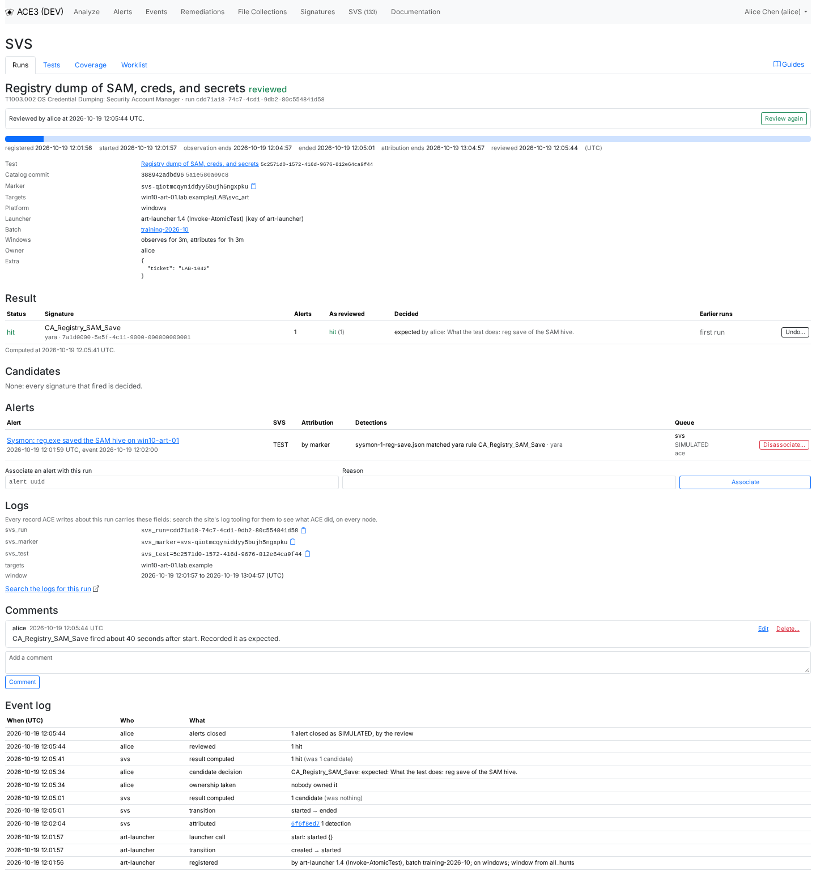

The next run of the same test is judged against your decision. In the demo, Bob reran the SAM test
and reviewed it; the dot under *Earlier runs* is Alice's first run, a hit.

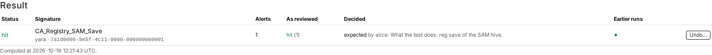

### After the review

- **Changed since review.** A late alert, an association by hand or a disassociation after the
  review marks the run *changed since review* and puts it back in *Needs attention*. Open it, look
  at what changed and click **Review again**, which replaces the earlier sign-off.
- **Comments.** Leave a comment whenever a result needs explaining: a missing signature you are
  chasing, a host problem, a decision you weren't sure about.

## Closing and canceling runs

Not every run deserves a review.

| Action | When | What it does |
|---|---|---|
| **Cancel** | The run is created or started and you want to stop it | The run is canceled. It keeps attributing until its attribution window passes, because the test may have fired anyway. A run that never started is closed at once |
| **Close** | The run ended, was canceled or failed, and nothing should be learned from it | Its fully attributed open alerts become `SIMULATED`, and the run is final. Nothing is learned: no expectations, no samples, no verdicts |
| **Review** | The run ended and its result is worth keeping | See [Reviewing a run](#reviewing-a-run) |

Closing a run that ended asks for a reason, because it was waiting for a review.

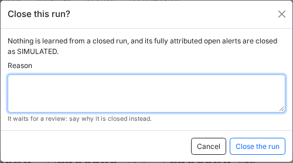

A run in *error* tells you the launcher reported a failure, or never started the run. Its page shows
the launcher's error; in the demo, the lab proxy blocked the test's download, and Bob took the run
and noted it in a comment. Close it once you know why it failed, or leave it in *Needs attention*
while someone fixes the cause.

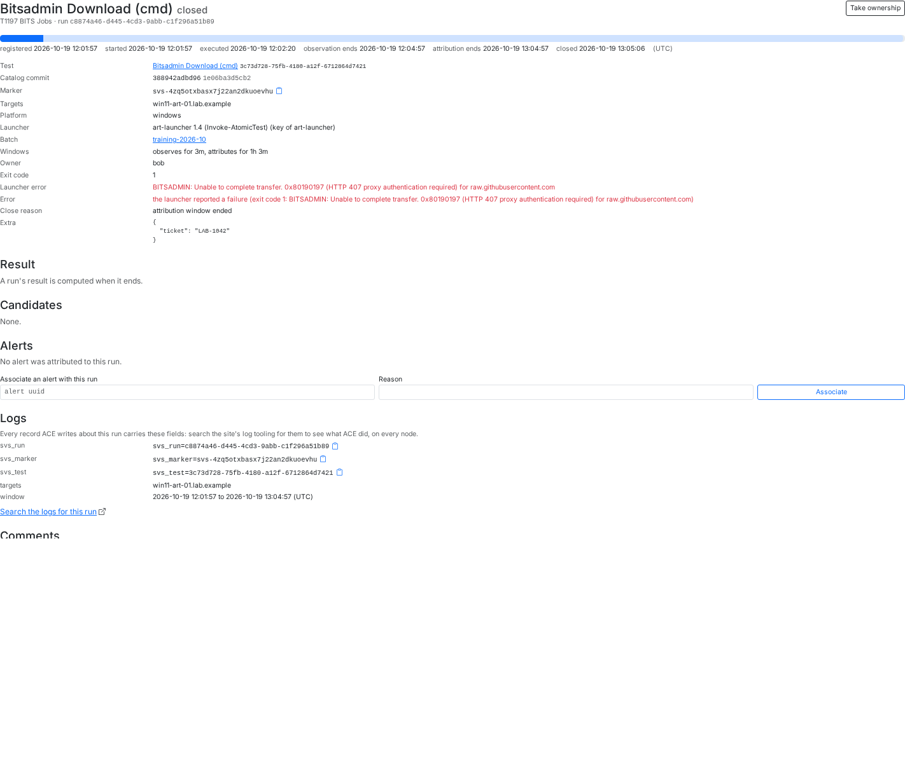

## Test alerts on the alert page

Every alert attributed to a run shows a banner at the top of its page, and its SVS status after its
description in the alert list.

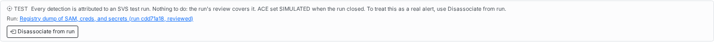

| Banner | Means | What to do |
|---|---|---|
| **TEST** | Every detection is attributed to a run by its marker. Once the run is reviewed or closed, ACE has set `SIMULATED` | Nothing. To treat it as a real alert after all, *Disassociate from run* |
| **TEST?** | Every detection is attributed by context alone | Nothing unless it looks wrong; then *Not a test* |
| **PARTIAL TEST** | Some detections are from a run and some aren't. The test detections are greyed out | Triage the other detections as usual |
| **MARKER MISMATCH** | A marker in the alert doesn't agree with its run: another host, outside the window, or a marker no run has. The banner is red and has no buttons | Investigate it as a real alert |

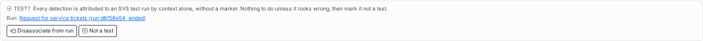

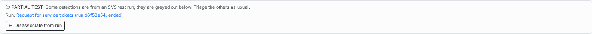

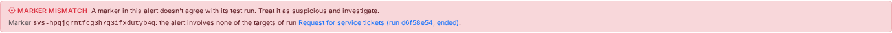

*Disassociate from run* and *Not a test* need `alert:write`. They take an optional reason, remove the
alert from every run that holds it, and give a `SIMULATED` alert back to analysts as `OPEN`. ACE
doesn't attribute it to that run again.

> [!IMPORTANT]
> A `SIMULATED` alert is frozen: its disposition can't be changed by hand, and it can't be reset,
> re-analyzed or given new observables. That keeps what a review signed off reproducible. Tags,
> comments and ownership still work.

Alert search and *Similar alerts* leave test alerts out by default; the search results say how
many were left out, with a link to include them.

## Tests and expectations

[SVS → Tests](/ace/svs/tests) lists the Atomic Red Team catalog, one row per test, with its state:

| State | Meaning |
|---|---|
| never run | No run of it was ever registered |
| awaiting review | No run of it is reviewed yet, or something was expected of it only after its latest review |
| no expectations | It has a reviewed run, and nothing is expected of it |
| validated | Its latest reviewed run hit every expected signature |
| failing | Its latest reviewed run missed an expected signature |
| stale | It would be validated, but the test or an expected signature's rule changed since that review |

A test is judged on each platform on its own; its state is the worst of its platforms'. The list
shows only tests still in the catalog by default (*In the catalog*), and its filters include
technique, platform, name and repository. Nothing on it suggests what to run next: that is your
team's call.

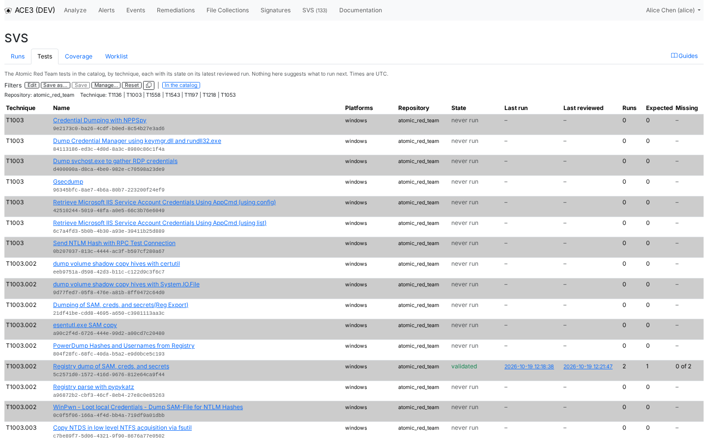

A test's page has its description, commands, input arguments and dependencies from the catalog, and
the decisions about it:

- **Observation window**: set minutes here to override the computed window for runs registered from
  now on (`svs:run_manage`); *Use the computed window* clears it. Use it when you know a test's
  signatures fire within a minute or two, so its runs end sooner.
- **Expectations**: per platform, each signature decided expected or rejected, by whom, why, and
  from which run. *Remove* undoes a decision; the signature becomes a candidate again the next
  time it fires.
- **Ignores**: for this test, and for every test.
- **Runs**: its latest runs, with their results.

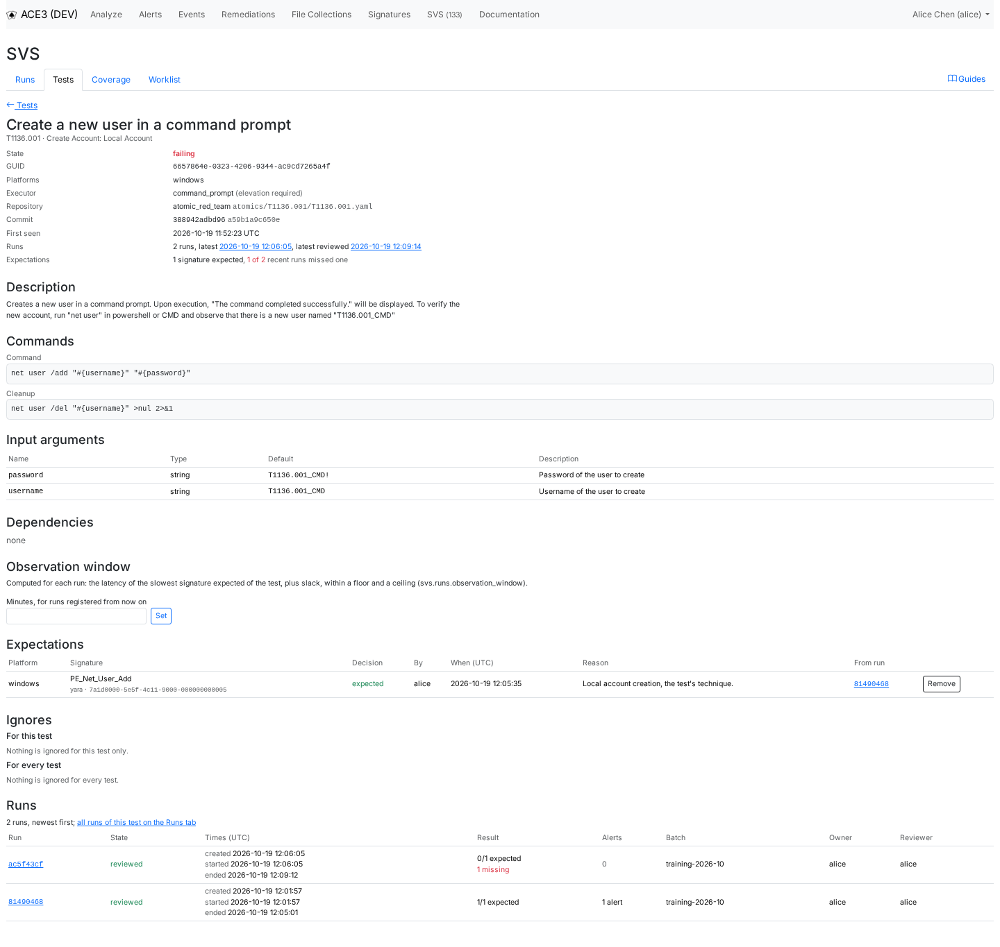

## Debugging a missing detection

A `missing` signature is the most useful thing a run can tell you: something you expected to
detect, you didn't. SVS doesn't build debugging tools; it gives you what you need to search your
own logs.

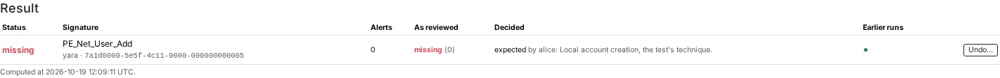

Work through it in this order:

1. **Did the test really run?** Check the event log for the launcher's `executed` call and its exit
   code. A test that failed quietly on the host produces nothing.
2. **Did the telemetry arrive?** Use the **Logs** section. Every record ACE writes about the run
   carries `svs_run`, `svs_marker` and `svs_test`, so one search on `svs_run=…` in your log tool
   shows everything ACE did about it, on every node. If your administrator set a log search URL, the
   section links straight to it.
3. **Did the signature have a chance?** For a hunt, search for its completion record over the run's
   window: if the hunt didn't run across that time, it couldn't fire. A `possibly suppressed` status
   points at the alert that probably suppressed it.
4. **Did it run and not match?** For a YARA rule, the run page links (with `signature:read`) to the
   files captured from the run's alerts; scan them against the rule.

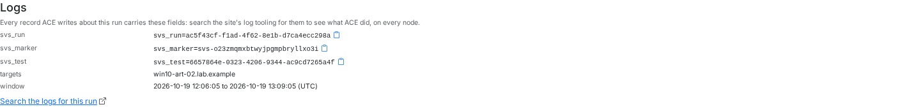

Usual causes: the host's logging changed (an agent update or a rebuilt image), the rule is narrower
than the test's command, the hunt didn't cover the window, or suppression. Write what you found in a
comment, so the next person doesn't start over.

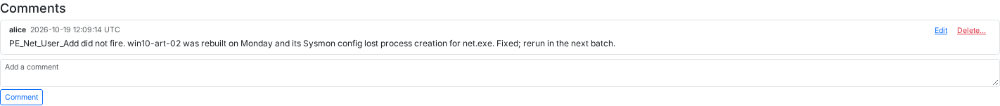

## Writing or fixing a signature from results

Runs tell you where detection is missing or weak. This is the loop that closes the gap.

1. **Find the gap.** A `missing` signature, a candidate nobody wants to expect, a coverage row
   that is *untested* or *failing*, or a worklist row that needs a decision.
2. **Write or change the rule** in your YARA rule repository. Give every rule a `uuid`, because SVS
   tracks rules by it (a rule without one is never tested), and tag it with the ATT&CK techniques it
   claims to detect in `mitre_attack`, comma separated. Keep a rule's `uuid` when you edit it: a new
   uuid is a new rule, with no samples and no history.

```text
rule PE_Net_User_Add
{
    meta:
        uuid = "7a1d0000-5e5f-4c11-9000-000000000005"
        description = "net.exe creating a local account"
        author = "Detection Engineering"
        mitre_attack = "T1136.001"
    strings:
        $a = "net user" nocase
        $b = "/add" nocase
    condition:
        all of them
}
```

3. **Open a pull request.** The repository's CI asks ACE for a validation and posts a summary on the
   pull request with a link to the report (see [Reading a validation report](#reading-a-validation-report)).
4. **Read the report** and fix what it found: a regression, a new false positive.
5. **Merge.** The yara service loads the new rules on its next check.
6. **Run the test again** and review the run. If the new rule fires, decide it *Expected*.

Hunts follow the same loop through their own repository; their technique tags count for coverage,
but validation replays only YARA rules.

## Reading a validation report

[Signatures → Validations](/ace/signatures/validations) lists every validation, newest first: its
state, repository, branch (with a link to the pull request), commits, who asked for it, and its
counts of regressions, new false positives and compile errors. The saved filters *Has regressions*
and *Failed* find the ones to look at.

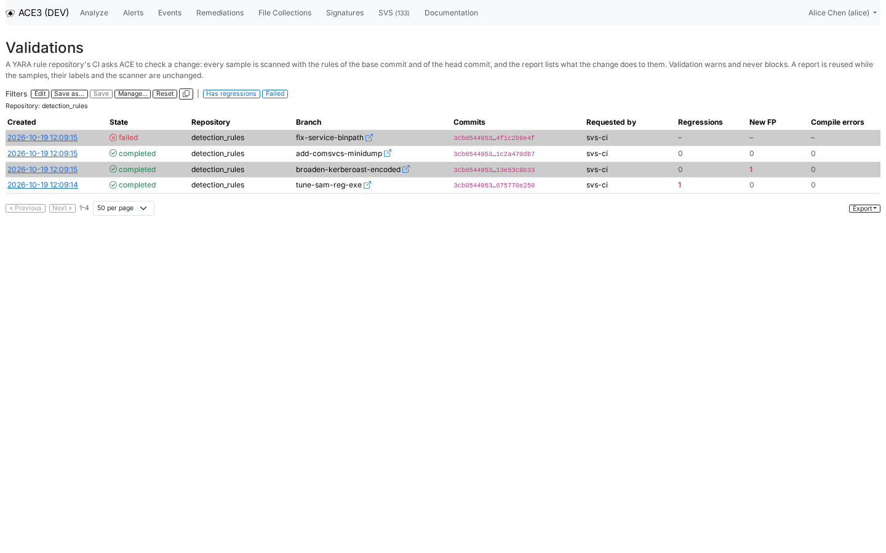

A report replays every stored sample under the change's base commit and its head commit, and sorts
what changed into bands, the most urgent first and open:

| Band | Means | What to do |
|---|---|---|
| Regressions | A TP sample the rule matched before and no longer does | Fix the rule, or, if dropping it was the point, retire the sample on its page |
| Regressions on unconfirmed labels | The same, on a sample whose TP label is weak (inherited on an alert where several signatures fired) | Check whether the sample was ever a real hit for this rule |
| New false positives | The rule now matches its own FP sample | Narrow the rule |
| New false positives on another rule's sample | The rule now matches a file that is an FP for another rule | Usually narrow the rule |
| Compile problems | Files that don't compile, the rules they drop, a ruleset that wouldn't load | Fix before merging: the yara service would keep its old rules |
| Scan errors, removed rules, recovered, improvements, already broken, new matches on real hits, unlabeled changes | For information | Open the band when it matters |

Here a tuning change made `CA_Registry_SAM_Save` miss the SAM dump it used to catch: *match → miss*
on a TP sample.

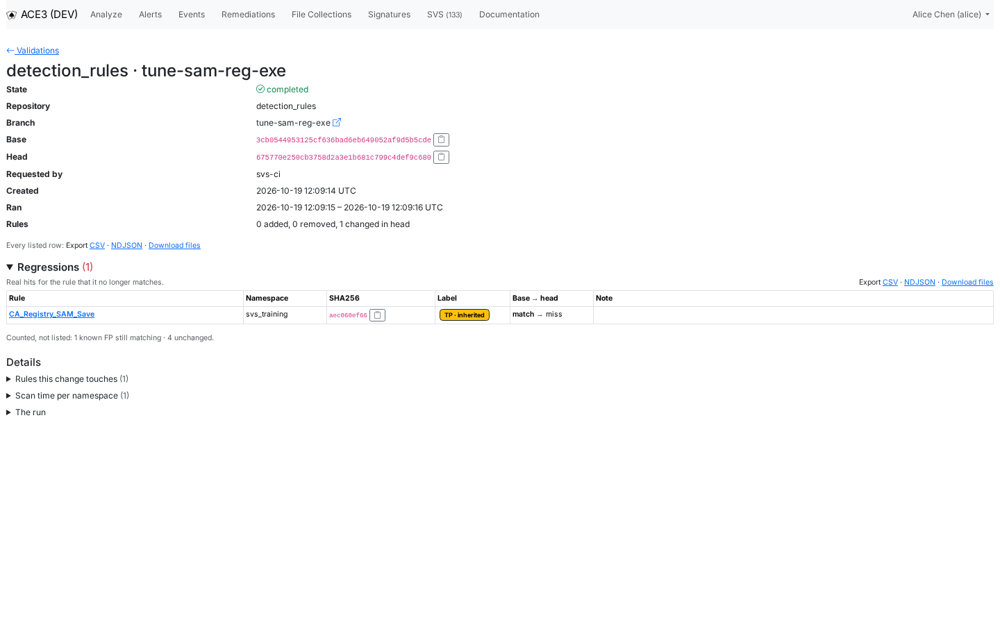

And here a change that broadened the Kerberoast rule to encoded PowerShell matches a file that is a
false positive for `EX_PowerShell_Encoded_Command`.

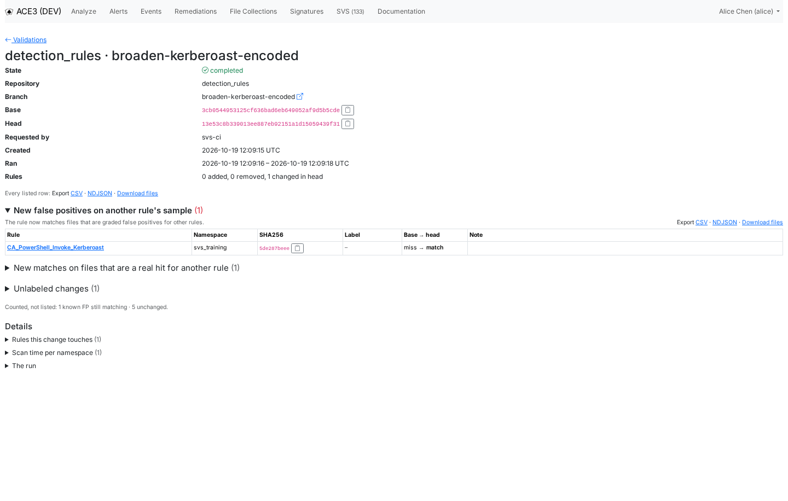

Each row's rule links to the sample's page, where the actions are. Each band, and the whole report,
exports as CSV or NDJSON, and with `signature:download` downloads its files. A validation warns and
never blocks: you decide what to merge.

## Samples and labels

[Signatures → Samples](/ace/signatures/samples) lists every file a YARA rule matched on an alert
graded TP or FP, for that rule. The label comes from the verdicts on the detections behind it, so
changing an alert's disposition relabels its samples. You don't label samples by hand in the normal
course of things; your dispositions do it.

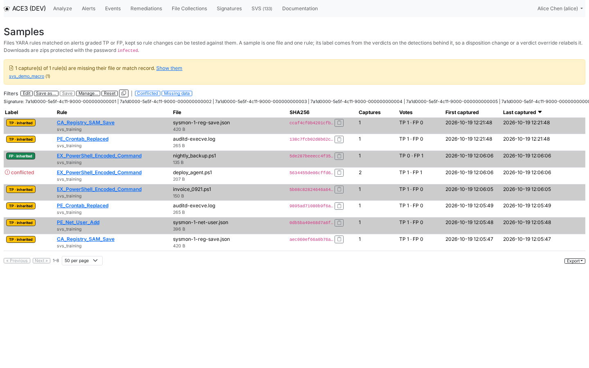

A label is *TP* or *FP*, with how strongly it is known: **explicit** (someone set a verdict),
**inherited** (from the alert's disposition) or **unconfirmed** (inherited on an alert where several
signatures fired). The strongest strength that has a vote decides. When votes of that strength
disagree, the sample is **conflicted**, and validations can't use it until someone decides.

In the demo, the same `deploy_agent.ps1` was graded FP on one alert and TP on another:

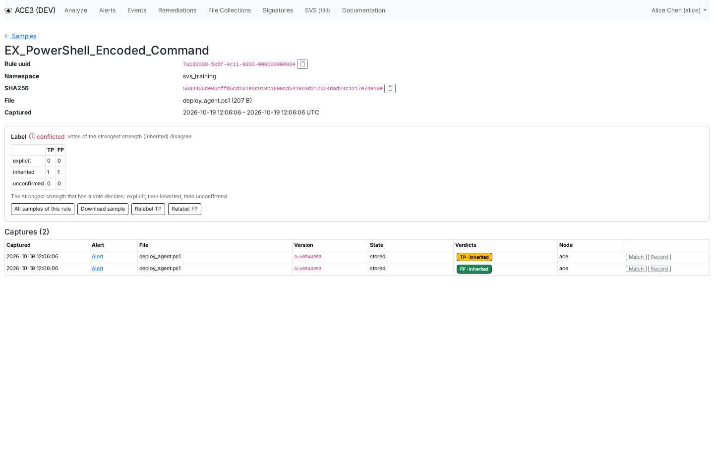

| Action | Permission | Use it to |
|---|---|---|
| **Relabel TP** / **Relabel FP** | `alert:write` | Store an explicit verdict on every detection behind the sample that can take one. Explicit votes outweigh inherited ones, so this resolves a conflict |
| **Reset to inherited** | `alert:write` | Clear the explicit verdicts, so the dispositions decide again |
| **Confirm** | `alert:write` | Store an explicit TP on each unconfirmed TP detection |
| **Retire** / **Unretire** | `svs:admin` | Stop a validation reporting an intended regression on this sample |
| **Delete sample** | `svs:admin` | Remove the file for every rule, for legal or privacy reasons; it is never captured again |

The *Conflicted* saved filter finds the samples that need a decision.

## Coverage

[SVS → Coverage](/ace/svs/coverage) shows one row per ATT&CK technique and platform, and a summary
of rows per platform and state above the list. The default view, *Endpoint platforms*, shows
Windows, Linux and macOS; *Gaps and failures* and *All* are the other saved filters.

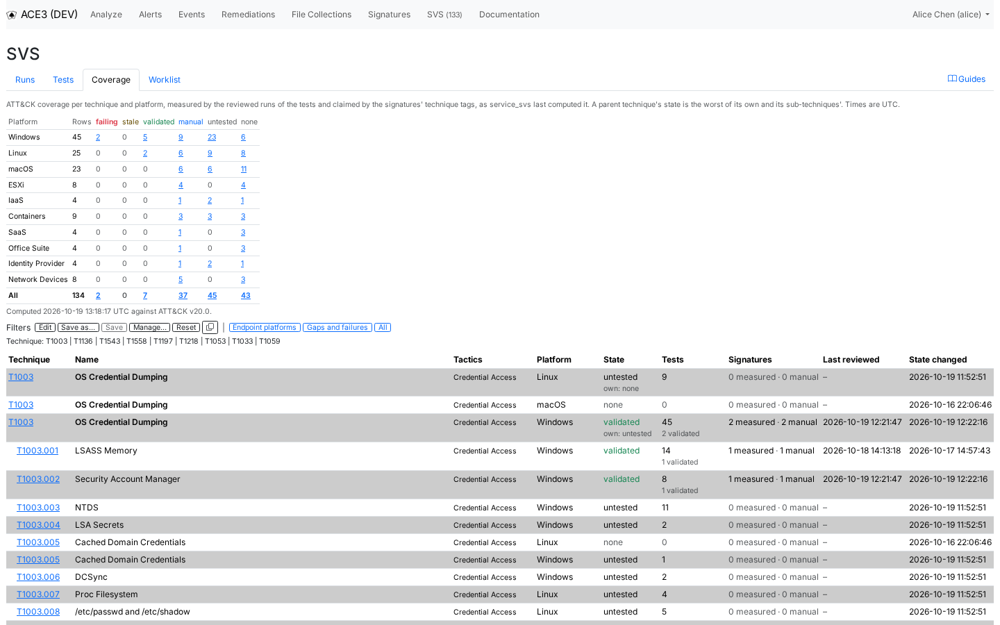

| State | Means |
|---|---|
| failing | A test of the technique missed an expected signature |
| stale | A test would be validated, but something changed since its review, or something expected hasn't been judged by a review yet |
| validated | Its tests' latest reviewed runs hit every expected signature |
| manual | Only a signature's technique tag claims it; no test measures it |
| untested | It has tests, but none counts yet |
| none | Nothing counts toward it |

A row's state is the worst of what counts toward it, and a parent technique includes its
sub-techniques. *Failing* means a test missed something, not that the technique goes undetected.

A technique's page shows its rows by platform, its sub-techniques, its tests and their states, the
measured and manual signatures, and how its state changed in the daily snapshots.

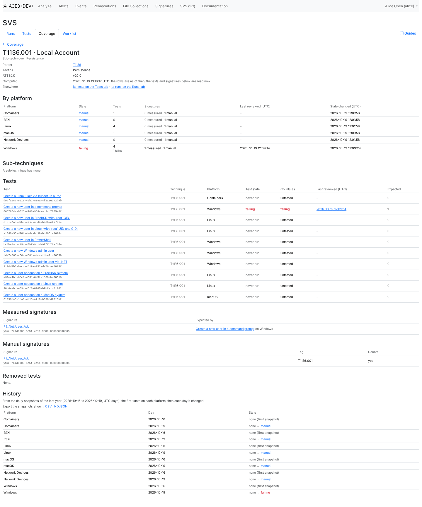

## The worklist

A signature's technique tags are claims. [SVS → Worklist](/ace/svs/worklist) compares them with what
the tests measure, one row per signature and technique, grouped by signature. Only signatures that
some test measures appear.

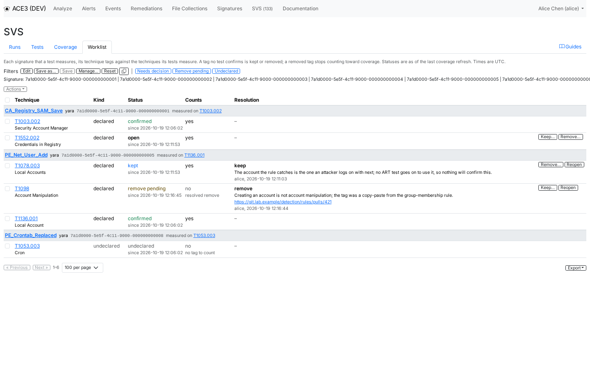

| Status | Means |
|---|---|
| confirmed | A test measures the technique the tag names |
| open | No test confirms the tag, and nobody has decided about it (the *Needs decision* view) |
| kept | Someone decided the tag stays: it covers something no test reaches |
| remove_pending | Someone decided the tag goes, and a pull request will drop it; it stops counting for coverage |
| removed | The tag is gone from the signature |
| undeclared | A test measures the technique, but no tag on the signature names it, for information |

For an open row, choose **Keep…** or **Remove…**. Both need a reason; a removal also takes the pull
request's link. **Reopen** clears a decision. Select rows to keep or remove several at once.

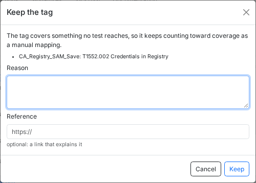

A signature's name opens its own page: every row, including retired ones, and the tests that
measure it.

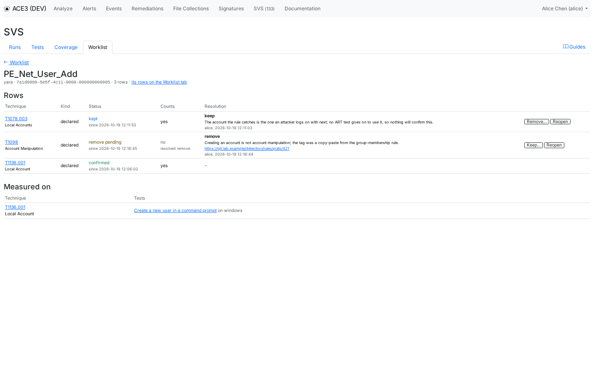

## YARA QA results

A YARA rule with `modifiers = "qa"` in its meta runs in QA mode: it scans everything but never
alerts, and ACE keeps the files it matches for review. Use it to see how noisy a new rule would be
before it can wake anyone up. [Signatures → Yara QA Results](/ace/signatures/yara-qa) lists the
rules in QA mode with how often they matched; click a rule to see its files. When the matches look
right, remove the `qa` modifier in a pull request.

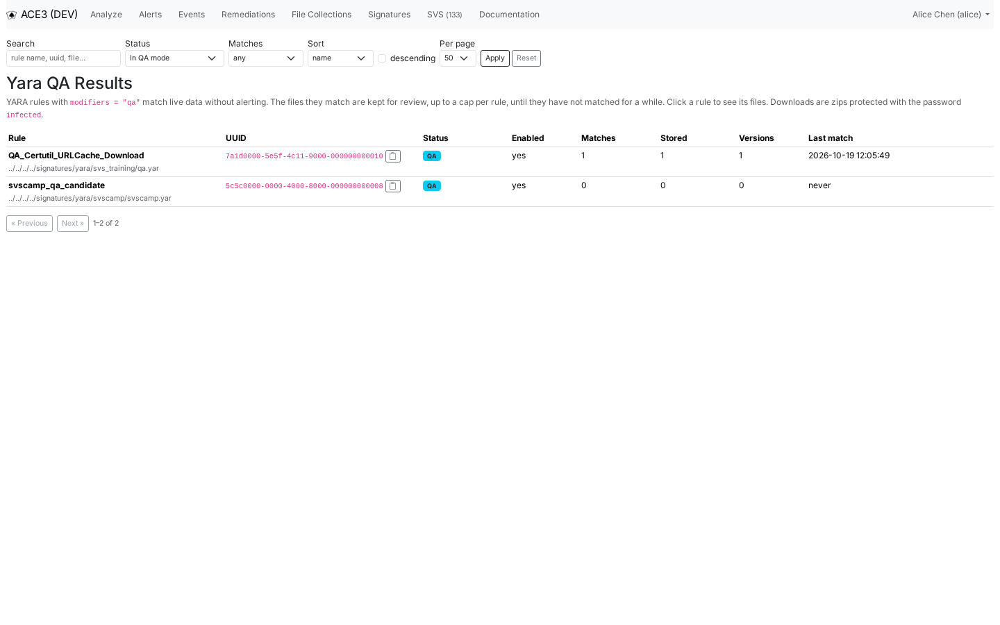

## Exporting data

Every SVS list has an *Export* menu: CSV, NDJSON, and *Copy API URL*, which gives you the API query
behind the list with its filters. Reports are built outside ACE from these, or from the API
directly. The [SVS data API](https://github.com/ACE-Collective/ace3/blob/main/docs/SVS_API.md)
describes every field, with worked examples such as per-signature false positive rates and test
pass rates per month.

## Next steps

- New to the ideas behind SVS? Read the [Beginner's guide](beginners.md).
- Setting up test hosts, the launcher's key or CI? See the
  [Administrator's guide](administrators.md).
- Curious how attribution or validation works inside? See the [Developer's guide](developers.md).
- For the design and its reasoning:
  [docs/SVS_RUNS.md](https://github.com/ACE-Collective/ace3/blob/main/docs/SVS_RUNS.md) and
  [docs/SVS.md](https://github.com/ACE-Collective/ace3/blob/main/docs/SVS.md).
